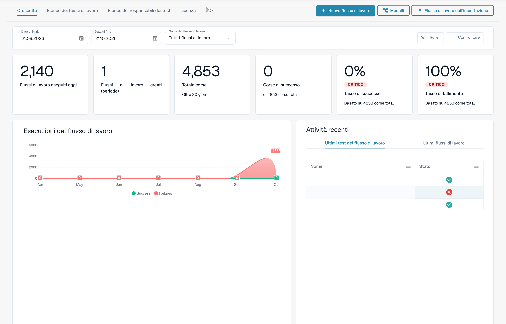
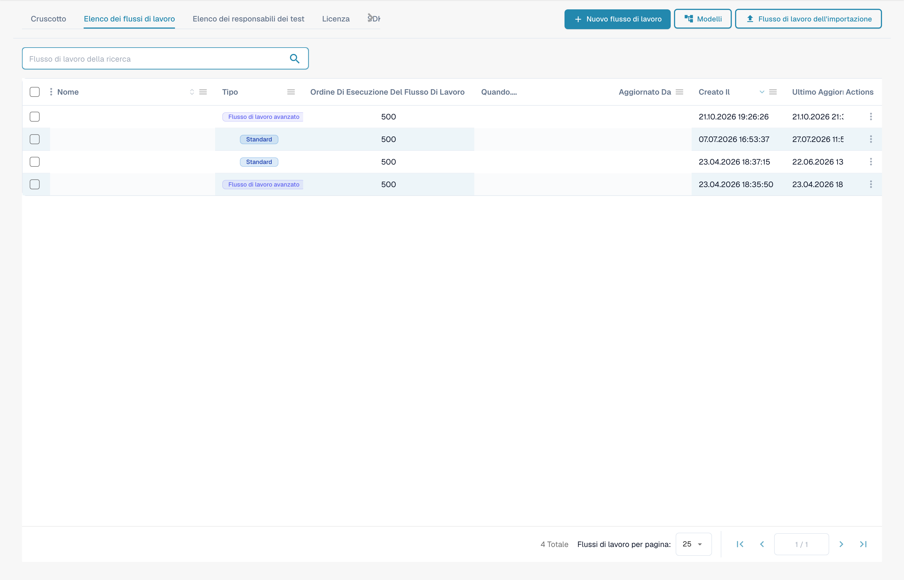

# Guide ai modelli di flusso di lavoro

**Versione:** 1.0 **Ultimo aggiornamento:** 23 ottobre 2025

***

## Panoramica

Questa directory contiene guide complete sui modelli di flusso di lavoro che dimostrano come combinare più schede di flusso di lavoro per risolvere scenari aziendali comuni. Ciascun modello fornisce istruzioni dettagliate per l'implementazione, esempi completi e best practice.

**Cosa sono i modelli di flusso di lavoro?**

I modelli di flusso di lavoro sono soluzioni comprovate e riutilizzabili per le comuni sfide di elaborazione della documentazione. Invece di iniziare da zero, puoi utilizzare questi modelli come modelli e adattarli alle tue esigenze specifiche.

***

## Il generatore di flussi di lavoro in breve

Ogni modello in questa pagina è assemblato nel **Costruttore di flussi di lavoro**. Puoi accedervi da **Dashboard del flusso di lavoro → Elenco del flusso di lavoro → Aggiungi flusso di lavoro** (o aprendo un flusso di lavoro esistente). Il dashboard fornisce la cronologia delle esecuzioni e le percentuali di successo/fallimento per tutti i flussi di lavoro:

<figure><figcaption><p>La Workflow Dashboard — totali delle esecuzioni, tassi di successo/fallimento e attività recente per ogni workflow. I nomi e i riferimenti riservati ai documenti sono nascosti.</p></figcaption></figure>

La scheda **Elenco flussi di lavoro** elenca ogni flusso di lavoro con il relativo tipo, ordine di esecuzione e trigger. Utilizza **Aggiungi flusso di lavoro** per crearne uno nuovo o fai clic su un flusso di lavoro per aprirlo nel builder:

<figure><figcaption><p>La Workflow List — ogni riga è un workflow che puoi aprire, attivare/disattivare o modificare. I nomi e i riferimenti riservati ai documenti sono nascosti.</p></figcaption></figure>

Un flusso di lavoro comprende tre gruppi di schede: **Quando** (evento di attivazione), **E** (condizioni aggiuntive) e **Allora** (azioni). L’esempio non salvato mostra questa struttura. Occorre ancora selezionare il tipo di documento, la sotto-organizzazione e l’utente:

<figure><figcaption><p>Esempio non salvato con schede Quando, E e Allora. Configurare tutti i campi prima dell’esecuzione. Alcune etichette dell’interfaccia di questa versione sono ancora in inglese o tradotte in modo non corretto. Le spiegazioni di questa pagina sono tradotte; l’immagine mostra l’interfaccia reale.</p></figcaption></figure>

Fai clic su **Aggiungi carta** in qualsiasi gruppo per aprire la libreria delle carte. Le schede sono organizzate per categoria (Confronta con ordine di acquisto, Schede partner, Campo documento, Data e ora, Documento, Logica, Stato, Tabella, Assegnatario, ...) in modo da poter trovare l'elemento costitutivo richiesto da ciascun modello:

<figure><figcaption><p>Schede disponibili nella categoria selezionata. Configurare i campi prima dell’uso. Alcune etichette dell’interfaccia di questa versione sono ancora in inglese o tradotte in modo non corretto. Le spiegazioni di questa pagina sono tradotte; l’immagine mostra l’interfaccia reale.</p></figcaption></figure>

***

## Modelli disponibili

### 1. [Modello di integrazione API](api-integration-pattern.md)

**Complessità:** Media | **Tempo di configurazione:** 45-60 minuti

Scopri come integrare DocBits con API esterne per recuperare, convalidare e archiviare dati da sistemi esterni.

**Casi d'uso:**

* Ottieni prezzi in tempo reale da sistemi esterni
* Convalidare le informazioni sui fornitori rispetto ai database principali
* Cerca i dettagli del prodotto dai sistemi di catalogo
* Ottieni tassi di cambio dai servizi valutari
* Verifica gli indirizzi con i servizi di geocodifica

**Carte utilizzate:** CALL\_API, CONDITION\_HTTPS\_REQUEST\_STATUS, ACTION\_SET\_FIELD\_TO\_TEXT, CONDITION\_COMPARE\_TWO\_DOCFIELD\_VALUES

[**Visualizza schema completo →**](api-integration-pattern.md)

***

### 2. [Modello di gestione delle attività](task-management-pattern.md)

**Complessità:** Bassa-Media | **Tempo di configurazione:** 30-45 minuti

Padroneggia l'arte di creare, assegnare, monitorare e gestire le attività all'interno dei flussi di lavoro DocBits per i processi di approvazione e revisione.

**Casi d'uso:**

* Crea flussi di lavoro di approvazione
* Assegna attività di revisione agli utenti
* Gestire le eccezioni che richiedono l'intervento umano
* Inoltrare i problemi ai manager
* Crea catene di approvazione multilivello
* Tieni traccia del completamento delle attività e delle scadenze

**Carte utilizzate:** tasks\_create, ACTION\_ASSIGN\_TO\_USER, ACTION\_SEND\_EMAIL\_TO\_GROUPS, CONDITION\_TASK\_STATUS

[**Visualizza schema completo →**](task-management-pattern.md)

***

### 3. [Modello di corrispondenza PO](po-matching-pattern.md)

**Complessità:** Medio-Alta | **Tempo di configurazione:** 60-90 minuti

Implementa flussi di lavoro completi di corrispondenza degli ordini di acquisto per convalidare le fatture rispetto agli ordini d'acquisto con instradamento basato sulla tolleranza.

**Casi d'uso:**

* Convalidare le fatture rispetto agli ordini di acquisto
* Rileva errori di prezzo prima del pagamento
* Identificare le discrepanze quantitative
* Applicare i controlli sugli appalti
* Previeni pagamenti duplicati
* Automatizza la corrispondenza a tre

**Carte utilizzate:** PURCHASE\_ORDER\_FULL\_MATCH, CONDITION\_DOC\_TO\_PO\_UNIT\_PRICE, CONDITION\_DOC\_TO\_PO\_QUANTITY, CONDITION\_DOC\_TO\_PO\_TAX\_LINES

[**Visualizza schema completo →**](po-matching-pattern.md)

***

### 4. [Modello logico decisionale](decision-logic-pattern.md)

**Complessità:** Media | **Tempo di configurazione:** 30-45 minuti

Implementa alberi decisionali complessi e una logica di instradamento condizionale per elaborare i documenti attraverso percorsi diversi basati su regole aziendali.

**Casi d'uso:**

* Instradare i documenti in base alle soglie di importo
* Applicare regole diverse per tipi di documenti diversi
* Implementare la logica di approvazione multilivello
* Gestire politiche aziendali complesse
* Crea routing dinamico basato su più criteri
* Implementare matrici di approvazione

**Carte utilizzate:** CONDITION\_DOC\_FIELD\_AMOUNT, CONDITION\_DOC\_TYPE\_IS\_ISNOT, CONDITION\_SUPPLIER\_STATUS\_IS\_ISNOT, ACTION\_ASSIGN\_TO\_USER

[**Visualizza schema completo →**](decision-logic-pattern.md)

***

### 5. [Modello di trasformazione dei dati](data-transformation-pattern.md)

**Complessità:** Media | **Tempo di configurazione:** 30-45 minuti

Trasforma, calcola, formatta e arricchisci i dati dei documenti per prepararli all'esportazione, eseguire calcoli e standardizzare i formati.

**Casi d'uso:**

* Calcola totali, subtotali, tasse
* Converti valute o unità
* Formato date, numeri, testo
* Deriva valori da campi esistenti
* Arricchisci i dati da fonti esterne
* Standardizzare i formati dei dati
* Convalidare i calcoli

**Carte utilizzate:** ACTION\_CALCULATE\_FIELD, ACTION\_SET\_FIELD\_TO\_TEXT, ACTION\_COPY\_FIELD\_VALUE, CALL\_API, CONDITION\_COMPARE\_TWO\_DOCFIELD\_VALUES

[**Visualizza schema completo →**](data-transformation-pattern.md)

***

## Guida alla selezione del modello

### Per complessità

| Complessità      | Modelli                                                                                                                                                                                      | Ideale per                               |
| --------------- | --------------------------------------------------------------------------------------------------------------------------------------------------------------------------------------------- | -------------------------------------- |
| **Basso-Medio**  | [Gestione attività](task-management-pattern.md)                                                                                                                                                 | Principianti, flussi di lavoro semplici            |
| **Medio**      | <p><a href="api-integration-pattern.md">Integrazione API</a><br><a href="decision-logic-pattern.md">Logica decisionale</a><br><a href="data-transformation-pattern.md">Trasformazione dati</a></p> | Utenti intermedi, flussi di lavoro standard |
| **Medio-Alta** | [Corrispondenza PO](po-matching-pattern.md)                                                                                                                                                         | Utenti avanzati, convalida complessa     |

***

### Per caso d'uso

| Ho bisogno di...                     | Usa questo modello                                              |
| -------------------------------- | ------------------------------------------------------------- |
| Integrazione con sistemi esterni  | [Modello di integrazione API](api-integration-pattern.md)         |
| Crea flussi di lavoro di approvazione        | [Modello di gestione delle attività](task-management-pattern.md)         |
| Convalidare rispetto agli ordini di acquisto | [Modello di corrispondenza PO](po-matching-pattern.md)                 |
| Itinerario in base alle condizioni        | [Modello logico decisionale](decision-logic-pattern.md)           |
| Calcolare e trasformare i dati     | [Modello di trasformazione dei dati](data-transformation-pattern.md) |

***

### Per settore/dipartimento

| Industria/Dipartimento    | Modelli consigliati                                                                                                                        |
| ---------------------- | ------------------------------------------------------------------------------------------------------------------------------------------- |
| **Finanza/Contabilità** | [Corrispondenza PO](po-matching-pattern.md), [Gestione attività](task-management-pattern.md), [Trasformazione dati](data-transformation-pattern.md) |
| **Approvvigionamenti**        | [Corrispondenza PO](po-matching-pattern.md), [Logica decisionale](decision-logic-pattern.md), [Integrazione API](api-integration-pattern.md)           |
| **Operazioni**         | [Gestione attività](task-management-pattern.md), [Logica decisionale](decision-logic-pattern.md)                                                  |
| **IT/Integrazione**     | [Integrazione API](api-integration-pattern.md), [Trasformazione dati](data-transformation-pattern.md)                                        |
| **Tutti i reparti**    | [Logica decisionale](decision-logic-pattern.md), [Gestione attività](task-management-pattern.md)                                                  |

***

## Come utilizzare questi modelli

### Passaggio 1: scegli un modello

1. Rivedi le descrizioni dei modelli sopra
2. Identifica quale modello corrisponde al tuo caso d'uso
3. Controlla la complessità e il tempo di configurazione stimato
4. Rivedi la sezione "Quando usare" nella guida al modello

### Passaggio 2: rivedere i prerequisiti

Ogni guida al modello elenca:

* Conoscenza richiesta
* Guide correlate da leggere per prime
* Carte che verranno utilizzate
* Requisiti di configurazione

### Passaggio 3: seguire le istruzioni dettagliate

Ogni modello fornisce:

* Esempio di flusso di lavoro completo
* Guida all'implementazione passo passo
* Modelli di configurazione
* Esempi del mondo reale
* Suggerimenti per la risoluzione dei problemi

### Passaggio 4: personalizza in base alle tue esigenze

* Adatta l'esempio alle tue regole aziendali
* Regolare soglie e tolleranze
* Modificare la logica del routing
* Aggiungi/rimuovi passaggi secondo necessità
* Testare accuratamente prima dell'uso in produzione

### Passaggio 5: monitorare e ottimizzare

* Tieni traccia delle prestazioni del flusso di lavoro
* Monitorare le percentuali di successo
* Raccogli il feedback degli utenti
* Perfezionare la configurazione
* Personalizzazioni dei documenti

***

## Combinazioni di modelli

Molti scenari del mondo reale richiedono la combinazione di più modelli:

### Esempio 1: elaborazione completa delle fatture

```
1. API Integration Pattern → Fetch current pricing
2. Data Transformation Pattern → Calculate totals
3. PO Matching Pattern → Validate against PO
4. Decision Logic Pattern → Route based on variance
5. Task Management Pattern → Create approval tasks
```

### Esempio 2: Approvazione di fatture di importo elevato

```
1. Data Transformation Pattern → Calculate amounts
2. Decision Logic Pattern → Check thresholds
3. Task Management Pattern → Multi-level approval
4. API Integration Pattern → Notify external systems
```

### Esempio 3: gestione delle eccezioni

```
1. PO Matching Pattern → Detect variances
2. Decision Logic Pattern → Classify exception severity
3. Task Management Pattern → Create review tasks
4. Data Transformation Pattern → Calculate impact
```

***

## Modelli di modelli

Ogni modello include queste sezioni standardizzate:

1. **Panoramica** - Cosa fa il modello
2. **Quando utilizzare** - Casi d'uso appropriati
3. **Esempio completo** - Scenario del mondo reale
4. **Passo dopo passo** - Istruzioni per l'implementazione
5. **Configurazione** - Modelli di configurazione della carta
6. **Diagramma del flusso di lavoro** - Rappresentazione visiva
7. **Variazioni avanzate** - Implementazioni alternative
8. **Gestione degli errori** - Problemi comuni e soluzioni
9. **Lista di controllo del test** - Passaggi di convalida
10. **Modelli correlati** - Modelli complementari
11. **Guide correlate** - Documentazione di riferimento

***

## Ottenere aiuto

### Risorse di supporto dei modelli

**Documentazione:**

* [Indice completo della guida al flusso di lavoro](..)
* [Guide alle carte individuali](../then/action)
* [Riferimento Carte Condizione](../and/condition-cards-complete-guide.md)
* [Mappa collegamento flusso di lavoro](https://github.com/Fellow-Consulting-AG/docbits/tree/main/WORKFLOW_LINKING_MAP.md)

**Risorse aggiuntive:**

* [Guida di riferimento rapido](https://github.com/Fellow-Consulting-AG/docbits/tree/main/WORKFLOW_LINKING_QUICK_REFERENCE.md)
* [Note sulla versione di ottobre 2025](https://github.com/Fellow-Consulting-AG/docbits/tree/main/readme/administration-and-setup/workflow/changelog/2025-10-october.md)
* [Riferimento versione scheda](../cards-overview/po-comparison-versions-guide.md)

**Contatto:**

* Feedback sul modello: docs@docbits.com
* Supporto tecnico: support@docbits.com
* Aiuto per l'implementazione: consulting@docbits.com

***

## Statistiche sui modelli

| Metrico                      | Valore               |
| --------------------------- | ------------------- |
| **Modelli totali**          | 5                   |
| **Totale carte coperte**     | 30+                 |
| **Documentazione combinata**  | \~1.200 righe       |
| **Scenari di esempio**       | 25+                 |
| **Modelli di configurazione** | 15+                 |
| **Diagrammi del flusso di lavoro**       | 5 schemi completi |
| **Riferimenti incrociati**        | Oltre 87 collegamenti interni  |

***

## Contribuire ai modelli

Hai un modello di flusso di lavoro che potrebbe avvantaggiare gli altri?

**Linee guida per il contributo del modello:**

1. **Documenta il tuo flusso di lavoro**
   * Scenario aziendale chiaro
   * Implementazione passo dopo passo
   * Esempi di configurazione funzionante
   * Risultati dei test nel mondo reale
2. **Segui modello modello**
   * Utilizza la struttura della sezione standard
   * Includere tutti gli elementi richiesti
   * Fornire diagrammi/esempi
   * Aggiungi la guida alla risoluzione dei problemi
3. **Invia per revisione**
   * Invia un'e-mail a: docs@docbits.com
   * Include: descrizione del modello, casi d'uso, guida all'implementazione
   * Esamineremo e potenzialmente aggiungeremo alla documentazione ufficiale

**Vantaggi:**

* Aiuta altri utenti DocBits
* Ottieni il riconoscimento nella documentazione
* Migliorare la base di conoscenza complessiva del prodotto
* Ricevi feedback sulla tua implementazione

***

## Registro delle modifiche

### Versione 1.0 (23 ottobre 2025)

* Versione iniziale di 5 modelli di flusso di lavoro completi
* Aggiunto modello di integrazione API
* Aggiunto modello di gestione delle attività
* Aggiunto modello di corrispondenza PO
* Aggiunto modello logico decisionale
* Aggiunto modello di trasformazione dei dati
* Collegamento con riferimenti incrociati implementato (87 collegamenti)
* Creata la guida alla selezione del modello

***

## Passaggi successivi

**Non conosci i modelli di flusso di lavoro?**

1. Inizia con [Task Management Pattern](task-management-pattern.md): il più semplice da capire
2. Rivedi [Decision Logic Pattern](decision-logic-pattern.md) - fondamentale per tutti i flussi di lavoro
3. Esplora [Modello di integrazione API](api-integration-pattern.md): esigenza di integrazione comune

**Pronto per l'implementazione?**

1. Scegli il tuo modello dall'elenco sopra
2. Leggi la guida completa al modello
3. Esaminare i prerequisiti e le relative guide
4. Segui le istruzioni passo dopo passo
5. Prova con documenti campione
6. Distribuire in produzione
7. Monitorare e ottimizzare

**Hai bisogno di ulteriore aiuto?**

* Rivedi [Panoramica della documentazione del flusso di lavoro](..)
* Controlla la [Guida di riferimento rapido](https://github.com/Fellow-Consulting-AG/docbits/tree/main/WORKFLOW_LINKING_QUICK_REFERENCE.md)
* Contatta il team di supporto

***

**Ultimo aggiornamento:** 23 ottobre 2025 **Mantenuto da:** Team di documentazione **Versione:** 1.0
