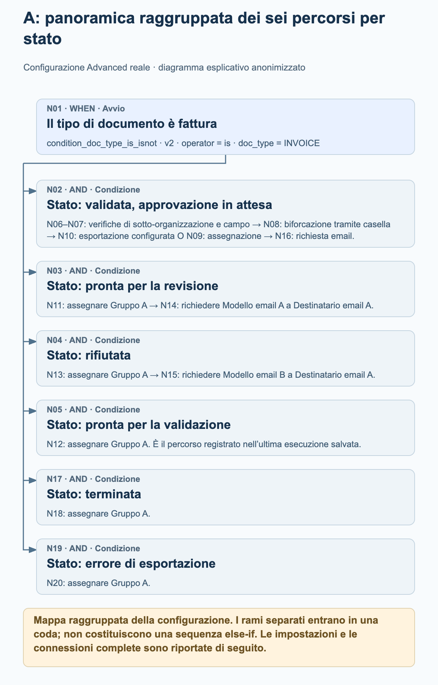
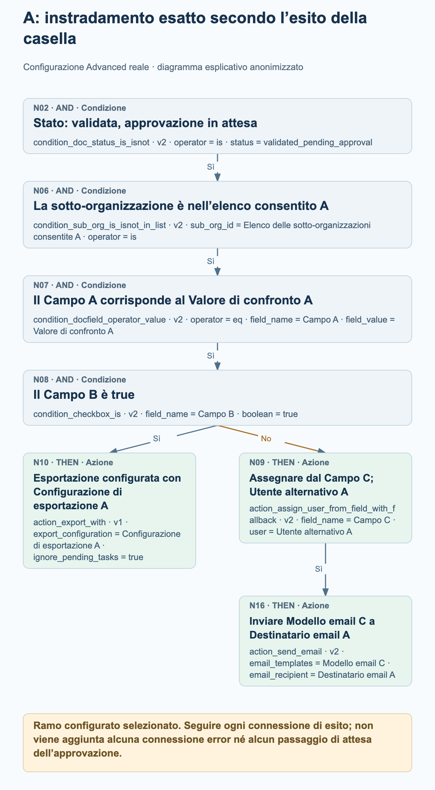
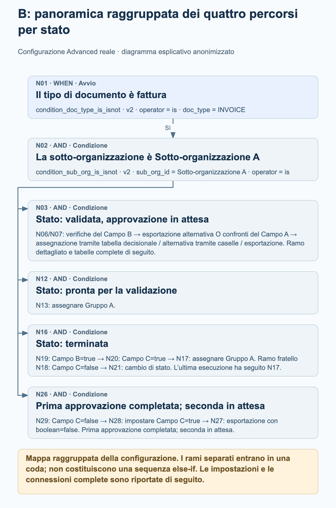
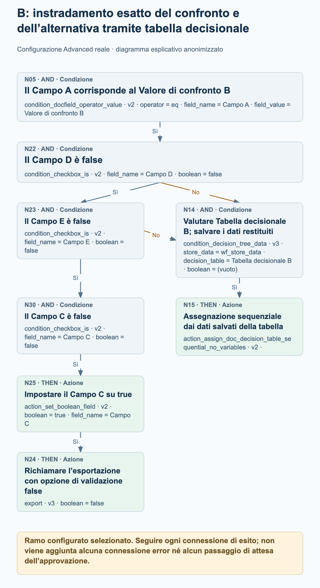

# Esempi di workflow Advanced di produzione

Due workflow Advanced attivi in produzione mostrano come l’instradamento reale delle fatture combini rami per stato, decisioni tramite caselle di controllo, assegnazioni e azioni di esportazione configurate. I quattro diagrammi di processo spiegano parti selezionate di ciascun grafo; le impostazioni complete dei nodi e le connessioni sono elencate separatamente.

Revisione delle fonti in sola lettura il 27 ottobre 2026: entrambe le configurazioni attuali corrispondono ai dati di nodi, schede, versioni, impostazioni e connessioni salvati con le ultime esecuzioni registrate. L’esempio A contiene 20 nodi e 19 connessioni; l’esempio B contiene 30 nodi e 30 connessioni. Entrambe le esecuzioni registrate hanno stato complessivo failed_condition, sebbene ciascuna includa un’azione di assegnazione a un gruppo con esito success. Si tratta di configurazioni osservate e registri di esecuzione salvati, non di nuovi test eseguiti. I valori di organizzazione, campo, utente, gruppo, tabella, modello e destinatario sono anonimizzati. Gli alias mantengono le distinzioni all’interno di ogni esempio e non identificano la stessa entità reale tra esempi diversi.

## Come leggere questi grafi

Ogni connessione segue un esito specifico: success, failed_condition o error. Questi esempi contengono connessioni success e failed_condition; nessuno dei due grafi configura una connessione error. Una condizione non soddisfatta è un normale esito di una condizione e non deve essere interpretata come un errore tecnico.

Più connessioni success in uscita aggiungono più destinazioni alla coda di esecuzione. Non creano una catena else-if e non indicano che le azioni vengano eseguite in parallelo. Una destinazione viene elaborata al massimo una volta nella stessa esecuzione del grafo. Seguire le connessioni effettive anziché dedurre il flusso di controllo dalla posizione di una scheda.

Una destinazione con più connessioni in ingresso non è automaticamente una congiunzione che attende tutti i rami. Nell’esempio B, una qualsiasi delle due connessioni failed_condition configurate può accodare la normale scheda di condizione N14; non è un gateway ALL o ANY separato.

Le assegnazioni non dimostrano che una persona abbia approvato un documento. Da un’assegnazione o da una scheda di esportazione configurata non si possono dedurre passaggi di attesa, completamenti dell’approvazione o ricezioni da parte di sistemi esterni. I diagrammi non aggiungono nessuno di questi passaggi.

Le panoramiche raggruppate riassumono i percorsi per stato e raggruppano esplicitamente i nodi successivi. I diagrammi di dettaglio ampliano i percorsi selezionati delle caselle di controllo o delle alternative. Utilizzare gli elenchi completi dei nodi e delle connessioni per esaminare l’intero grafo configurato.

## A. Instradamento per stato con percorso di esportazione o assegnazione controllato da una casella

Una fattura si dirama verso sei verifiche di stato. Il ramo con validazione completata e approvazione in attesa verifica anche un elenco di sotto-organizzazioni consentite, confronta il Campo A e controlla il Campo B. L’esito della casella seleziona una scheda di esportazione configurata oppure un’azione di assegnazione da un campo seguita da un’email. Gli altri percorsi per stato assegnano il Gruppo A e due di questi inviano poi un’email configurata.

### A: panoramica raggruppata dei sei percorsi per stato

<figure><figcaption>N01 si dirama verso sei verifiche di stato separate. La panoramica raggruppa il ramo più lungo di N02 e mostra i percorsi di assegnazione ed email configurati per gli altri stati. È una mappa raggruppata della configurazione, non una traccia di esecuzione né una sequenza else-if.</figcaption></figure>

### A: instradamento esatto secondo l’esito della casella

<figure><figcaption>Ramo ampliato N02 → N06 → N07 → N08. Campo B=true segue success fino alla scheda di esportazione configurata N10 con ignore_pending_tasks=true. La connessione failed_condition conduce alla scheda di assegnazione da campo N09, il cui esito success conduce alla scheda email N16. Non viene implicato alcun esito dell’esportazione, alcuna approvazione umana né alcun passaggio di attesa.</figcaption></figure>

### Cosa mostra realmente l’ultima esecuzione salvata

Esecuzione salvata: 26 ottobre 2026, 12:01:54 UTC. N01 e la verifica ready_for_validation N05 hanno restituito success; successivamente anche l’assegnazione N12 ha restituito success. Le altre cinque verifiche di stato hanno restituito failed_condition e i nodi rimanenti non hanno alcun esito registrato in questa esecuzione. Il registro complessivo è failed_condition. Questa esecuzione dimostra quindi il percorso di assegnazione al gruppo N01 → N05 → N12; non dimostra i percorsi della casella, dell’esportazione o delle email.

- Dopo che N01 restituisce success, le verifiche di stato N02, N03, N04, N05, N17 e N19 vengono accodate tramite connessioni success separate. Non costituiscono una catena else-if.
- Il ramo di approvazione dettagliato è N02 → N06 → N07 → N08 seguendo success. N08 verifica il Campo B rispetto a true. La sua connessione success conduce a N10; la connessione failed_condition conduce a N09.
- N10 è action_export_with v1, configurata con Configurazione di esportazione A e ignore_pending_tasks=true. Il diagramma indica la configurazione e non afferma che l’esportazione sia riuscita o che sia stata ricevuta da un sistema esterno. In questa scheda, ignore_pending_tasks=true disabilita il controllo delle attività in sospeso per la richiesta di esportazione; è un’opzione specifica di questo esempio.
- N09 è configurata per assegnare dal Campo C con Utente alternativo A. Solo la sua connessione success conduce a N16, configurata con Modello email C e Destinatario email A.
- Il Campo C deve contenere un ID utente. Un ID utente senza corrispondenza può utilizzare l’alternativa configurata; un campo del documento mancante può causare un errore prima che venga raggiunta l’alternativa. L’alternativa non garantisce l’assegnazione in ogni caso di campo mancante.
- N11, N12, N13, N18 e N20 configurano tutti lo stesso Gruppo A all’interno di questo esempio. Solo N11 e N13 hanno nodi email successivi connessi: N14 e N15.

Configurazione completa dei nodi

| Nodo | Scheda | Configurazione |
| --- | --- | --- |
| N01 | condition_doc_type_is_isnot · v2 | operator = is; doc_type = INVOICE |
| N02 | condition_doc_status_is_isnot · v2 | operator = is; status = validated_pending_approval |
| N03 | condition_doc_status_is_isnot · v2 | operator = is; status = ready_for_review |
| N04 | condition_doc_status_is_isnot · v2 | operator = is; status = rejected |
| N05 | condition_doc_status_is_isnot · v2 | operator = is; status = ready_for_validation |
| N06 | condition_sub_org_is_isnot_in_list · v2 | sub_org_id = Elenco delle sotto-organizzazioni consentite A; operator = is |
| N07 | condition_docfield_operator_value · v2 | operator = eq; field_name = Campo A; field_value = Valore di confronto A |
| N08 | condition_checkbox_is · v2 | field_name = Campo B; boolean = true |
| N09 | action_assign_user_from_field_with_fallback · v2 | field_name = Campo C; user = Utente alternativo A |
| N10 | action_export_with · v1 | export_configuration = Configurazione di esportazione A; ignore_pending_tasks = true |
| N11 | doc_group_assign · v2 | groups = Gruppo A; use_decision_table = (vuoto) |
| N12 | doc_group_assign · v2 | groups = Gruppo A; use_decision_table = (vuoto) |
| N13 | doc_group_assign · v2 | groups = Gruppo A; use_decision_table = (vuoto) |
| N14 | action_send_email · v2 | email_templates = Modello email A; email_recipient = Destinatario email A |
| N15 | action_send_email · v2 | email_templates = Modello email B; email_recipient = Destinatario email A |
| N16 | action_send_email · v2 | email_templates = Modello email C; email_recipient = Destinatario email A |
| N17 | condition_doc_status_is_isnot · v2 | operator = is; status = finished |
| N18 | doc_group_assign · v2 | groups = Gruppo A; use_decision_table = (vuoto) |
| N19 | condition_doc_status_is_isnot · v2 | operator = is; status = export_error |
| N20 | doc_group_assign · v2 | groups = Gruppo A; use_decision_table = (vuoto) |

Tutte le connessioni configurate

| Nodo | Percorso del risultato | Nodo |
| --- | --- | --- |
| N01 | success | N02 |
| N01 | success | N03 |
| N01 | success | N04 |
| N01 | success | N05 |
| N08 | failed_condition | N09 |
| N08 | success | N10 |
| N07 | success | N08 |
| N06 | success | N07 |
| N02 | success | N06 |
| N03 | success | N11 |
| N04 | success | N13 |
| N05 | success | N12 |
| N13 | success | N15 |
| N11 | success | N14 |
| N09 | success | N16 |
| N01 | success | N17 |
| N17 | success | N18 |
| N19 | success | N20 |
| N01 | success | N19 |

## B. Instradamento tramite tabelle decisionali con alternative basate su caselle e rami per stato

Una fattura nella Sotto-organizzazione A si dirama verso quattro verifiche di stato. Il percorso con validazione completata e approvazione in attesa utilizza il Campo B, due confronti alternativi del Campo A, tabelle decisionali e ulteriori controlli delle caselle. Il percorso del documento terminato utilizza i Campi B e C prima di assegnare il Gruppo A o configurare un cambio di stato. Un percorso separato con seconda approvazione in attesa imposta il Campo C e richiama l’esportazione quando la condizione configurata è soddisfatta.

### B: panoramica raggruppata dei quattro percorsi per stato

<figure><figcaption>N01 e N02 conducono a quattro verifiche di stato connesse separatamente. La panoramica raggruppa il ramo più ampio delle tabelle decisionali, mantiene il percorso di assegnazione dei documenti pronti per la validazione e la biforcazione tramite caselle dei documenti terminati, e riassume il percorso di esportazione con seconda approvazione in attesa. Gli elenchi completi dei nodi e delle connessioni mantengono tutti i 30 nodi e le 30 connessioni.</figcaption></figure>

### B: instradamento esatto del confronto e dell’alternativa tramite tabella decisionale

<figure><figcaption>Ramo configurato selezionato dopo N01 → N02 → N03 → N07: N05 confronta il Campo A con il Valore di confronto B. Una qualsiasi delle connessioni failed_condition di N22 (Campo D=false) o N23 (Campo E=false) può accodare la Tabella decisionale B nella normale scheda di condizione N14, seguita dall’assegnazione sequenziale N15. L’esito success di N23 prosegue invece attraverso N30 → N25 → N24. Non vengono implicati una congiunzione ALL, una scheda ANY, un’approvazione completata o una ricezione esterna.</figcaption></figure>

### Cosa mostra realmente l’ultima esecuzione salvata

Esecuzione salvata: 27 ottobre 2026, 11:56:25 UTC. N01, N02, la verifica dello stato finished N16, la verifica Campo B=true N19, la verifica Campo C=true N20 e l’assegnazione al gruppo N17 hanno restituito success. N03, N12, N18 e N26 hanno restituito failed_condition; gli altri nodi non hanno alcun esito registrato in questa esecuzione. Il registro complessivo è failed_condition. Questa esecuzione dimostra il percorso di assegnazione del documento terminato, non i percorsi delle tabelle decisionali, un cambio di stato o un’esportazione.

- Dopo che le verifiche di fattura e Sotto-organizzazione A restituiscono success, N02 accoda le verifiche di stato N03, N12, N16 e N26. Il grafo non attende il completamento di un ramo per stato prima di definirne un altro.
- Con esito success di N03, N06 verifica Campo B=false e N07 verifica Campo B=true. L’esito success di N06 porta a impostare Campo B=true in N10 e poi alla scheda di esportazione alternativa N11. L’esito success di N07 accoda entrambi i confronti del Campo A, N04 e N05.
- N06 e N07 vengono accodati prima dell’aggiornamento del Campo B in N10. Entrambe le verifiche vengono valutate prima di tale aggiornamento; impostare Campo B=true non fa sì che N07 restituisca success più avanti nello stesso percorso. Le schede accodate successivamente possono osservare i valori restituiti da azioni precedenti; i rami non sono istantanee isolate.
- Il percorso di Valore di confronto A conduce alla Tabella decisionale A in N08 e all’assegnazione sequenziale N09. Il percorso di Valore di confronto B verifica Campo D=false in N22, Campo E=false in N23 e Campo C=false in N30 prima di impostare Campo C=true in N25 e richiamare l’esportazione N24.
- Un esito failed_condition di N22 o N23 può accodare N14, la normale scheda di condizione per la Tabella decisionale B. N14 non è una congiunzione che attende tutti i rami né una scheda ANY aggiunta. La sua connessione success conduce all’assegnazione sequenziale N15.
- Per i documenti terminati, N19 verifica Campo B=true e poi accoda sia N18 sia N20. Campo C=true in N20 conduce all’assegnazione al Gruppo A N17. Campo C=false in N18 conduce alla scheda di cambio stato N21, configurata con validated_pending_approval e trigger_docflow=true. Non è un passaggio di attesa.
- Il percorso approved_pending_second_approval esegue N29 → N28 → N27 seguendo success: verifica Campo C=false, imposta Campo C=true, quindi richiama l’esportazione. Le schede di esportazione N24 e N27 mantengono boolean=false. Si tratta di un’opzione di validazione, non di un’istruzione per disabilitare la chiamata di esportazione.
- Entrambe le schede di condizione delle tabelle decisionali salvano i dati in wf_store_data. Le rispettive azioni di assegnazione sequenziale non hanno impostazioni proprie. Le regole delle tabelle e i destinatari reali non vengono pubblicati e il grafo non dimostra il completamento dell’approvazione.
- L’esportazione alternativa N11 dipende dagli attributi di esportazione del tipo di documento. Non è possibile dedurre una configurazione o una destinazione di esportazione dalle impostazioni vuote del nodo. Il cambio di stato N21 richiede la successiva attivazione dei workflow; non aggiunge alcuna connessione implicita di ritorno nello stesso percorso.

Configurazione completa dei nodi

| Nodo | Scheda | Configurazione |
| --- | --- | --- |
| N01 | condition_doc_type_is_isnot · v2 | operator = is; doc_type = INVOICE |
| N02 | condition_sub_org_is_isnot · v2 | sub_org_id = Sotto-organizzazione A; operator = is |
| N03 | condition_doc_status_is_isnot · v2 | operator = is; status = validated_pending_approval |
| N04 | condition_docfield_operator_value · v2 | operator = eq; field_name = Campo A; field_value = Valore di confronto A |
| N05 | condition_docfield_operator_value · v2 | operator = eq; field_name = Campo A; field_value = Valore di confronto B |
| N06 | condition_checkbox_is · v2 | field_name = Campo B; boolean = false |
| N07 | condition_checkbox_is · v2 | field_name = Campo B; boolean = true |
| N08 | condition_decision_tree_data · v3 | store_data = wf_store_data; decision_table = Tabella decisionale A; boolean = (vuoto) |
| N09 | action_assign_doc_decision_table_sequential_no_variables · v2 | — |
| N10 | action_set_boolean_field · v2 | boolean = true; field_name = Campo B |
| N11 | action_alternate_export · v2 | — |
| N12 | condition_doc_status_is_isnot_in_list · v2 | operator = is; status = ready_for_validation |
| N13 | doc_group_assign · v2 | groups = Gruppo A; use_decision_table = (vuoto) |
| N14 | condition_decision_tree_data · v3 | store_data = wf_store_data; decision_table = Tabella decisionale B; boolean = (vuoto) |
| N15 | action_assign_doc_decision_table_sequential_no_variables · v2 | — |
| N16 | condition_doc_status_is_isnot_in_list · v2 | operator = is; status = finished |
| N17 | doc_group_assign · v2 | groups = Gruppo A; use_decision_table = (vuoto) |
| N18 | condition_checkbox_is · v2 | field_name = Campo C; boolean = false |
| N19 | condition_checkbox_is · v2 | field_name = Campo B; boolean = true |
| N20 | condition_checkbox_is · v2 | field_name = Campo C; boolean = true |
| N21 | staus_change · v3 | status = validated_pending_approval; trigger_docflow = true |
| N22 | condition_checkbox_is · v2 | field_name = Campo D; boolean = false |
| N23 | condition_checkbox_is · v2 | field_name = Campo E; boolean = false |
| N24 | export · v3 | boolean = false |
| N25 | action_set_boolean_field · v2 | boolean = true; field_name = Campo C |
| N26 | condition_doc_status_is_isnot_in_list · v2 | operator = is; status = approved_pending_second_approval |
| N27 | export · v3 | boolean = false |
| N28 | action_set_boolean_field · v2 | boolean = true; field_name = Campo C |
| N29 | condition_checkbox_is · v2 | field_name = Campo C; boolean = false |
| N30 | condition_checkbox_is · v2 | field_name = Campo C; boolean = false |

Tutte le connessioni configurate

| Nodo | Percorso del risultato | Nodo |
| --- | --- | --- |
| N01 | success | N02 |
| N02 | success | N03 |
| N03 | success | N06 |
| N03 | success | N07 |
| N07 | success | N04 |
| N07 | success | N05 |
| N06 | success | N10 |
| N10 | success | N11 |
| N02 | success | N12 |
| N12 | success | N13 |
| N16 | success | N19 |
| N20 | success | N17 |
| N19 | success | N20 |
| N19 | success | N18 |
| N18 | success | N21 |
| N04 | success | N08 |
| N02 | success | N16 |
| N05 | success | N22 |
| N22 | success | N23 |
| N25 | success | N24 |
| N02 | success | N26 |
| N22 | failed_condition | N14 |
| N23 | failed_condition | N14 |
| N28 | success | N27 |
| N26 | success | N29 |
| N29 | success | N28 |
| N23 | success | N30 |
| N30 | success | N25 |
| N08 | success | N09 |
| N14 | success | N15 |

## Prima di adattare un esempio

Sostituire ogni alias neutro con un valore appropriato della propria organizzazione. Mantenere la distinzione tra le impostazioni che fanno riferimento allo stesso campo e quelle che si riferiscono a campi diversi; non riutilizzare questi segnaposto come identificatori reali.

Verificare esplicitamente ogni connessione di esito, compreso l’instradamento failed_condition e le destinazioni con più connessioni in ingresso. Definire la gestione degli errori per il proprio processo senza presumere che il grafo gestisca un percorso error non connesso.

Esaminare le impostazioni di esportazione, le opzioni di validazione e la gestione delle attività in sospeso rispetto ai propri requisiti. Un’azione di esportazione configurata o un nodo registrato con esito success non dimostrano la ricezione da parte di un sistema esterno.

Validare il workflow adattato in un ambiente di test autorizzato, includendo ogni esito pertinente delle condizioni e i dati di assegnazione mancanti. Questi esempi di produzione sono stati letti senza modificarli né eseguirli nuovamente.
