# Modello logico decisionale

**Tipo di pattern:** Instradamento condizionale e logica **Complessità:** Media **Configurazione stimata:** 30-45 minuti **Casi d'uso comuni:** Instradamento multi-percorso, elaborazione condizionale, alberi decisionali, implementazione di regole aziendali

***

Nel designer in modalità Standard, scegli «Aggiungi scheda» nel gruppo «E....» e apri la categoria «Logica». La schermata mostra una condizione basata su una tabella decisionale, senza una tabella selezionata né la memorizzazione dei risultati configurata. Seleziona la tabella e configura la memorizzazione dei risultati restituiti per il documento o per l’organizzazione fornitrice. Configura quindi le ulteriori condizioni, le azioni e i collegamenti del flusso di lavoro e verifica il comportamento con dei test.

<figure>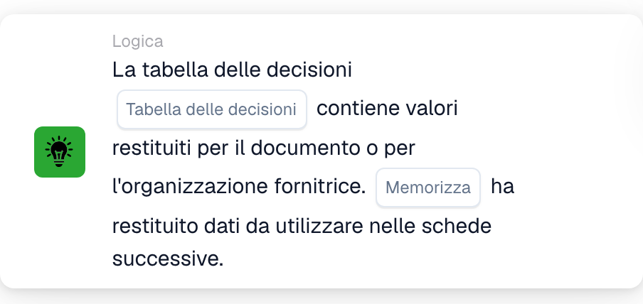<figcaption><p>Designer in modalità Standard: categoria «Logica» aperta tramite «Aggiungi scheda» nel gruppo «E....»; condizione con tabella decisionale non ancora selezionata e memorizzazione dei risultati non ancora configurata.</p></figcaption></figure>

***

## Panoramica del pattern

#### Diagramma: Panoramica

<figure>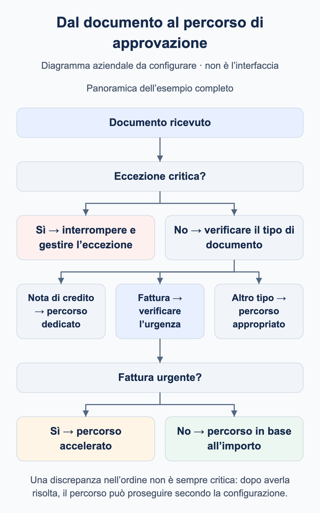<figcaption><p>Panoramica dell’esempio completo: controllare le eccezioni critiche, il tipo di documento e l’urgenza prima di scegliere il percorso di approvazione. Ogni operazione e ogni collegamento devono essere configurati; lo schema non rappresenta un comportamento automatico del prodotto.</p></figcaption></figure>

Questi diagrammi spiegano regole aziendali da configurare. Completano l'immagine della libreria sopra. In modalità Advanced, collegare esplicitamente ogni percorso. In una sequenza lineare Standard, definire le condizioni che consentono le azioni.

Questo pattern mostra come implementare una logica decisionale complessa nei workflow di DocBits usando le card di condizione per instradare i documenti attraverso percorsi di elaborazione diversi in base agli attributi del documento, ai valori dei campi e alle regole aziendali.

**Cosa fa questo pattern:**

1. Valuta più condizioni in sequenza o in parallelo
2. Instrada i documenti verso percorsi diversi in base alle condizioni
3. Implementa regole e policy aziendali
4. Gestisce alberi decisionali complessi
5. Combina più criteri per le decisioni di instradamento

***

## Quando usare questo pattern

Usa questo pattern quando devi:

* ✅ Instradare i documenti per soglie di importo
* ✅ Applicare regole diverse per tipi di documento diversi
* ✅ Implementare logica di approvazione multi-livello
* ✅ Gestire policy aziendali complesse
* ✅ Creare instradamento dinamico basato su più criteri
* ✅ Implementare la logica di gestione delle eccezioni
* ✅ Creare matrici di approvazione

**Non usare questo pattern quando:**

* ❌ Un semplice flusso di lavoro lineare è sufficiente
* ❌ Tutti i documenti seguono lo stesso percorso
* ❌ Non è necessaria alcuna elaborazione condizionale

***

## Tipi di logica decisionale

Gli esempi IF-THEN, AND, OR e annidati riportati sotto sono indipendenti. Le loro soglie illustrano ciascun principio; non formano un'unica matrice di approvazione. La matrice completa successiva usa quattro fasce senza sovrapposizioni. Un valore sconosciuto o un errore di valutazione non equivale automaticamente a False: definirne e provarne separatamente la gestione.

### 1. Logica IF-THEN semplice

#### Diagramma: Condizione semplice

<figure>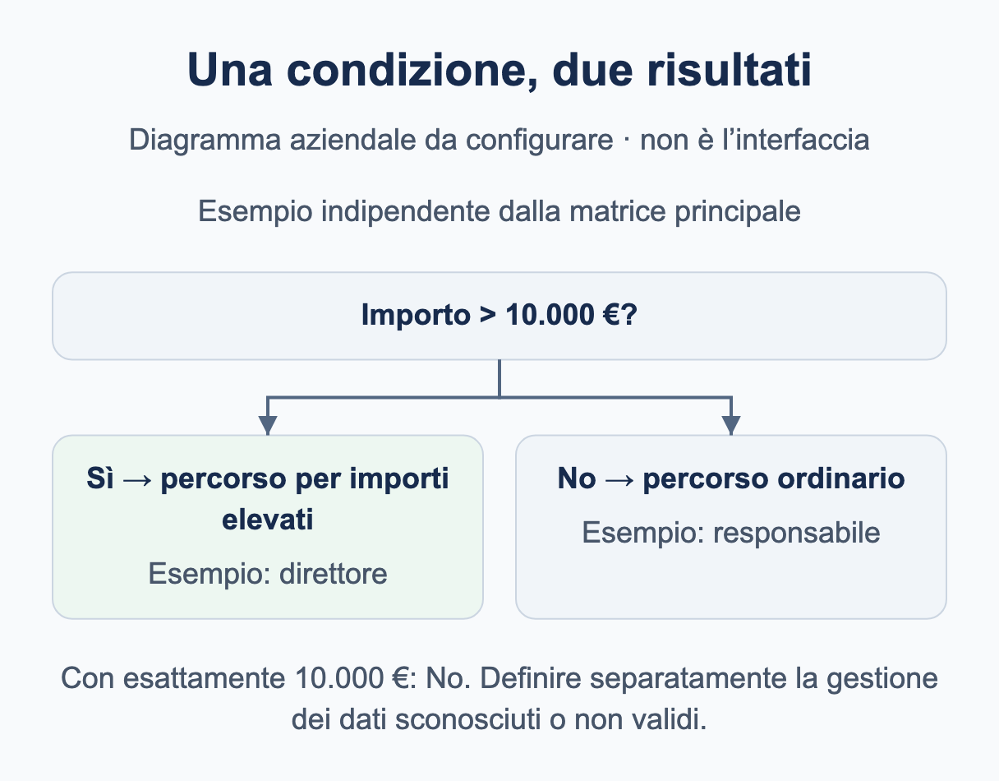<figcaption><p>Esempio IF-THEN indipendente: un importo strettamente superiore a 10.000 € seleziona il direttore; altrimenti, il responsabile. L&#x27;uguaglianza resta nel secondo ramo. Configurare le destinazioni.</p></figcaption></figure>

<details>
<summary>Principio IF-THEN: una condizione, due risultati</summary>

```
IF condition:
  → Azione A
ELSE:
  → Azione B
```

</details>

**Esempio:**

Spiegazione visiva: [condizione semplice](#diagramma-condizione-semplice).

<details>
<summary>Esempio IF-THEN: soglia di importo</summary>

```
IF Amount > €10,000:
  → Assegnare al direttore
ELSE:
  → Assegnare al responsabile
```

</details>

#### Diagramma: Criteri E e O

<figure>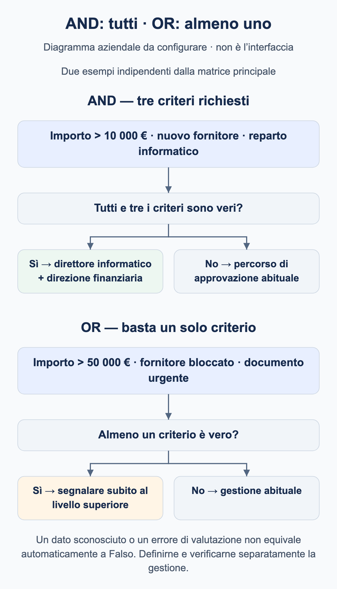<figcaption><p>Due esempi indipendenti: AND richiede tutti e tre i criteri; OR ne richiede almeno uno. Le loro soglie illustrative non sostituiscono le fasce della matrice completa. Le uscite e la gestione dei dati sconosciuti o degli errori devono essere configurate.</p></figcaption></figure>

### 2. Criteri multipli (logica AND)

<details>
<summary>Principio AND: tutti i criteri</summary>

```
IF condition1 AND condition2 AND condition3:
  → Azione A
ELSE:
  → Azione B
```

</details>

**Esempio:**

Spiegazione visiva: [criteri E e O](#diagramma-criteri-e-e-o).

<details>
<summary>Esempio AND: tre criteri</summary>

```
IF Amount > €10,000 AND Supplier = "New" AND Department = "IT":
  → Assegnare al direttore IT + CFO (doppia approvazione)
ELSE:
  → Workflow di approvazione ordinario
```

</details>

### 3. Criteri alternativi (logica OR)

Spiegazione visiva: [criteri E e O](#diagramma-criteri-e-e-o).

<details>
<summary>Principio OR: almeno un criterio</summary>

```
IF condition1 OR condition2 OR condition3:
  → Azione A
ELSE:
  → Azione B
```

</details>

**Esempio:**

Spiegazione visiva: [criteri E e O](#diagramma-criteri-e-e-o).

<details>
<summary>Esempio OR: importo, blocco o urgenza</summary>

```
IF Amount > €50,000 OR Supplier is "Blocked" OR Document ha il flag "Urgent":
  → Inoltrare subito al livello superiore
ELSE:
  → Elaborazione ordinaria
```

</details>

### 4. Albero decisionale annidato

#### Diagramma: Decisioni annidate

<figure>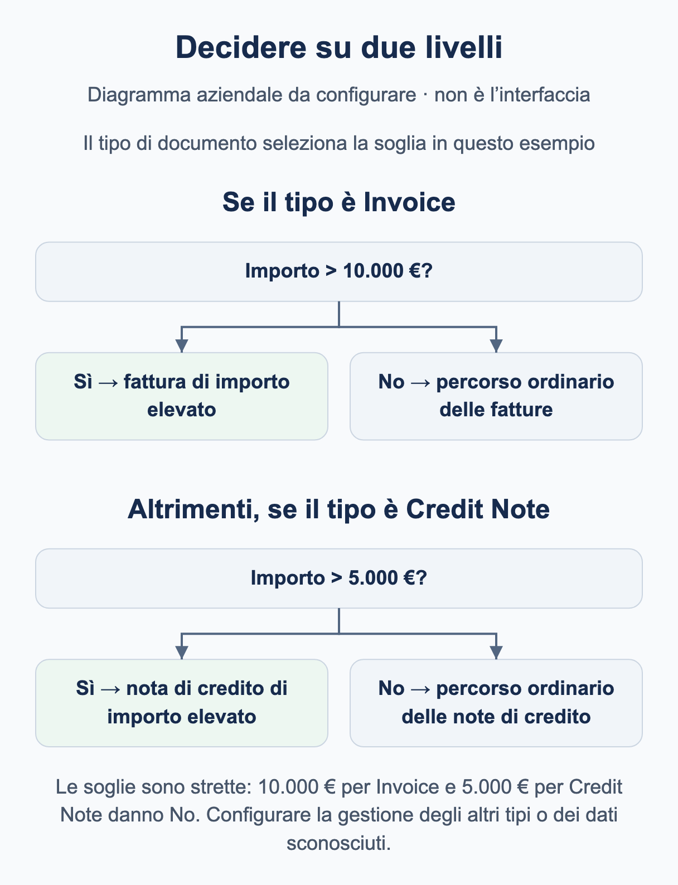<figcaption><p>Esempio annidato indipendente: il tipo di documento seleziona un confronto dell&#x27;importo. Le soglie sono strette: una fattura di 10.000 € o una nota di credito di 5.000 € non soddisfano il confronto «maggiore di». Definire la gestione degli altri tipi e dei dati sconosciuti.</p></figcaption></figure>

<details>
<summary>Principio di decisione annidata</summary>

```
IF condition1:
  IF condition2:
    → Azione A
  ELSE:
    → Azione B
ELSE:
  IF condition3:
    → Azione C
  ELSE:
    → Azione D
```

</details>

**Esempio:**

Spiegazione visiva: [decisioni annidate](#diagramma-decisioni-annidate).

<details>
<summary>Esempio annidato: fattura e nota di credito</summary>

```
IF Document_Type = "Invoice":
  IF Amount > €10,000:
    → Workflow per fatture di importo elevato
  ELSE:
    → Workflow ordinario delle fatture
ELSE IF Document_Type = "Credit Note":
  IF Amount > €5,000:
    → Workflow per note di credito di importo elevato
  ELSE:
    → Workflow ordinario delle note di credito
```

</details>

***

## Esempio completo di flusso di lavoro

### Scenario: Matrice di approvazione delle fatture

**Regole aziendali:**

1. Prima dell'instradamento per importo, interrompere e gestire le eccezioni critiche, incluso un fornitore bloccato. Uno scostamento dall'ordine non è sempre critico: dopo la risoluzione da parte degli acquisti, il percorso può proseguire secondo configurazione. Verificare poi il tipo di documento.
2. Per una fattura urgente, seguire il percorso accelerato di questo esempio invece delle fasce ordinarie.
3. Per una fattura non urgente con importo valido:
   * importo < 1.000 €: approvazione automatica;
   * 1.000 € ≤ importo < 10.000 €: approvazione del responsabile;
   * 10.000 € ≤ importo < 50.000 €: controlli sul fornitore seguiti dall'approvazione del direttore; un fornitore non bloccato con meno di 180 giorni richiede l'approvazione del direttore e poi del CFO; anche gli altri fornitori sono sottoposti a un controllo del rischio;
   * importo ≥ 50.000 €: approvazione della direzione descritta nel percorso D.
4. Un importo assente o non valido passa alla revisione manuale espressamente configurata in questo esempio. È una politica di esempio, non un ripiego automatico del prodotto.
5. Dopo aver creato un'attività, attenderne il risultato. Il rifiuto interrompe la catena e segue la gestione configurata; un risultato in attesa non consente di proseguire. Creare l'attività del CFO solo dopo l'approvazione positiva del direttore.

#### Diagramma: Fasce di importo

<figure>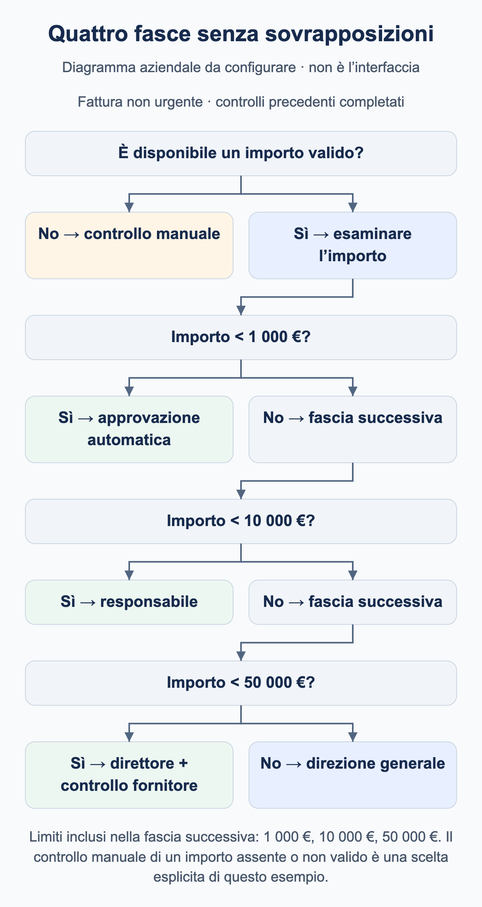<figcaption><p>Soglie del livello 2: meno di 1 000 €; da 1 000 € inclusi a 10 000 € esclusi; da 10 000 € inclusi a 50 000 € esclusi; 50 000 € o più. Ogni verifica segue l’esito negativo della precedente. Il controllo manuale per un importo assente o non valido deve essere configurato esplicitamente.</p></figcaption></figure>

I valori limite 1.000 €, 10.000 € e 50.000 € rientrano nella fascia superiore. Configurare e provare i controlli preliminari, l'attesa dei risultati e i collegamenti tra percorsi. La creazione di un'attività non dimostra né l'approvazione né l'esportazione del documento.

**Implementazione illustrativa:** adattare nomi tecnici e pseudocodice alle schede effettivamente disponibili nella propria versione. Questi blocchi descrivono un esempio da configurare, non un file importabile. Verificare i risultati dell'esecuzione e gli effetti collaterali.

Spiegazione visiva: [panoramica](#diagramma-panoramica), [fasce di importo](#diagramma-fasce-di-importo), [analisi del fornitore](#diagramma-analisi-del-fornitore), [percorso automatico](#diagramma-percorso-automatico), [attività del responsabile](#diagramma-attivita-del-responsabile), [approvazione della direzione](#diagramma-approvazione-della-direzione), [registro della regola](#diagramma-registro-della-regola).

<details>
<summary>Pseudocodice della matrice completa</summary>

```
CONTROLLO PRELIMINARE: eccezioni critiche
  IF Critical_Exception = TRUE OR Supplier_Status = "BLOCKED":
    → Interrompere e gestire l'eccezione prima dell'instradamento

PASSAGGIO 1: verificare scostamenti dall'ordine
  IF PO_Match_Status = "FAIL":
    → Instradare agli acquisti per risolvere lo scostamento dall'ordine
    → Dopo la risoluzione, proseguire sotto secondo configurazione

PASSAGGIO 1b: verificare il tipo di documento
  IF Document_Type = "Credit Note":
    → Workflow configurato per le note di credito
  ELSE IF Document_Type is not "Invoice":
    → Workflow configurato per questo tipo di documento
  ELSE:
    → Proseguire sotto

PASSAGGIO 2: verificare il flag di urgenza
  IF Urgent_Flag = TRUE:
    → Saltare i controlli dell'importo
    → Instradare all'approvatore di livello più alto
    → Impostare la priorità = URGENT
    → Scadenza di 1 giorno

PASSAGGIO 3: instradamento per importo (Invoice, se non urgente)
  IF Amount assente o non valido:
    → Revisione manuale (politica esplicita di esempio)
    → Non accedere alle fasce di importo

  ELSE IF Amount < €1,000:
    → Approvare automaticamente
    → Esportare immediatamente

  ELSE IF Amount < €10,000:
    → Creare l'attività del responsabile
    → Priority: Medium
    → Deadline: 3 giorni

  ELSE IF Amount < €50,000:
    VERIFICA di stato e rischio del fornitore:
      IF Supplier_Status = "BLOCKED":
        → Interrompere e gestire l'eccezione
      ELSE IF Supplier_Age < 180 giorni (nuovo):
        → Creare l'attività del direttore (attività 1)
        → Attendere l'approvazione positiva del direttore prima di creare l'attività del CFO (attività 2)
        → Attendere l'approvazione positiva del CFO prima di proseguire
        → Qualsiasi rifiuto: interrompere la catena e gestire il rifiuto secondo configurazione
        → In attesa: non proseguire
        → Priority: High
        → Deadline: 2 giorni ciascuna
      ELSE IF Supplier_Risk_Rating = "HIGH":
        → Controlli aggiuntivi e preapprovazione del responsabile
        → Attendere l'approvazione positiva del responsabile prima di quella del direttore
        → In attesa o rifiutato: non proseguire nella catena di approvazione
      ELSE (fornitore esistente):
        → Creare un'attività solo per il direttore
        → Priority: High
        → Deadline: 2 giorni

  ELSE (Amount ≥ €50,000):
    → Percorso di approvazione della direzione (vedere percorso D)
```

</details>

***

## Implementazione passo passo

### Passo 1: Definisci le card di condizione

**Condizione 1: Soglia di importo**

#### Diagramma: Parametri indipendenti

<figure>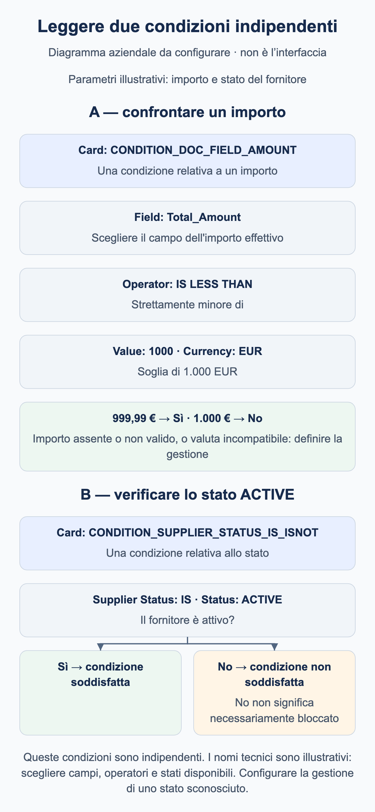<figcaption><p>Due condizioni indipendenti: un importo strettamente inferiore a 1.000 EUR e un fornitore con stato ACTIVE. L&#x27;uguaglianza dell&#x27;importo dà No; un fornitore inattivo non è necessariamente bloccato. I parametri tecnici sono illustrativi e vanno adattati alla configurazione reale.</p></figcaption></figure>

<details>
<summary>Parametri illustrativi: soglia di importo</summary>

```
Card: CONDITION_DOC_FIELD_AMOUNT
Field: Total_Amount
Operator: IS LESS THAN
Value: 1000
Currency: EUR
```

</details>

**Condizione 2: Verifica del tipo di documento**

#### Diagramma: Tipi di documento

<figure>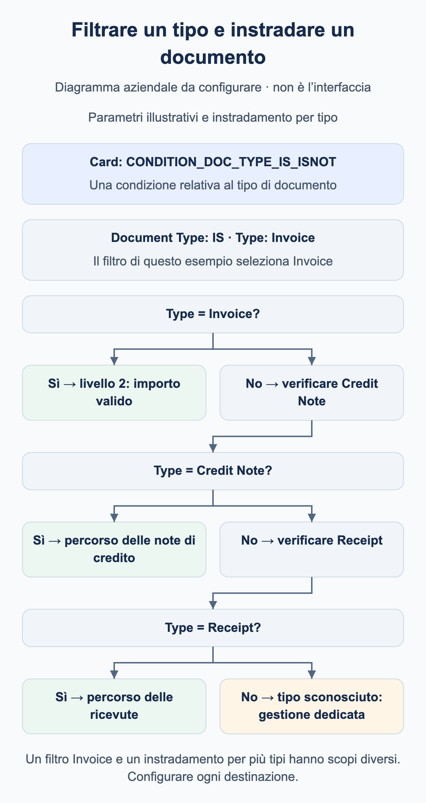<figcaption><p>Il filtro Invoice e l&#x27;instradamento per tipo illustrano aspetti complementari di questo esempio. L&#x27;instradamento distingue fattura, nota di credito, ricevuta e tipo sconosciuto. I nomi di schede e workflow sono illustrativi; configurare ogni destinazione.</p></figcaption></figure>

<details>
<summary>Parametri illustrativi: tipo di documento</summary>

```
Card: CONDITION_DOC_TYPE_IS_ISNOT
Document Type: IS
Type: Invoice
```

</details>

**Condizione 3: Stato del fornitore**

Spiegazione visiva: [parametri indipendenti](#diagramma-parametri-indipendenti).

<details>
<summary>Parametri illustrativi: stato attivo</summary>

```
Card: CONDITION_SUPPLIER_STATUS_IS_ISNOT
Supplier Status: IS
Status: ACTIVE
```

</details>

**Condizione 4: Verifica del nuovo fornitore**

Per questo esempio, calcolare la data di 180 giorni prima della data di valutazione, poi confrontare la data della prima transazione con tale limite. «IS AFTER» significa strettamente successiva: l'uguaglianza dà No. Scegliere il campo effettivo e calcolare o inserire la data limite; i nomi della scheda e del campo e il segnaposto {{TODAY_MINUS_180_DAYS}} sono illustrativi. Verificare separatamente che la data della prima transazione sia valida e non superi la data di valutazione; configurare la gestione dei valori assenti o non validi.

#### Diagramma: Condizione dei 180 giorni

<figure>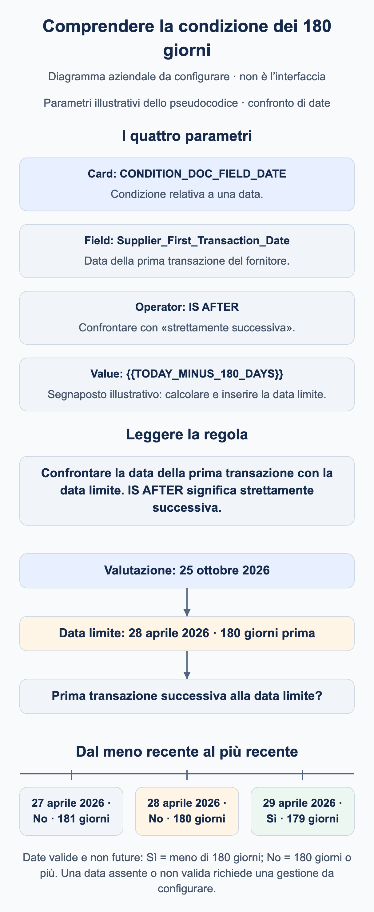<figcaption><p>Esempio di confronto: al 25 ottobre 2026, la data limite è il 28 aprile 2026. «IS AFTER» esclude l’uguaglianza: il 29 aprile dà Sì, il 28 e il 27 aprile danno No. I nomi della scheda e del campo e il segnaposto {{TODAY_MINUS_180_DAYS}} sono illustrativi: scegliere il campo reale e calcolare o inserire la data limite. Si presuppone che le date siano valide e non future; la gestione di una data assente o non valida resta da configurare.</p></figcaption></figure>

<details>
<summary>Copiare i parametri illustrativi dell'esempio</summary>

```
Card: CONDITION_DOC_FIELD_DATE
Field: Supplier_First_Transaction_Date
Operator: IS AFTER
Value: {{TODAY_MINUS_180_DAYS}}
```

</details>


**Riferimento alla guida:** [Guida Completa Carte Condizioni](../and/condition-cards-complete-guide.md)

***

### Passo 2: Costruisci l'albero decisionale

**Livello 1: Tipo di documento**

Spiegazione visiva: [tipi di documento](#diagramma-tipi-di-documento).

<details>
<summary>Instradamento illustrativo per tipo di documento</summary>

```
Workflow: "Invoice Processing"

IF Document_Type = "Invoice":
  → Proseguire al livello 2

ELSE IF Document_Type = "Credit Note":
  → Instradare a "Credit Note Processing"

ELSE IF Document_Type = "Receipt":
  → Instradare a "Receipt Processing"

ELSE:
  → Instradare alla gestione "Unknown Document Type"
```

</details>

**Livello 2: soglie di importo (fatture non urgenti, importo valido)**

Spiegazione visiva: [fasce di importo](#diagramma-fasce-di-importo).

<details>
<summary>Quattro fasce di importo: pseudocodice</summary>

```
IF Amount < €1,000:
  → Instradare a "Auto-Approve Path"

ELSE IF Amount < €10,000:
  → Instradare a "Manager Approval Path"

ELSE IF Amount < €50,000:
  → Instradare a "Director Approval Path"
  → Verificare le condizioni del livello 3

ELSE (Amount ≥ €50,000):
  → Instradare a "Executive Approval Path"
  → Richiesta doppia o tripla approvazione
```

</details>

**Livello 3: Analisi del fornitore (per le fatture di valore elevato)**

#### Diagramma: Analisi del fornitore

<figure>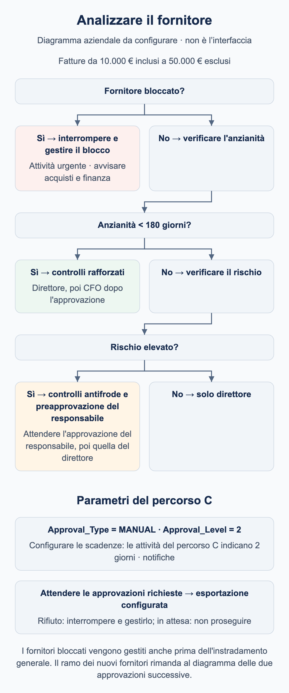<figcaption><p>Dettaglio del percorso del fornitore: gestire il blocco, poi l&#x27;anzianità e infine il rischio. Il ramo dei fornitori con meno di 180 giorni rimanda al diagramma delle due approvazioni successive. Configurare attività, scadenze, notifiche e azioni del percorso C.</p></figcaption></figure>

<details>
<summary>Analisi del fornitore: blocco, anzianità e rischio</summary>

```
IF Supplier_Status = "BLOCKED":
  → INTERROMPERE l'elaborazione
  → Creare un'attività urgente di escalation
  → Avvisare acquisti e finanza

ELSE IF Supplier_Age < 180 giorni (nuovo):
  → Richiesta approvazione aggiuntiva
  → Aggiungere il CFO alla catena di approvazione
  → Verifica rafforzata

ELSE IF Supplier_Risk_Rating = "HIGH":
  → Richiesti controlli aggiuntivi
  → Revisione dei controlli antifrode
  → Preapprovazione del responsabile; attendere l'approvazione positiva
  → Approvazione del direttore; attendere l'approvazione positiva

ELSE:
  → Workflow ordinario per importi elevati
```

</details>

***

### Passo 3: Crea le azioni di instradamento

**Percorso A: Approvazione automatica (Importo < €1.000)**

#### Diagramma: Percorso automatico

<figure>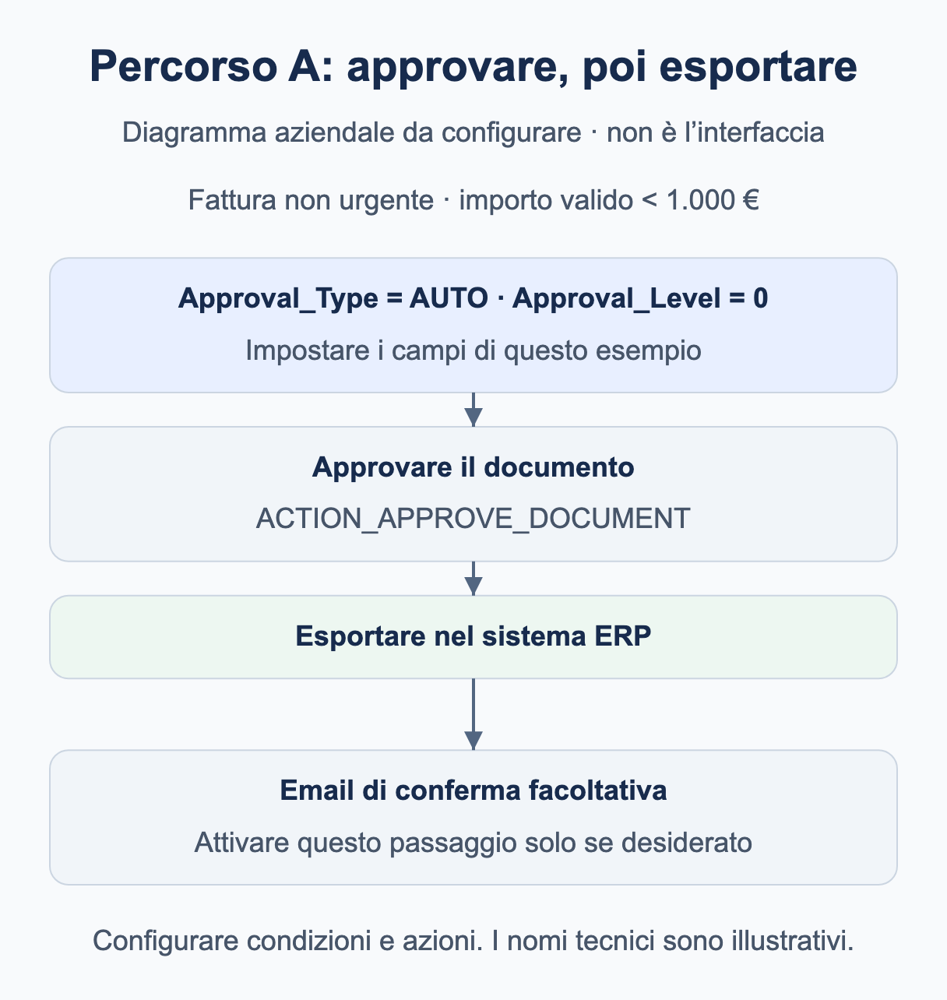<figcaption><p>Esempio del percorso A: impostare i campi di approvazione, approvare il documento e poi esportarlo. L&#x27;email di conferma è facoltativa. Questo diagramma descrive azioni da configurare, non un&#x27;esecuzione osservata.</p></figcaption></figure>

<details>
<summary>Azioni del percorso A: approvazione automatica</summary>

```
Azioni:
1. Impostare il campo "Approval_Type" = "AUTO"
2. Impostare il campo "Approval_Level" = "0"
3. ACTION_APPROVE_DOCUMENT
4. Esportare nell'ERP
5. Inviare email di conferma (facoltativa)
```

</details>

**Percorso B: approvazione del responsabile (1.000 € ≤ importo < 10.000 €)**

#### Diagramma: Attività del responsabile

<figure>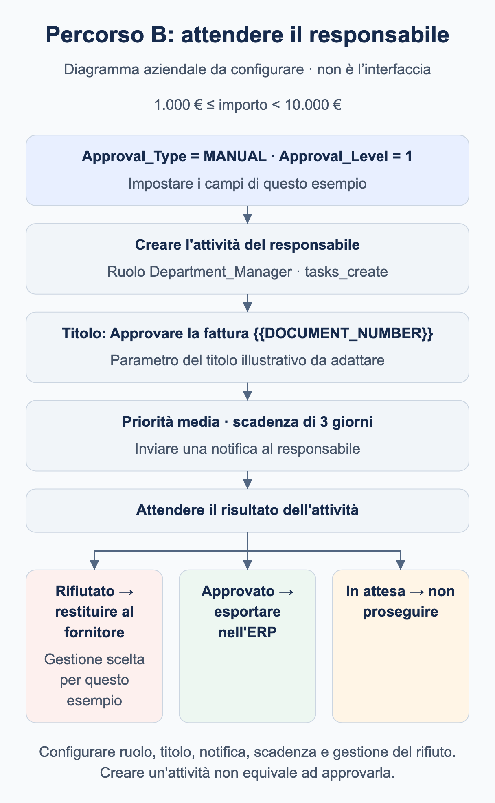<figcaption><p>Esempio del percorso B: creare un&#x27;attività per il responsabile, avvisarlo e attendere il risultato. Solo l&#x27;approvazione permette l&#x27;esportazione; qui il rifiuto restituisce il documento al fornitore. La scadenza di tre giorni e i destinatari sono scelte di configurazione.</p></figcaption></figure>

<details>
<summary>Azioni del percorso B: attività del responsabile</summary>

```
Azioni:
1. Impostare il campo "Approval_Type" = "MANUAL"
2. Impostare il campo "Approval_Level" = "1"
3. tasks_create:
   - Title: "Approvare la fattura {{DOCUMENT_NUMBER}}"
   - Assign to: Department_Manager
   - Priority: Medium
   - Deadline: 3 giorni
4. Inviare una notifica email al responsabile
5. Attendere il completamento dell'attività
6. Se approvato: esportare nell'ERP
7. Se rifiutato: restituire al fornitore
```

</details>

**Percorso C: approvazione del direttore (10.000 € ≤ importo < 50.000 €)**

Spiegazione visiva: [analisi del fornitore](#diagramma-analisi-del-fornitore), [approvazioni successive](#diagramma-approvazioni-successive).

<details>
<summary>Azioni del percorso C: controlli e approvazioni richieste</summary>

```
Azioni:
1. Impostare il campo "Approval_Type" = "MANUAL"
2. Impostare il campo "Approval_Level" = "2"
3. Verificare Supplier_Age e Supplier_Risk_Rating:
   IF nuovo (< 180 giorni):
     - Creare l'attività 1: approvazione del direttore
     - Attendere l'approvazione positiva dell'attività 1 prima di creare l'attività 2: approvazione del CFO
     - Attendere l'approvazione positiva dell'attività 2 prima di proseguire
     - In attesa: non proseguire
     - Qualsiasi rifiuto: interrompere la catena e gestire il rifiuto secondo configurazione
     - Richieste entrambe le approvazioni positive
   ELSE IF Supplier_Risk_Rating = "HIGH":
     - Controlli aggiuntivi del rischio e preapprovazione del responsabile
     - Attendere l'approvazione positiva del responsabile prima di quella del direttore
     - Attendere l'approvazione positiva del direttore prima dell'esportazione
     - In attesa o rifiutato: interrompere l'avanzamento e gestire l'esito secondo configurazione
   ELSE:
     - Creare un'attività: solo approvazione del direttore
4. Priority: High
5. Deadline: 2 giorni per le attività di approvazione del percorso C; configurare separatamente le scadenze dei controlli del rischio
6. Inviare notifiche email
7. Attendere il completamento
8. Se tutti approvati: esportare
9. Se uno è rifiutato: restituire al fornitore
```

</details>

#### Diagramma: Approvazioni successive

<figure>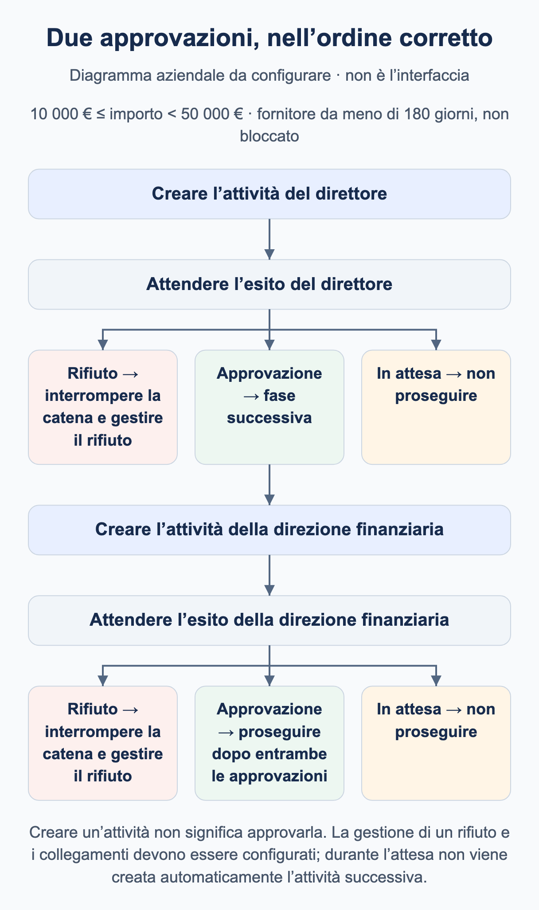<figcaption><p>Esempio di approvazioni successive: creare l’attività della direzione finanziaria solo dopo l’approvazione del direttore, quindi attenderne l’esito. Proseguire solo dopo entrambe le approvazioni. Un rifiuto interrompe la catena e segue la gestione configurata; un esito in attesa non consente di proseguire.</p></figcaption></figure>

Secondo la configurazione, il rifiuto può restituire il documento al fornitore o seguire un altro percorso. Il diagramma richiede soltanto l'interruzione di questa catena di approvazione; non impone una revisione manuale in ogni caso.

**Percorso D: Approvazione esecutiva (≥ €50.000)**

#### Diagramma: Approvazione della direzione

<figure>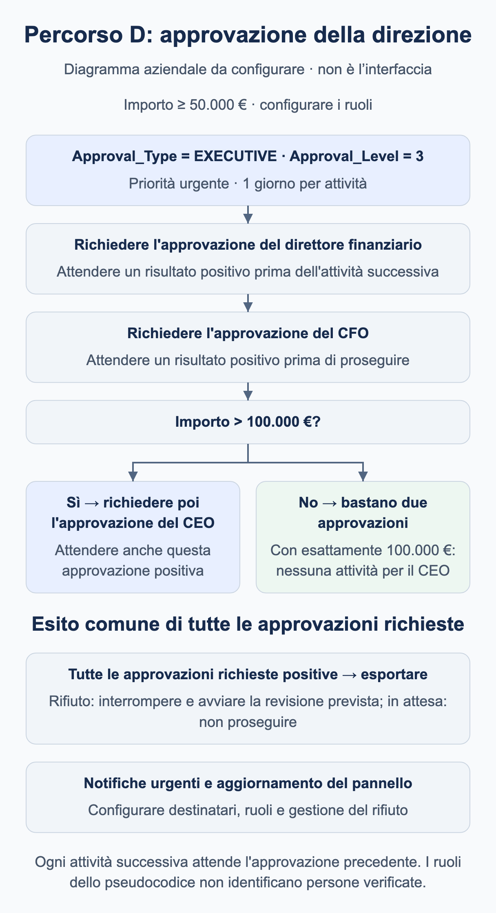<figcaption><p>Esempio del percorso D: due approvazioni successive da 50.000 €, con una terza solo oltre 100.000 €. Ogni attività successiva attende l&#x27;approvazione precedente. Configurare ruoli, scadenze, notifiche e gestione del rifiuto.</p></figcaption></figure>

<details>
<summary>Azioni del percorso D: approvazione della direzione</summary>

```
Azioni:
1. Impostare il campo "Approval_Type" = "EXECUTIVE"
2. Impostare il campo "Approval_Level" = "3"
3. Approvazioni successive:
   - Attività 1: direttore finanziario
   - Attività 2: CFO
   - Attività 3: CEO (se > €100,000)
4. Priority: Urgent
5. Deadline: 1 giorno ciascuna
6. Inviare notifiche urgenti
7. Aggiornamento del pannello della direzione
8. Attendere tutte le approvazioni
9. Se tutti approvati: esportare
10. Se uno è rifiutato: riunione di revisione della direzione
```

</details>

***

## Pattern avanzati di logica decisionale

I modelli seguenti sono varianti indipendenti. Punteggi, soglie dei reparti e regole temporali non si aggiungono automaticamente alla matrice completa sopra; scegliere e configurare le regole adatte al proprio caso.

### Pattern 1: Instradamento basato sul punteggio

**Calcolare un punteggio di rischio intero e instradare di conseguenza in questo esempio:**

#### Diagramma: Punteggio di rischio

<figure>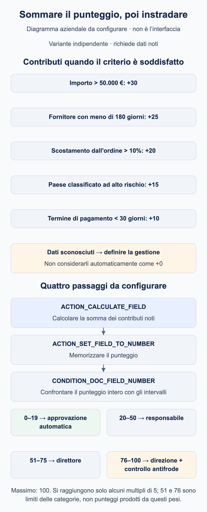<figcaption><p>Variante indipendente: cinque contributi noti producono un punteggio intero da 0 a 100 e poi un percorso. I limiti 51 e 76 definiscono categorie; questi cinque pesi non producono tali punteggi. Definire separatamente la gestione dei dati sconosciuti.</p></figcaption></figure>

<details>
<summary>Calcolo del punteggio di rischio e intervalli</summary>

```
Calcolo del punteggio di rischio:
  Score = 0

  IF Amount > €50,000: Score += 30
  IF Supplier_Age < 180 giorni: Score += 25
  IF PO_Variance > 10%: Score += 20
  IF Supplier_Country = "High Risk Country": Score += 15
  IF Payment_Terms < 30 giorni: Score += 10

  Intervallo totale di Score: 0-100

Instradamento:
  IF Score < 20: Approvare automaticamente
  IF Score 20-50: Approvazione del responsabile
  IF Score 51-75: Approvazione del direttore
  IF Score > 75: Approvazione della direzione + controllo antifrode
```

</details>

**Implementazione:**

Spiegazione visiva: [punteggio di rischio](#diagramma-punteggio-di-rischio).

<details>
<summary>Implementazione illustrativa del punteggio</summary>

```
1. ACTION_CALCULATE_FIELD: Calcolare il punteggio di rischio
2. ACTION_SET_FIELD_TO_NUMBER: Memorizzare il punteggio
3. CONDITION_DOC_FIELD_NUMBER: Verificare le soglie del punteggio
4. Instradare in base al punteggio
```

</details>

***

### Pattern 2: Matrice basata sul reparto

**Regole di approvazione diverse per reparto:**

#### Diagramma: Matrice dei reparti

<figure>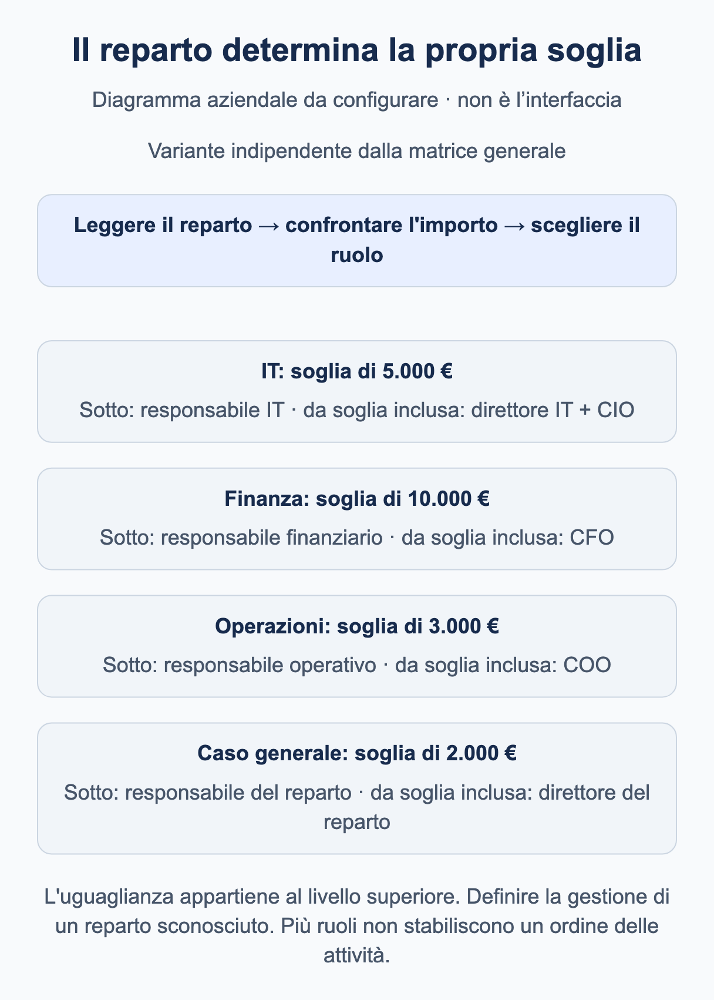<figcaption><p>Matrice dei reparti indipendente: le soglie differiscono per IT, finanza, operazioni e caso generale. L&#x27;uguaglianza seleziona la fascia superiore. Configurare i ruoli; la loro presenza non dimostra un&#x27;approvazione sequenziale.</p></figcaption></figure>

<details>
<summary>Matrice delle soglie per reparto</summary>

```
Matrice dei reparti:

  Reparto IT:
    Amount < €5,000: Responsabile IT
    Amount ≥ €5,000: Direttore IT + CIO

  Reparto finanza:
    Amount < €10,000: Responsabile finanziario
    Amount ≥ €10,000: CFO

  Reparto operazioni:
    Amount < €3,000: Responsabile operativo
    Amount ≥ €3,000: COO

  Caso generale:
    Amount < €2,000: Responsabile del reparto
    Amount ≥ €2,000: Direttore del reparto
```

</details>

**Implementazione:**

Spiegazione visiva: [matrice dei reparti](#diagramma-matrice-dei-reparti).

<details>
<summary>Implementazione illustrativa della matrice dei reparti</summary>

```
1. Verificare il campo Department
2. In base al reparto, verificare la soglia di importo
3. Instradare all'approvatore appropriato
4. Soglie diverse per reparto
```

</details>

***

### Pattern 3: Logica basata sul tempo

**Regole diverse in base alla tempistica:**

#### Diagramma: Varianti temporali

<figure>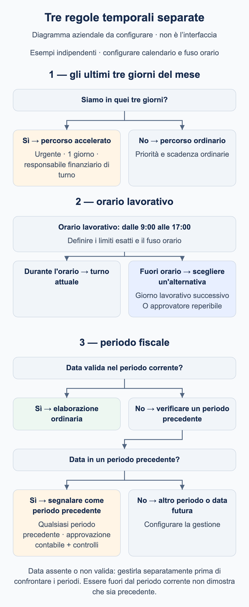<figcaption><p>Tre varianti indipendenti: fine mese, orario lavorativo e periodo fiscale. Coda e approvazione del reperibile sono alternative tra cui scegliere. Una data fuori dal periodo corrente non è necessariamente precedente; verificarne il caso separatamente.</p></figcaption></figure>

<details>
<summary>Tre varianti temporali indipendenti</summary>

```
Elaborazione di fine mese (ultimi 3 giorni del mese):
  IF Today negli ultimi 3 giorni del mese:
    - Priority: URGENT
    - Deadline: 1 giorno
    - Approvatore: responsabile finanziario di turno
    - Workflow accelerato
  ELSE:
    - Priorità ordinaria
    - Scadenza ordinaria
    - Workflow ordinario

Orario lavorativo e fuori orario:
  IF Time tra le 9:00 e le 17:00:
    - Assegnare al turno attuale
  ELSE:
    - Accodare per il giorno lavorativo successivo
    - OR instradare all'approvatore reperibile

Periodo fiscale (politica illustrativa indipendente):
  IF Document_Date assente o non valida:
    - Gestire la data non valida o sconosciuta secondo configurazione
  ELSE IF Document_Date in Current_Fiscal_Period:
    - Elaborazione ordinaria
  ELSE IF Document_Date in qualsiasi Fiscal_Period precedente a Current_Fiscal_Period:
    - Segnalare come "Prior Period"
    - Richiedere l'approvazione contabile
    - Controlli aggiuntivi
  ELSE:
    - Periodo fiscale futuro o diverso: gestire secondo configurazione
```

</details>

***

### Pattern 4: Instradamento basato sulle eccezioni

**Instrada le eccezioni separatamente:**

#### Diagramma: Gravità delle eccezioni

<figure>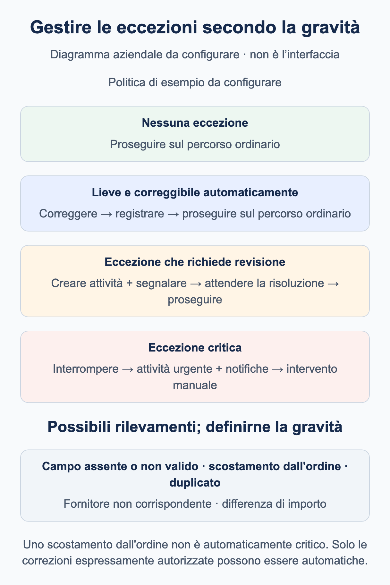<figcaption><p>Politica di gravità di esempio: proseguire solo dopo la correzione configurata o la risoluzione prevista. Un&#x27;eccezione critica interrompe l&#x27;elaborazione. I soli esempi di rilevamento non determinano la gravità.</p></figcaption></figure>

<details>
<summary>Politica di gravità delle eccezioni</summary>

```
Rilevamento delle eccezioni:

  Nessuna eccezione:
    → Workflow ordinario

  Eccezione lieve (correggibile automaticamente):
    → Correggere automaticamente
    → Registrare la correzione
    → Proseguire nel workflow ordinario

  Eccezione media (richiede revisione):
    → Creare un'attività di revisione
    → Segnalare il documento
    → Dopo la correzione: proseguire nel workflow

  Eccezione grave (richiede escalation):
    → Interrompere l'elaborazione
    → Creare un'attività urgente
    → Avvisare più livelli
    → Richiesto intervento manuale

Tipi di eccezione:
  - Campo obbligatorio assente
  - Valore del campo non valido
  - Scostamento dall'ordine
  - Fattura duplicata
  - Fornitore non corrispondente
  - Differenza di importo
```

</details>

***

## Diagramma completo della logica decisionale

I diagrammi presentano i passaggi essenziali. L'albero testuale dettagliato sotto conserva l'esempio tecnico; le destinazioni richiedono comunque configurazione.


Spiegazione visiva: [panoramica](#diagramma-panoramica), [fasce di importo](#diagramma-fasce-di-importo), [analisi del fornitore](#diagramma-analisi-del-fornitore), [approvazioni successive](#diagramma-approvazioni-successive), [percorso automatico](#diagramma-percorso-automatico), [attività del responsabile](#diagramma-attivita-del-responsabile), [approvazione della direzione](#diagramma-approvazione-della-direzione).

<details>
<summary>Esempio completo: albero testuale dettagliato</summary>

```
ARRIVO DELLA FATTURA
│
├─ LIVELLO 1: CONTROLLO DELLE ECCEZIONI
│  │
│  ├─ Eccezione critica o fornitore BLOCKED?
│  │  (Configurare la criticità; non ogni scostamento dall'ordine è critico.)
│  │  │
│  │  ├─ SÌ → interrompere e inoltrare al livello superiore
│  │  │        Creare un'attività urgente
│  │  │        Avvisare l'amministratore
│  │  │        → FINE (gestione dell'eccezione)
│  │  │
│  │  └─ NO → proseguire al livello 2
│
├─ LIVELLO 2: TIPO DI DOCUMENTO
│  │
│  ├─ Type = Invoice?
│  │  └─ SÌ → proseguire al livello 3
│  │
│  ├─ Type = Credit Note?
│  │  └─ SÌ → instradare al workflow delle note di credito
│  │           → FINE (percorso delle note di credito)
│  │
│  └─ Altro tipo?
│     └─ SÌ → instradare al workflow appropriato
│              → FINE (percorso degli altri tipi)
│
├─ LIVELLO 3: CONTROLLO DELL'URGENZA (per le fatture)
│  │
│  ├─ Flag di urgenza = TRUE?
│  │  │
│  │  ├─ SÌ → workflow accelerato
│  │  │        Priority: URGENT
│  │  │        Deadline: 1 giorno
│  │  │        Assegnare a: approvatore di livello superiore
│  │  │        → FINE (percorso accelerato)
│  │  │
│  │  └─ NO → proseguire al livello 4
│
├─ LIVELLO 4: SOGLIE DI IMPORTO
│  │
│  ├─ Amount assente o non valido?
│  │  ├─ SÌ → revisione manuale (politica esplicita di esempio)
│  │  └─ NO → proseguire alle soglie di importo sotto
│  │
│  ├─ Amount < €1,000?
│  │  │
│  │  ├─ SÌ → PERCORSO DI APPROVAZIONE AUTOMATICA
│  │  │        Impostare Approval_Type = "AUTO"
│  │  │        Approvare immediatamente
│  │  │        Esportare nell'ERP
│  │  │        → FINE (approvato automaticamente)
│  │  │
│  │  └─ NO → proseguire
│  │
│  ├─ Amount < €10,000?
│  │  │
│  │  ├─ SÌ → PERCORSO DI APPROVAZIONE DEL RESPONSABILE
│  │  │        Creare l'attività del responsabile
│  │  │        Priority: Medium
│  │  │        Deadline: 3 giorni
│  │  │        → ATTENDERE il risultato; in attesa non proseguire
│  │  │           → Approvato: proseguire con l'elaborazione configurata
│  │  │           → Rifiutato: interrompere la catena e gestire il rifiuto secondo configurazione
│  │  │
│  │  └─ NO → proseguire
│  │
│  ├─ Amount < €50,000?
│  │  │
│  │  ├─ SÌ → PERCORSO DI APPROVAZIONE DEL DIRETTORE
│  │  │        Proseguire al livello 5 (controllo del fornitore)
│  │  │
│  │  └─ NO → proseguire
│  │
│  └─ Amount ≥ €50,000?
│     │
│     └─ SÌ → PERCORSO DI APPROVAZIONE DELLA DIREZIONE
│              Creare attività successive:
│              - Direttore finanziario
│              - CFO
│              - CEO (se > €100,000)
│              Priority: URGENT
│              Deadline: 1 giorno ciascuna
│              → ATTENDERE tutti i risultati richiesti
│                 → Tutti approvati: proseguire con l'elaborazione configurata
│                 → In attesa: non proseguire
│                 → Qualsiasi rifiuto: interrompere la catena e gestire il rifiuto secondo configurazione
│
├─ LIVELLO 5: ANALISI DEL FORNITORE (€10,000 ≤ Amount < €50,000)
│  │
│  ├─ Supplier Status = "BLOCKED"?
│  │  │
│  │  ├─ SÌ → BLOCCARE E INOLTRARE AL LIVELLO SUPERIORE
│  │  │        Interrompere l'elaborazione
│  │  │        Creare un'attività urgente
│  │  │        Avvisare acquisti e finanza
│  │  │        → FINE (fornitore bloccato)
│  │  │
│  │  └─ NO → proseguire
│  │
│  ├─ Supplier Age < 180 giorni (nuovo)?
│  │  │
│  │  ├─ SÌ → RICHIESTA DOPPIA APPROVAZIONE
│  │  │        Attività 1: direttore (2 giorni)
│  │  │        → ATTENDERE l'attività 1
│  │  │           IF attività 1 approvata:
│  │  │             Attività 2: CFO (2 giorni)
│  │  │             → ATTENDERE l'attività 2
│  │  │                → In attesa: non proseguire
│  │  │                → Approvato: proseguire solo dopo entrambe le approvazioni positive
│  │  │                → Rifiutato: interrompere la catena e gestire il rifiuto secondo configurazione
│  │  │           IF attività 1 rifiutata:
│  │  │             → Interrompere la catena e gestire il rifiuto secondo configurazione
│  │  │           IF attività 1 in attesa:
│  │  │             → Non creare l'attività 2 né proseguire
│  │  │
│  │  └─ NO → proseguire
│  │
│  ├─ Supplier Risk Rating = "HIGH"?
│  │  │
│  │  ├─ SÌ → APPROVAZIONE RAFFORZATA
│  │  │        Controlli antifrode aggiuntivi
│  │  │        Preapprovazione del responsabile, poi approvazione del direttore
│  │  │        Attendere ogni risultato positivo; in attesa o rifiutato non proseguire
│  │  │        Configurare le scadenze dei controlli del rischio; le attività di approvazione del percorso C indicano 2 giorni
│  │  │        → FINE (percorso rafforzato)
│  │  │
│  │  └─ NO → APPROVAZIONE ORDINARIA DEL DIRETTORE
│  │           Creare l'attività del direttore
│  │           Priority: High
│  │           Deadline: 2 giorni
│  │           → ATTENDERE il risultato; in attesa non proseguire
│  │              → Approvato: proseguire con l'elaborazione configurata
│  │              → Rifiutato: interrompere la catena e gestire il rifiuto secondo configurazione
│  │
│  └─ [Analisi del fornitore completata]
│
└─ [Tutti i livelli decisionali elaborati]
```

</details>


***

## Best practice di configurazione

### 1. Mantieni la logica chiara e manutenibile

Il confronto seguente presenta una condizione semplice, una condizione densa e una politica diversa suddivisa in passaggi. Il diagramma ne distingue gli scopi senza affermarne l'equivalenza.

#### Diagramma: Decisioni leggibili

<figure>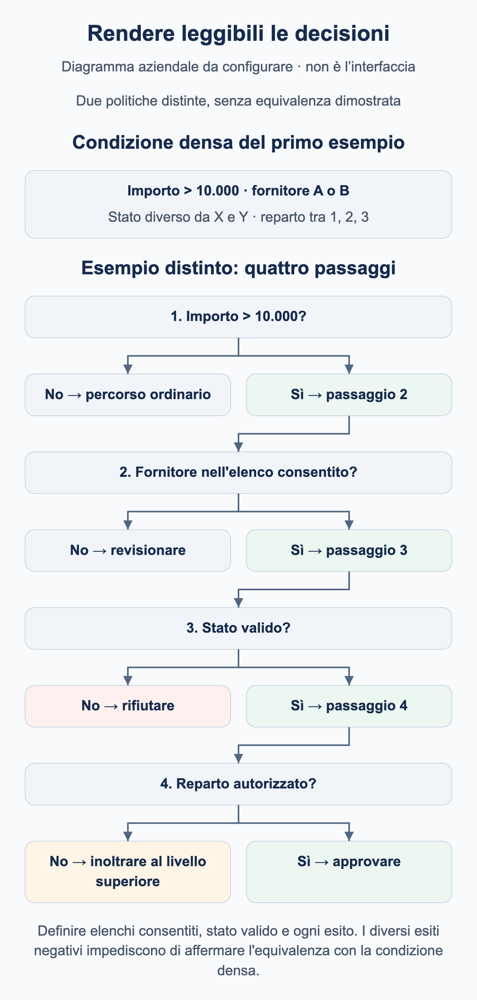<figcaption><p>L&#x27;esempio in quattro passaggi illustra una politica diversa dalla condizione densa. Rende visibile ogni esito negativo; non è una trasformazione logica di equivalenza dimostrata. Definire elenchi consentiti e gestione delle uscite.</p></figcaption></figure>

✅ **Buono:**

Spiegazione visiva: [condizione semplice](#diagramma-condizione-semplice).

<details>
<summary>Esempio semplice: percorso per importi elevati</summary>

```
IF Amount > 10000:
  → Percorso per importi elevati
ELSE:
  → Percorso ordinario
```

</details>

❌ **Cattivo (troppo complesso):**

Spiegazione visiva: [decisioni leggibili](#diagramma-decisioni-leggibili).

<details>
<summary>Esempio di condizione densa</summary>

```
IF (Amount > 10000 AND (Supplier = "A" OR Supplier = "B") AND NOT (Status = "X" OR Status = "Y") AND Department IN [1,2,3]):
  → Percorso complesso
```

</details>

**Altro esempio: una politica distinta in quattro passaggi:**

Questo esempio distingue gli esiti di ogni passaggio. Non è una riscrittura logicamente equivalente della condizione densa sopra: elenchi dei fornitori, stati validi, reparti consentiti e gestione degli esiti negativi vanno definiti per questo secondo esempio.

Spiegazione visiva: [decisioni leggibili](#diagramma-decisioni-leggibili).

<details>
<summary>Altro esempio: politica in quattro passaggi</summary>

```
Passaggio 1: IF Amount > 10000: Proseguire, ELSE: Percorso ordinario
Passaggio 2: IF Supplier nell'elenco consentito: Proseguire, ELSE: Revisionare
Passaggio 3: IF Status valido: Proseguire, ELSE: Rifiutare
Passaggio 4: IF Department autorizzato: Approvare, ELSE: Inoltrare al livello superiore
```

</details>

***

### 2. Documenta la logica decisionale

**Includi sempre:**

* Lo scopo di ogni punto decisionale
* La regola aziendale implementata
* Gli esiti attesi
* La gestione delle eccezioni

**Esempio di documentazione:**

#### Diagramma: Registro della regola

<figure>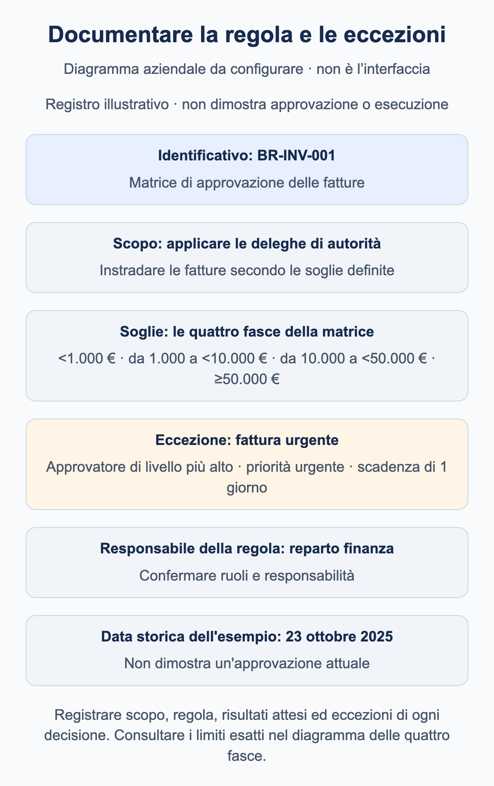<figcaption><p>Registro illustrativo BR-INV-001: scopo, soglie, eccezione, responsabile e data di riferimento. Rimandare alle quattro fasce evita di duplicare la regola; questo registro non dimostra approvazione o esecuzione.</p></figcaption></figure>

<details>
<summary>Registro illustrativo della regola BR-INV-001</summary>

```
Punto decisionale: verifica della soglia di importo
Regola aziendale: BR-INV-001 (matrice di approvazione delle fatture)
Scopo: instradare le fatture in base alle soglie di importo secondo la politica aziendale
Soglie:
  < €1,000: Approvare automaticamente (soglia approvata dal CFO nell'esempio)
  €1,000 ≤ Amount < €10,000: Approvazione del responsabile (matrice delle deleghe)
  €10,000 ≤ Amount < €50,000: Approvazione del direttore con controlli sul fornitore
  Amount ≥ €50,000: Approvazione della direzione
Eccezioni: le fatture urgenti passano al livello più alto
Aggiornato: 2025-10-23
Responsabile: reparto finanza
```

</details>

***

### 3. Testa tutti i percorsi

**Matrice di prova proposta — risultati attesi, non prove eseguite:**

Verificare questi risultati attesi nella propria configurazione e registrare quanto osservato.

| Caso | Importo | Tipo | Fornitore | Percorso atteso | Verifica |
| --- | --- | --- | --- | --- | --- |
| TC1 | 500 € | Invoice | Esistente | Approvazione automatica | Da provare |
| TC2 | 5.000 € | Invoice | Esistente | Responsabile | Da provare |
| TC3 | 15.000 € | Invoice | Nuovo | Direttore, poi CFO | Da provare |
| TC4 | 60.000 € | Invoice | Esistente | Direzione | Da provare |
| TC5 | 2.000 € | Credit Note | Esistente | Workflow note di credito | Da provare |
| TC6 | 100.000 € | Invoice | Bloccato | Interrompere e inoltrare al livello superiore | Da provare |
| TC7 | 999,99 € | Invoice | Esistente | Approvazione automatica | Da provare |
| TC8 | 1.000 € | Invoice | Esistente | Responsabile | Da provare |
| TC9 | 9.999,99 € | Invoice | Esistente | Responsabile | Da provare |
| TC10 | 10.000 € | Invoice | Esistente | Direttore + controlli sul fornitore | Da provare |
| TC11 | 49.999,99 € | Invoice | Esistente | Direttore + controlli sul fornitore | Da provare |
| TC12 | 50.000 € | Invoice | Esistente | Direzione | Da provare |
| TC13 | Assente o non valido | Invoice | Esistente | Revisione manuale scelta per questo esempio | Da provare |
| TC14 | 15.000 € | Invoice | Nuovo | Direttore in attesa: non creare l'attività successiva | Da provare |
| TC15 | 15.000 € | Invoice | Nuovo | Direttore o CFO rifiutato: interrompere la catena e gestire il rifiuto | Da provare |
| TC16 | 15.000 € | Invoice | Nuovo | Entrambe le approvazioni positive: proseguire con l'elaborazione configurata | Da provare |

***

### 4. Monitora le metriche decisionali

**Monitora:**

* Distribuzione tra i percorsi decisionali
* Tasso di approvazione automatica
* Tasso di revisione manuale
* Tempo medio di elaborazione per percorso
* Tassi di eccezione
* Utilizzo dei percorsi

**Metriche di esempio fittizie:** questi valori illustrano un report; non dimostrano prestazioni attuali o l'esecuzione di questo workflow.

#### Diagramma: Metriche fittizie

<figure>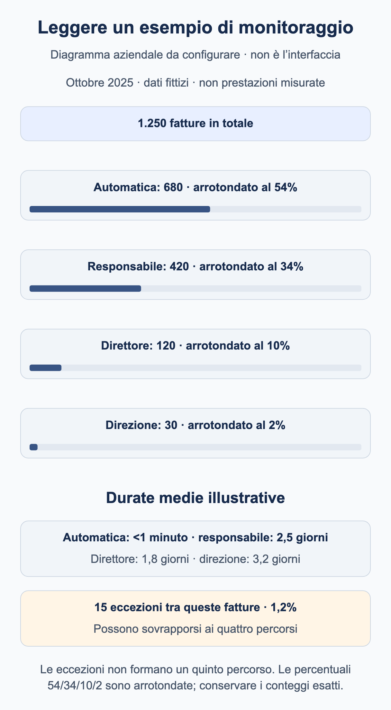<figcaption><p>Esempio fittizio: i quattro percorsi totalizzano 1.250 fatture. Le percentuali sono arrotondate. Le 15 eccezioni, pari all&#x27;1,2%, possono riguardare le stesse fatture; non formano un quinto percorso. Le durate non sono prestazioni misurate di DocBits.</p></figcaption></figure>

<details>
<summary>Esempio fittizio di distribuzione e durate</summary>

```
Mese: ottobre 2025
Totale fatture: 1250

Distribuzione dei percorsi decisionali:
- Approvate automaticamente (< €1k): 680 (54%)
- Percorso del responsabile (€1k ≤ Amount < €10k): 420 (34%)
- Percorso del direttore (€10k ≤ Amount < €50k): 120 (10%)
- Percorso della direzione (Amount ≥ €50k): 30 (2%)

Tempo di elaborazione:
- Approvare automaticamente: < 1 minuto
- Percorso del responsabile: 2,5 giorni di media
- Percorso del direttore: 1,8 giorni di media
- Percorso della direzione: 3,2 giorni di media

Eccezioni: 15 (1,2%)
```

</details>

***

## Pattern correlati

### Pattern che funzionano bene insieme:

* [**Modello di gestione delle attività**](task-management-pattern.md) - Crea task in base alle decisioni
* [**Modello di integrazione API**](api-integration-pattern.md) - Recupera dati per il processo decisionale
* [**Modello di corrispondenza PO**](po-matching-pattern.md) - Usa i risultati del PO nelle decisioni
* [**Modello di trasformazione dei dati**](data-transformation-pattern.md) - Trasforma i dati prima delle decisioni

***

## Guide correlate

### Prerequisiti

* [Guida completa alle schede di condizione](../and/condition-cards-complete-guide.md) - Tutte le card di condizione
* [Guida alla manipolazione del campo](../then/document-field/field-manipulation-guide.md) - Operazioni sui campi
* [Guida all’assegnazione](../then/assignee/assignment-user-guide.md) - Logica di instradamento

### Card correlate

* **CONDITION\_DOC\_FIELD\_AMOUNT** - [Guida alle carte condizione](../and/condition-cards-complete-guide.md)
* **CONDITION\_DOC\_TYPE\_IS\_ISNOT** - [Guida alle carte condizione](../and/condition-cards-complete-guide.md)
* **CONDITION\_SUPPLIER\_STATUS\_IS\_ISNOT** - [Guida alle carte condizione](../and/condition-cards-complete-guide.md)
* **ACTION\_ASSIGN\_TO\_USER** - [Guida all'assegnazione](../then/assignee/assignment-user-guide.md)
* **tasks\_create** - [Guida all'assegnazione delle attività](../then/task/task-assignment-guide.md)

### Prossimi passi

* Attività Crea: [Modello di gestione attività](task-management-pattern.md)
* Aggiungi matching complesso: [Modello di corrispondenza con gli ordini](po-matching-pattern.md)
* Integra le API: [Modello di integrazione API](api-integration-pattern.md)

***

**Metadati storici dell'esempio:**

**Versione del modello:** 1.0 **Ultimo aggiornamento:** 23 ottobre 2025 **Difficoltà:** media **Tempo stimato:** 30–45 minuti

[Esempi reali di workflow nella pratica](production-workflow-examples.md)
