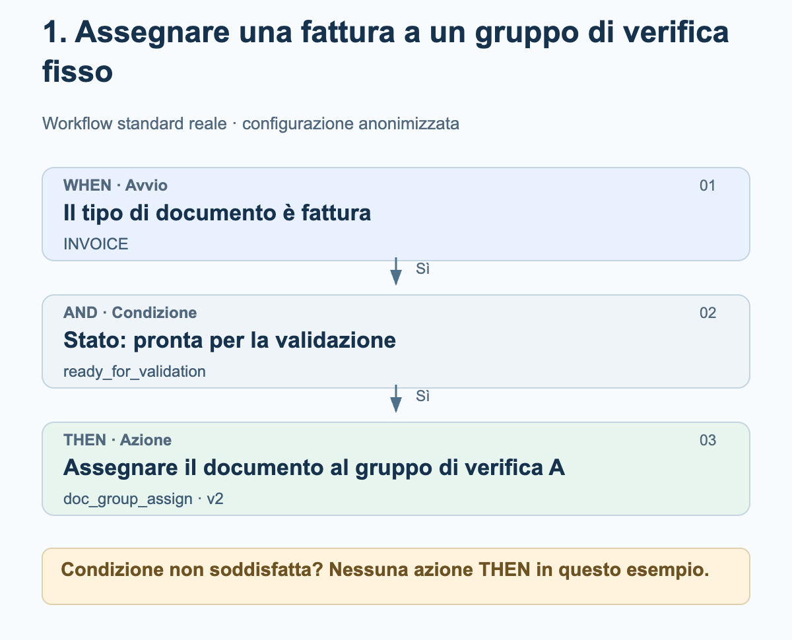
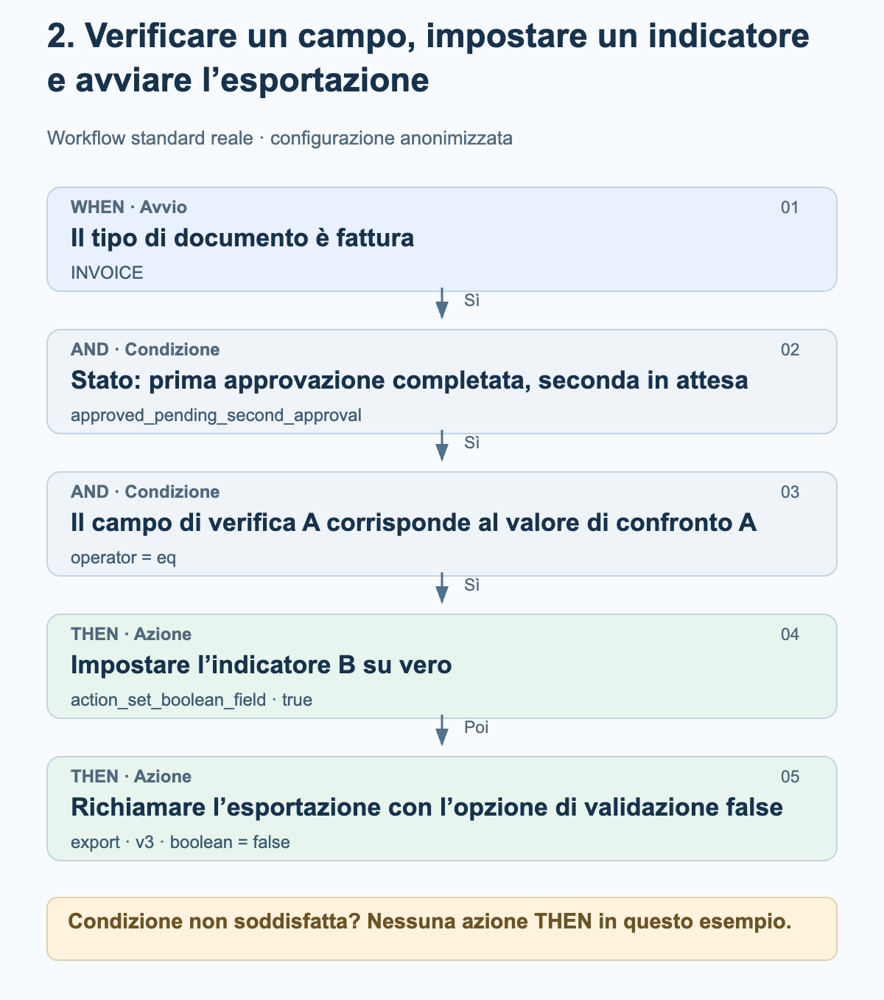
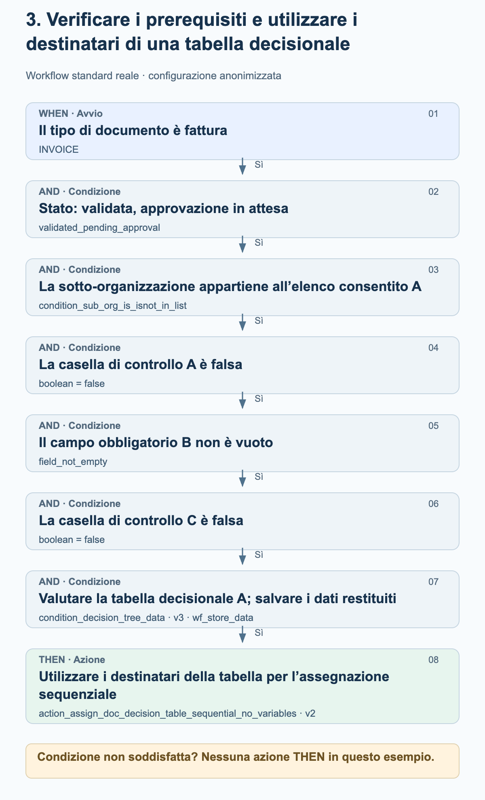

# Esempi reali di workflow nella pratica

Questi tre esempi provengono da workflow standard attivati nell’ambiente di produzione. Mostrano la sequenza effettivamente configurata di WHEN, AND e THEN. Gruppi, organizzazioni, nomi dei campi, valori di confronto e tabelle decisionali sono stati sostituiti con denominazioni neutre. I diagrammi spiegano la configurazione; non sono schermate dell’interfaccia.

Aggiornamento: 27 ottobre 2026. Le schede utilizzate, le versioni, i parametri e la loro sequenza sono stati confrontati con le configurazioni salvate di esecuzioni di produzione riuscite. Un registro del workflow con risultato success non conferma né un’approvazione umana né la ricezione nell’ERP. Nessun workflow è stato modificato o eseguito a scopo di test.

## Come leggere i diagrammi

Gli esempi utilizzano la modalità standard. WHEN limita il tipo di documento; tutte le condizioni AND devono essere soddisfatte prima che seguano le azioni THEN. In questi esempi, una condizione non soddisfatta non comporta alcuna azione THEN. Le frecce tra le azioni indicano la sequenza configurata. Non rappresentano un ulteriore passaggio di verifica del successo o di approvazione. Un’esecuzione può anche terminare con un errore.

## 1. Assegnare una fattura a un gruppo di verifica fisso

Una fattura deve essere inviata per la verifica a un gruppo configurato in modo fisso non appena raggiunge lo stato «pronta per la validazione». Questo esempio non richiede una tabella decisionale.

<figure><figcaption>Fattura e stato corrispondente: il documento viene assegnato al gruppo di verifica A configurato in modo fisso. L’assegnazione non costituisce ancora un’approvazione.</figcaption></figure>

Schede e impostazioni

| Fase / Scheda | Impostazione nell’esempio | Significato |
| --- | --- | --- |
| WHEN · condition_doc_type_is_isnot_list · v2 | operator = is; doc_type = INVOICE | Solo le fatture soddisfano questa condizione. |
| AND · condition_doc_status_is_isnot · v2 | operator = is; status = ready_for_validation | Il documento è pronto per la validazione. |
| THEN · doc_group_assign · v2 | groups = Gruppo di verifica A | La versione 2 utilizza il gruppo configurato. L’opzione relativa alla tabella decisionale non è determinante in questa versione della scheda. |

### Verifiche prima di riprodurre l’esempio

- Gruppo di verifica A è una denominazione anonimizzata. Scegli un gruppo della tua organizzazione e verificane la competenza.
- Verifica separatamente tipo di documento e stato: una fattura in un altro stato non soddisfa questo esempio.
- Assegnazione del documento, attività e approvazione sono operazioni distinte. Questa configurazione contiene soltanto l’assegnazione.

## 2. Verificare un campo, impostare un indicatore e avviare l’esportazione

Una fattura in uno specifico stato di approvazione viene elaborata ulteriormente solo se il suo campo di verifica A corrisponde esattamente al valore di confronto A. Il workflow tenta quindi di impostare l’indicatore B su vero e successivamente richiama l’esportazione. I nomi originali dei campi e il valore di confronto sono anonimizzati.

<figure><figcaption>La verifica del campo abilita le due azioni. Prima viene richiamata l’impostazione dell’indicatore; segue poi la chiamata di esportazione. Lo stato e i controlli di validazione disattivati fanno parte di questa specifica configurazione.</figcaption></figure>

Schede e impostazioni

| Fase / Scheda | Impostazione nell’esempio | Significato |
| --- | --- | --- |
| WHEN · condition_doc_type_is_isnot_list · v2 | operator = is; doc_type = INVOICE | Solo le fatture soddisfano questa condizione. |
| AND · condition_doc_status_is_isnot · v2 | operator = is; status = approved_pending_second_approval | Lo stato configurato significa «prima approvazione completata, seconda approvazione in attesa». Qui non viene sostituito con uno stato di approvazione più generico. |
| AND · condition_docfield_operator_value · v2 | field_name = Campo di verifica A; operator = eq; field_value = Valore di confronto A | Il contenuto del campo deve corrispondere al valore configurato; la condizione non verifica semplicemente che il campo sia compilato. |
| THEN 1 · action_set_boolean_field · v2 | field_name = Indicatore B; boolean = true | Tenta di impostare su vero il campo booleano configurato. |
| THEN 2 · export · v3 | boolean = false | Avvia l’esportazione con ignore_field_validation_errors = true e validate_po_match = false. In questo caso false disattiva i controlli di validazione, non l’esportazione. |

### Verifiche prima di riprodurre l’esempio

- L’opzione di esportazione false è un’impostazione specifica di un cliente e non una raccomandazione generale. Prima di riprodurre l’esempio, verifica in particolare la validazione dei campi, la corrispondenza con gli ordini di acquisto e i requisiti di approvazione.
- Tra l’impostazione dell’indicatore e l’esportazione non è configurata alcuna ulteriore condizione. La sola sequenza non garantisce che la prima azione sia riuscita; le eccezioni e gli errori delle azioni devono essere verificati separatamente.
- Il workflow non contiene un passaggio di attesa di una seconda approvazione umana. Un’esecuzione riuscita del workflow non sostituisce una prova della ricezione nell’ERP.

## 3. Verificare i prerequisiti e utilizzare i destinatari di una tabella decisionale

Una fattura deve essere assegnata tramite una tabella decisionale solo quando organizzazione, stato, due caselle di controllo e un campo obbligatorio soddisfano i requisiti. Il workflow salva i dati restituiti dalla tabella decisionale affinché la successiva assegnazione sequenziale possa utilizzarli.

<figure><figcaption>Tutte e sei le condizioni AND devono essere soddisfatte. I dati restituiti dalla tabella decisionale vengono salvati e quindi utilizzati per l’assegnazione sequenziale del documento. Il diagramma non inventa destinatari o livelli di approvazione.</figcaption></figure>

Schede e impostazioni

| Fase / Scheda | Impostazione nell’esempio | Significato |
| --- | --- | --- |
| WHEN · condition_doc_type_is_isnot_list · v2 | operator = is; doc_type = INVOICE | Limita l’esempio alle fatture. |
| AND 1 · condition_doc_status_is_isnot · v2 | operator = is; status = validated_pending_approval | Il documento è validato e un’approvazione è in attesa. |
| AND 2 · condition_sub_org_is_isnot_in_list · v2 | operator = is; sub_org_id = Elenco consentito A | Solo le sotto-organizzazioni configurate rientrano nell’ambito di applicazione. |
| AND 3 · condition_checkbox_is · v2 | field_name = Casella di controllo A; boolean = false | La prima casella di controllo configurata deve essere falsa. |
| AND 4 · condition_docfield_status · v2 | field_name = Campo obbligatorio B; field_status = field_not_empty | Il campo configurato deve essere compilato. |
| AND 5 · condition_checkbox_is · v2 | field_name = Casella di controllo C; boolean = false | Anche la seconda casella di controllo deve essere falsa. |
| AND 6 · condition_decision_tree_data · v3 | decision_table = Tabella decisionale A; store_data = wf_store_data | La tabella viene valutata per il documento. I dati restituiti vengono salvati per le schede successive. Il campo boolean aggiuntivo della versione precedente è vuoto e non controlla questa versione. |
| THEN · action_assign_doc_decision_table_sequential_no_variables · v2 | nessuna variabile propria della scheda | Utilizza i destinatari dei dati restituiti dalla tabella e salvati per l’assegnazione sequenziale. Destinatari e priorità dipendono dalla tabella. |

### Verifiche prima di riprodurre l’esempio

- Casella di controllo A, Campo obbligatorio B e Casella di controllo C indicano tre diversi campi configurati. Le denominazioni neutre sostituiscono i nomi originali.
- La verifica che un campo non sia vuoto non conferma ancora la correttezza funzionale del suo contenuto.
- Verifica la tabella decisionale effettiva, inclusi destinatari e priorità. Le sue regole non sono pubblicate qui; non vengono inventate soglie di importo o ruoli.
- Una valutazione riuscita della tabella non garantisce ancora destinatari utilizzabili. La successiva assegnazione richiede risultati validi relativi a utenti o gruppi.
- Un’assegnazione sequenziale non dimostra che un’approvazione umana sia stata completata. Questo workflow non contiene alcuna chiamata di esportazione.

## Dall’esempio alla propria configurazione

Definisci i campi, i gruppi e le tabelle decisionali appropriati nella tua organizzazione. Non considerare le denominazioni neutre come campi già presenti nel prodotto. Verifica ogni caso positivo e negativo delle condizioni, oltre agli errori delle azioni, in un ambiente di test adeguato. Verifica approvazioni ed esportazioni in base ai loro risultati effettivi; attiva un workflow solo dopo la validazione funzionale.
