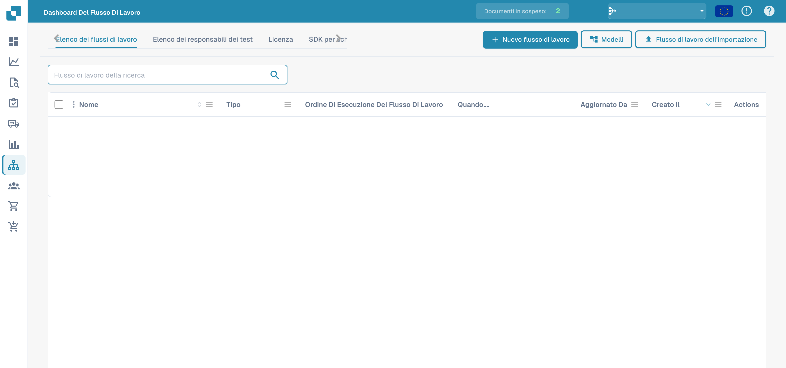
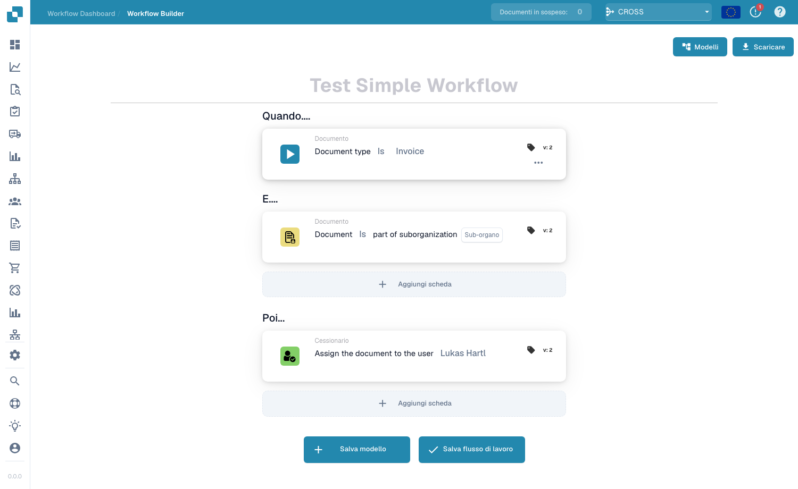
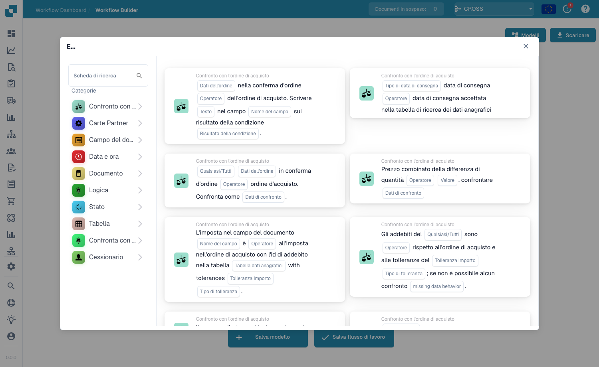

# Flusso standard

Il builder **Flusso standard** è l'editor lineare basato su schede per automatizzare l'elaborazione dei documenti. Un workflow è composto da tre gruppi di schede — **Quando** (il trigger), **E** (condizioni aggiuntive) e **Allora** (le azioni da eseguire). Quando un documento soddisfa le condizioni When/And, le azioni Then vengono eseguite automaticamente.

## Creare e testare uno Standard Workflow 

Crea uno Standard Workflow completo nella vera interfaccia DocBits: seleziona la fattura, verifica il numero e un importo superiore a 1000, assegna un revisore e modifica lo stato. Salva la regola, esegui tre scenari di test e verifica il risultato effettivo sul documento.



[Guarda con i sottotitoli](https://docbits-videos.fra1.cdn.digitaloceanspaces.com/settings-assistant/standard-workflow-admin/v2/it.html) · [Apri il video](https://docbits-videos.fra1.cdn.digitaloceanspaces.com/settings-assistant/standard-workflow-admin/v2/it.mp4) · [Sottotitoli (WebVTT)](https://docbits-videos.fra1.cdn.digitaloceanspaces.com/settings-assistant/standard-workflow-admin/v2/it.vtt) · [Trascrizione](https://docbits-videos.fra1.cdn.digitaloceanspaces.com/settings-assistant/standard-workflow-admin/v2/it.txt) · 4:05

Capitoli e trascrizione

| Capitolo | Inizio |
| --- | --- |
| Cosa fa questo workflow | [0:00](https://docbits-videos.fra1.cdn.digitaloceanspaces.com/settings-assistant/standard-workflow-admin/v2/it.mp4#t=0.000) |
| Assegnare un nome al workflow | [0:15](https://docbits-videos.fra1.cdn.digitaloceanspaces.com/settings-assistant/standard-workflow-admin/v2/it.mp4#t=15.333) |
| When: tipo di documento | [0:26](https://docbits-videos.fra1.cdn.digitaloceanspaces.com/settings-assistant/standard-workflow-admin/v2/it.mp4#t=26.750) |
| And: numero di fattura | [0:39](https://docbits-videos.fra1.cdn.digitaloceanspaces.com/settings-assistant/standard-workflow-admin/v2/it.mp4#t=39.792) |
| And: importo superiore a 1000 | [0:55](https://docbits-videos.fra1.cdn.digitaloceanspaces.com/settings-assistant/standard-workflow-admin/v2/it.mp4#t=55.000) |
| Then: assegnare un revisore | [1:10](https://docbits-videos.fra1.cdn.digitaloceanspaces.com/settings-assistant/standard-workflow-admin/v2/it.mp4#t=70.417) |
| Then: modificare lo stato | [1:25](https://docbits-videos.fra1.cdn.digitaloceanspaces.com/settings-assistant/standard-workflow-admin/v2/it.mp4#t=85.708) |
| Verificare e salvare | [1:38](https://docbits-videos.fra1.cdn.digitaloceanspaces.com/settings-assistant/standard-workflow-admin/v2/it.mp4#t=98.542) |
| Controllare la regola salvata | [1:55](https://docbits-videos.fra1.cdn.digitaloceanspaces.com/settings-assistant/standard-workflow-admin/v2/it.mp4#t=115.458) |
| Preparare lo scenario di test | [2:08](https://docbits-videos.fra1.cdn.digitaloceanspaces.com/settings-assistant/standard-workflow-admin/v2/it.mp4#t=128.333) |
| Eseguire il caso positivo | [2:30](https://docbits-videos.fra1.cdn.digitaloceanspaces.com/settings-assistant/standard-workflow-admin/v2/it.mp4#t=150.958) |
| Testare il valore limite | [2:52](https://docbits-videos.fra1.cdn.digitaloceanspaces.com/settings-assistant/standard-workflow-admin/v2/it.mp4#t=172.375) |
| Testare un altro numero di fattura | [3:11](https://docbits-videos.fra1.cdn.digitaloceanspaces.com/settings-assistant/standard-workflow-admin/v2/it.mp4#t=191.708) |
| Verificare il risultato sul documento | [3:29](https://docbits-videos.fra1.cdn.digitaloceanspaces.com/settings-assistant/standard-workflow-admin/v2/it.mp4#t=209.500) |
| Attivare la regola testata | [3:49](https://docbits-videos.fra1.cdn.digitaloceanspaces.com/settings-assistant/standard-workflow-admin/v2/it.mp4#t=229.208) |

**Cosa fa questo workflow**

Allora, creo uno Standard Workflow completo per una fattura di formazione. Sopra mille deve essere assegnata a un revisore e attendere approvazione. Un numero di fattura dedicato limita l’esempio al documento previsto.

**Assegnare un nome al workflow**

Nell’elenco faccio clic su Nuovo workflow. Assegno un nome chiaro prima di aggiungere le schede. Questa organizzazione apre direttamente il designer Standard.

**When: tipo di documento**

In Quando apro la libreria e seleziono la scheda del tipo di documento. Imposto l’operatore È e scelgo Fattura. Così definisco il tipo di documento controllato dalla regola.

**And: numero di fattura**

In E aggiungo una condizione su un campo del documento. Scelgo invoice_id, imposto Uguale e inserisco il numero della fattura di formazione. Questa condizione limita la dimostrazione alla fattura prevista.

**And: importo superiore a 1000**

Un’altra condizione E controlla total_amount. Scelgo Maggiore di e inserisco mille. Esattamente mille non soddisfa questa condizione. Importo e valuta devono corrispondere al documento di formazione.

**Then: assegnare un revisore**

In Allora seleziono l’azione per assegnare il documento a un utente. Scelgo Docs User A2, il nostro revisore di test della documentazione. Questa azione assegna il documento senza creare una notifica via email.

**Then: modificare lo stato**

La seconda azione cambia lo stato in In attesa di approvazione. Imposto Attiva workflow su falso. Questo esempio non richiede un’altra esecuzione quando la propria azione cambia lo stato.

**Verificare e salvare**

Prima di salvare rileggo tutta la regola. Devono corrispondere Fattura, il numero esatto e un importo superiore a mille. Le due azioni vengono poi eseguite nell’ordine mostrato. Salvo il workflow e controllo la conferma.

**Controllare la regola salvata**

Nell’elenco controllo il workflow salvato e il suo stato di attivazione. Il salvataggio può già attivare un workflow. Disattivo questa regola di formazione mentre preparo i test.

**Preparare lo scenario di test**

In Test Manager aggiungo uno scenario e seleziono il workflow salvato. Inserisco un nome chiaro e carico i file JSON di ingresso e del risultato atteso. L’ingresso contiene il numero della fattura, l’importo mille settecentottantacinque e lo stato Pronto per la convalida. Lo stato atteso è In attesa di approvazione.

**Eseguire il caso positivo**

Invio lo scenario e scelgo Esegui test dal menu. Riapro l’elenco per caricare il risultato salvato. Il test superato confronta lo stato atteso del documento. In questo sandbox, il pannello delle schede non mostra in modo affidabile i singoli messaggi, quindi controllo anche il documento reale.

**Testare il valore limite**

Provo poi esattamente mille. Il numero e il tipo di documento corrispondono ancora, ma Maggiore di deve risultare falso. In questo ingresso di test, lo stato atteso resta Pronto per la convalida. Salvo ed eseguo lo scenario separato, poi controllo il risultato.

**Testare un altro numero di fattura**

Un altro scenario usa un numero di fattura diverso e un importo superiore a mille. Il solo importo non deve avviare le azioni. Salvo ed eseguo lo scenario con lo stato iniziale come risultato atteso. Questi casi negativi verificano i limiti della regola.

**Verificare il risultato sul documento**

Nella Dashboard trovo il documento di formazione. Lo stato reale è In attesa di approvazione ed è assegnato a Docs User A2. Questo conferma il risultato visibile di entrambe le azioni. La modifica deriva dal test manuale e non dimostra un’elaborazione automatica.

**Attivare la regola testata**

Nell’elenco attivo la regola testata e controllo che l’interruttore sia acceso. Prima della messa in servizio verifico condizioni, destinatari e risultati. Dopo la dimostrazione disattivo nuovamente la regola di formazione.

## Come accedere

Apri **Dashboard dei flussi → Elenco dei flussi**, quindi clicca su **Aggiungi flusso di lavoro** per creare un nuovo workflow Standard, oppure clicca su un workflow esistente per modificarlo.

<figure><figcaption>
Elenco dei workflow e comandi di importazione.
</figcaption></figure>

## Il modello When / And / Then

<figure><figcaption>
Il canvas Standard Workflow. Questo esempio si attiva sulle fatture in una sotto-organizzazione e le assegna a un utente.
</figcaption></figure>

- **Quando** — il trigger che avvia il workflow (es. *Il tipo di documento è Fattura*).
- **E** — condizioni aggiuntive che devono essere anch'esse vere (es. *Il documento fa parte di una sotto-organizzazione*). Lascia vuoto per eseguire a ogni corrispondenza della scheda When.
- **Allora** — le azioni da eseguire (es. *Assegna il documento all'utente*, crea un'attività, chiama un'API, invia un'email).

## Aggiungere schede

Clicca su **Aggiungi scheda** in qualsiasi gruppo per aprire la libreria delle schede. Le schede sono organizzate per categoria così puoi trovare il blocco di base di cui hai bisogno:

<figure><figcaption>
La libreria <strong>Add Card</strong> — schede di condizione, schede di confronto, schede di azione e altro, raggruppate per categoria.
</figcaption></figure>

Salva con **Salva flusso di lavoro**, oppure salva il layout come template riutilizzabile con **Salva modello**.

## Prossimi passi

- Scopri cosa fa ogni scheda nella sezione **Schede**.
- Combina le schede in soluzioni collaudate con le **Guide ai modelli di flusso**.
- Per flussi con ramificazioni e percorsi paralleli (Wait ALL / Wait ANY / OR), usa il builder **Flusso di lavoro avanzato**.
