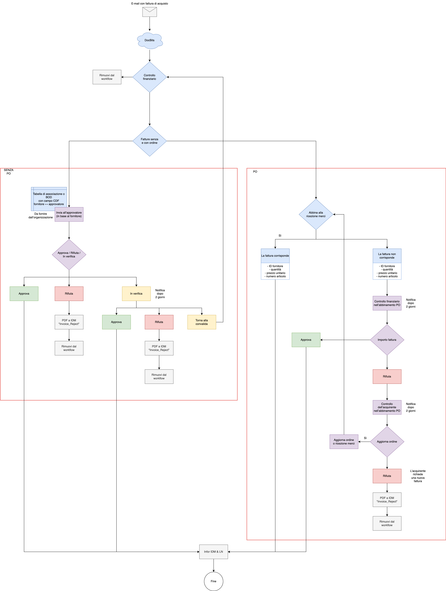

# Workflow Standard

Il diagramma descrive un **esempio di processo**, non una configurazione attiva in ogni organizzazione. Distingue fatture senza ordine e fatture collegate a un ordine di acquisto. Autorizzazioni, instradamento e integrazioni devono essere configurati e verificati separatamente.

<figure><figcaption>
Esempio di workflow con percorsi distinti per fatture con e senza ordine di acquisto. Etichette italiane su forme e collegamenti originali; la notifica dopo due giorni è una scelta dell’esempio, non un termine universale. Non è un’esecuzione del prodotto.
</figcaption></figure>

## Ingresso e controllo iniziale

La fattura arriva tramite e-mail a DocBits e passa al controllo finanziario. Il processo distingue poi il percorso senza ordine di acquisto da quello con ordine; la rimozione dal workflow è un’uscita prevista dall’esempio, non la prova di un’esportazione o di un pagamento.

## Fatture senza ordine di acquisto

L’approvatore viene determinato tramite l’associazione fornitore–approvatore prevista dal processo, ad esempio una tabella di associazione o dati CDF nel BOD. Il percorso distingue approvazione, rifiuto e verifica. Un ritorno alla convalida non equivale a un’approvazione.

Per il rifiuto, il diagramma indica l’invio del PDF a IDM con identificatore `Invoice_Reject` e la rimozione dal workflow. Sono passaggi dell’esempio da verificare nell’integrazione effettiva.

## Fatture con ordine di acquisto

Il confronto con la ricezione merci riguarda ID fornitore, quantità, prezzo unitario e numero articolo. Sono controlli del percorso con ordine, non criteri di approvazione specifici del percorso senza ordine.

In caso di differenze sono previsti controllo finanziario nell’abbinamento e revisione dell’acquirente. Il processo può richiedere l’aggiornamento dell’ordine o della ricezione merci e un nuovo confronto, oppure una nuova fattura e il rifiuto di quella corrente.

## Tempi e sistemi destinatari

La notifica dopo **due giorni** è una scelta di questo esempio, non un termine o SLA universale. Il nodo finale indica **Infor IDM e LN**; il diagramma non dimostra una scrittura riuscita, una registrazione contabile o un pagamento. Verifica dati trasferiti, esiti e gestione degli errori prima dell’uso operativo.
