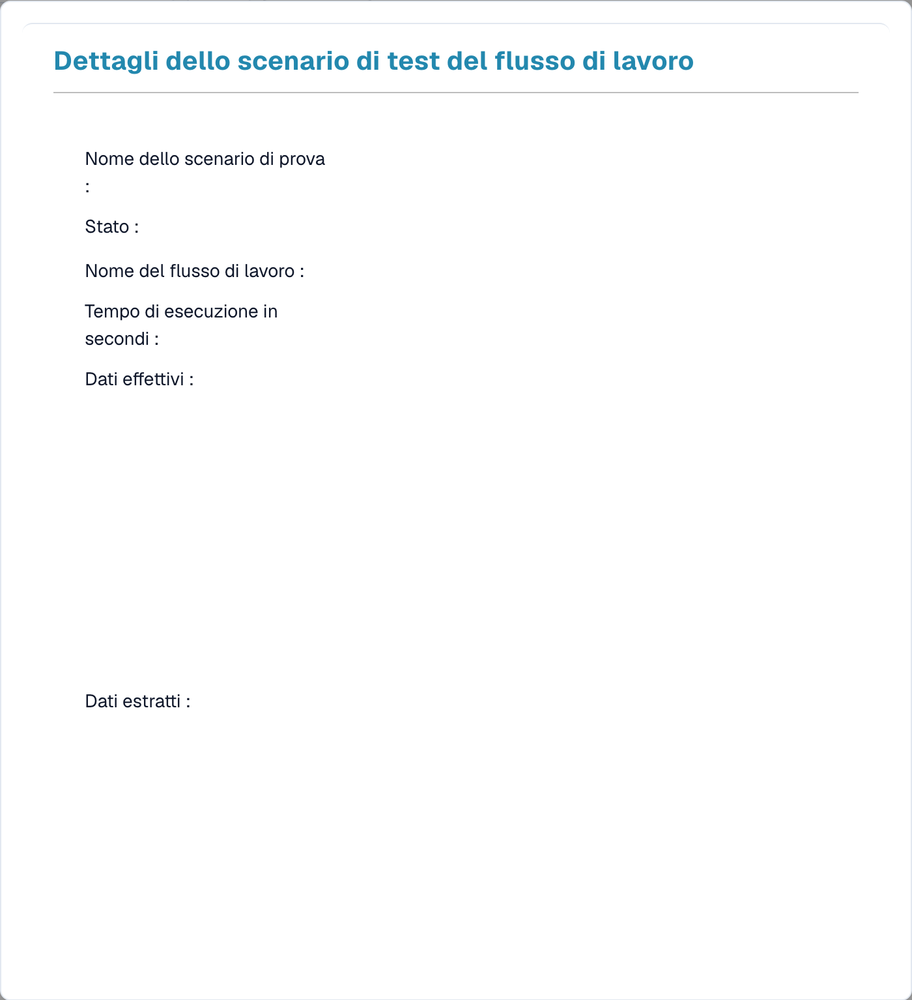

# Test Manager

Il **Test Manager** ti consente di salvare **scenari di test** riutilizzabili per i tuoi workflow ed eseguirli insieme, così puoi verificare che un workflow continui a comportarsi correttamente dopo averlo modificato. Funziona sia per i workflow Standard sia per quelli Avanzati.

Aprilo da **Workflow Dashboard → Test Manager List**.

<figure><figcaption>
La Test Manager List: ogni scenario salvato mostra un esito superato/fallito.
</figcaption></figure>

## Che cos'è uno scenario di test

Uno scenario di test cattura un workflow, un input di esempio e il **risultato atteso**. Quando lo esegui, il Test Manager riproduce il workflow su quell'input e confronta il risultato con quanto ti aspettavi, colorando la riga di **verde** (superato) o **rosso** (fallito).

## Lavorare con gli scenari

- **Aggiungi scenario di test** — crea un nuovo scenario a partire da un workflow e da un documento di esempio.
- **Esegui tutti i test** — esegui tutti gli scenari contemporaneamente e vedi a colpo d'occhio quali workflow continuano a superare il test.
- **Visualizza dettagli** — apri uno scenario per esaminarne il risultato.

<figure><figcaption>
Dettagli di uno scenario del gestore dei test; i dati sono nascosti.
</figcaption></figure>

La vista dei dettagli mostra il nome dello scenario e lo **stato**, il **nome del workflow**, il **tempo di esecuzione** e i dati **effettivi** ed **estratti** prodotti dall'esecuzione, così puoi vedere esattamente perché uno scenario è stato superato o è fallito.

## Test Manager rispetto al testing nel builder

Sono due cose diverse:

- **Test Manager** (questa pagina) — scenari *salvati e ripetibili* con risultati attesi, eseguiti insieme con **Esegui tutti i test**. Usalo per i test di regressione dopo le modifiche.
- **Testing nel builder** — i controlli inline **Convalidare** e **Test** all'interno del builder dei Workflow Avanzati, per verifiche rapide mentre stai costruendo. Vedi [Validazione e Testing](advanced-workflow/validation-and-testing.md).
