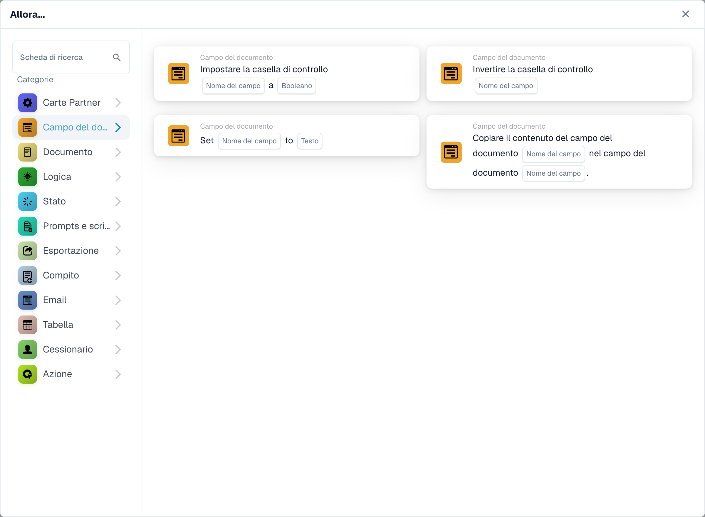
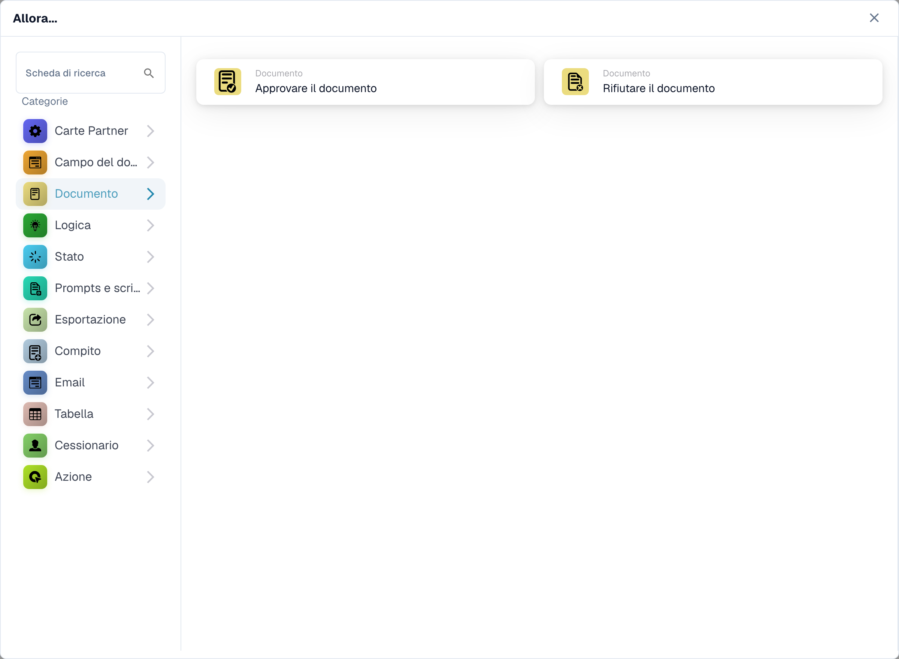
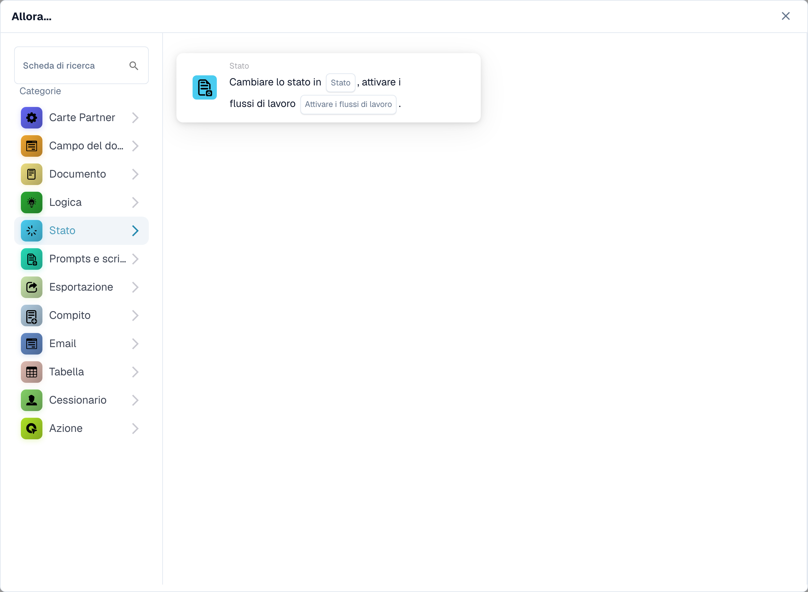
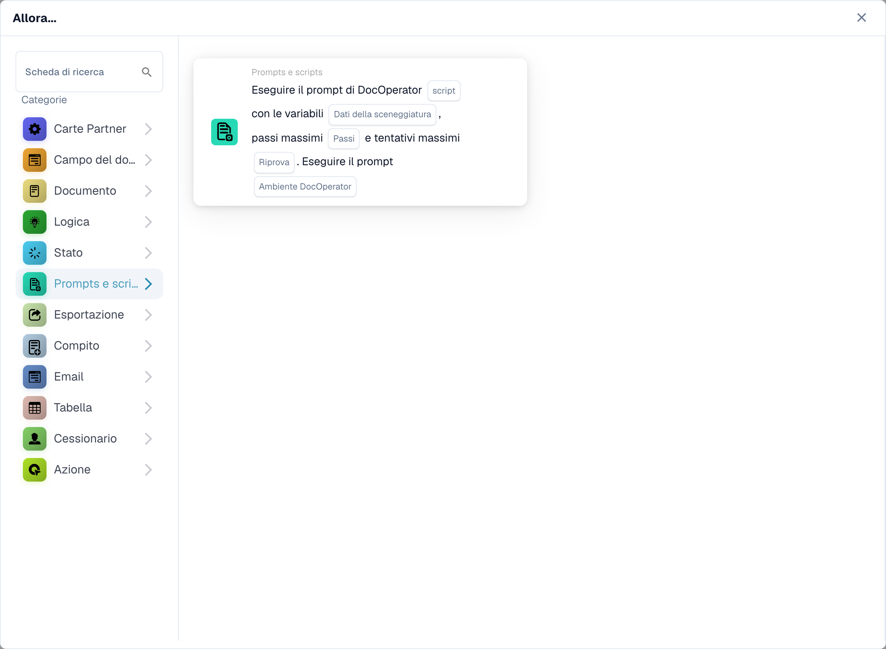
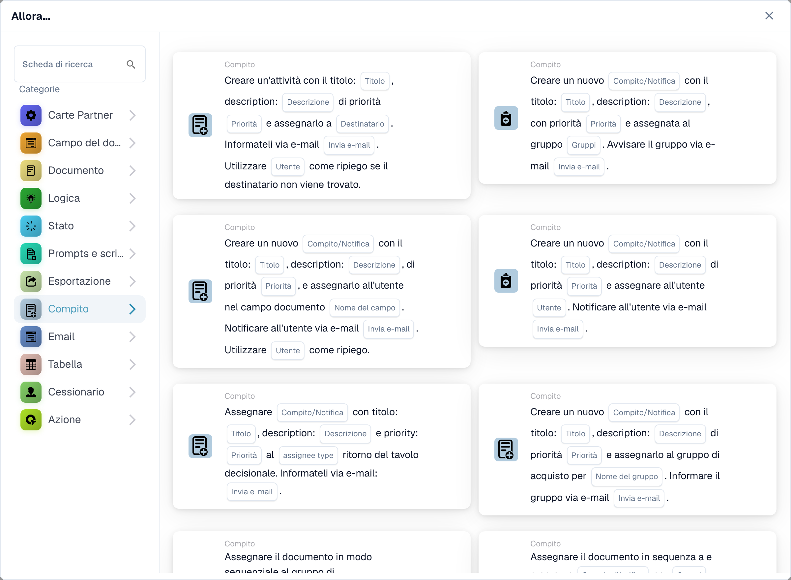
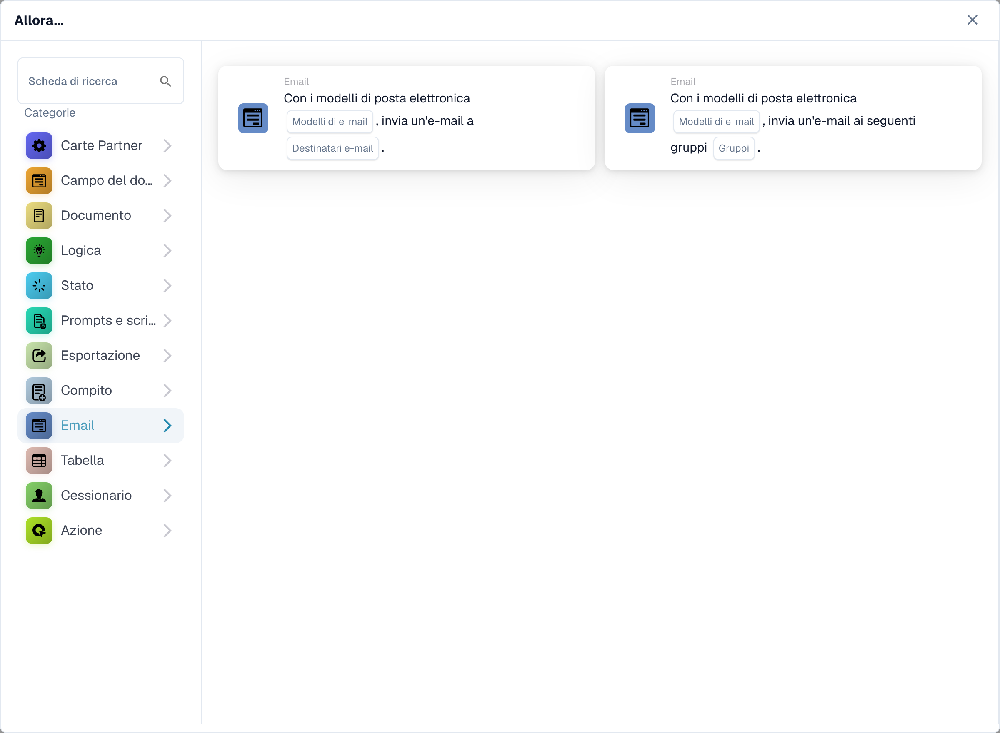
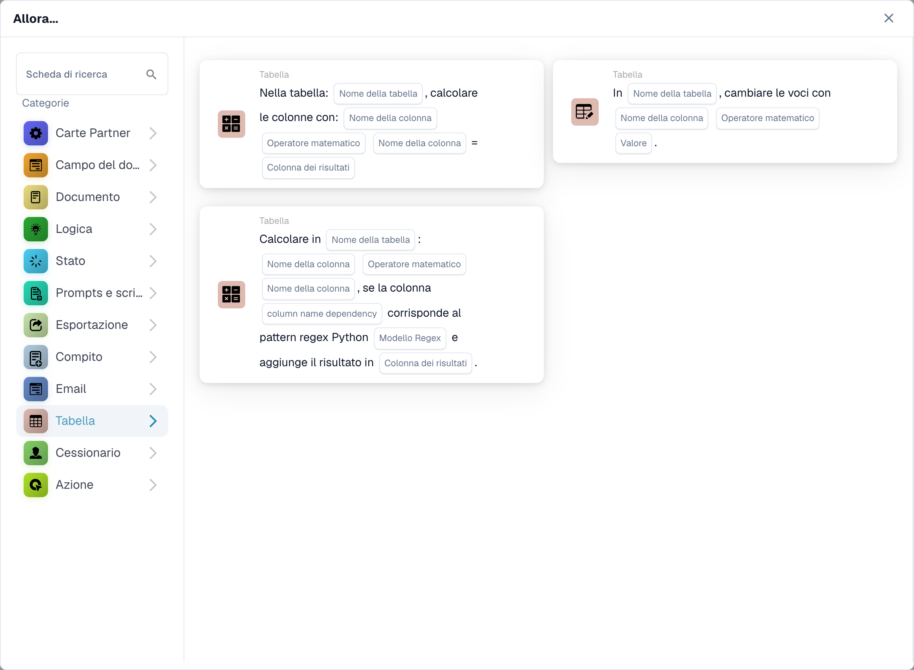
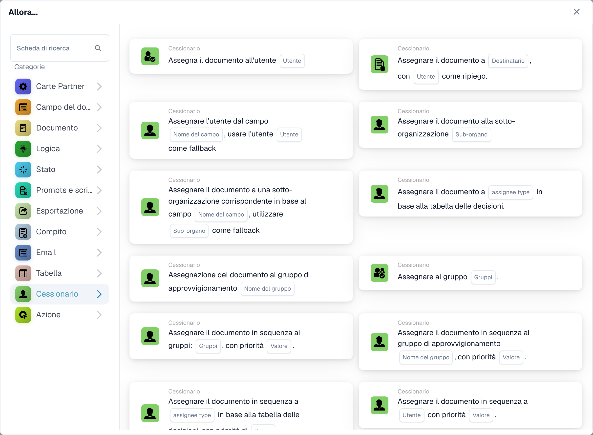
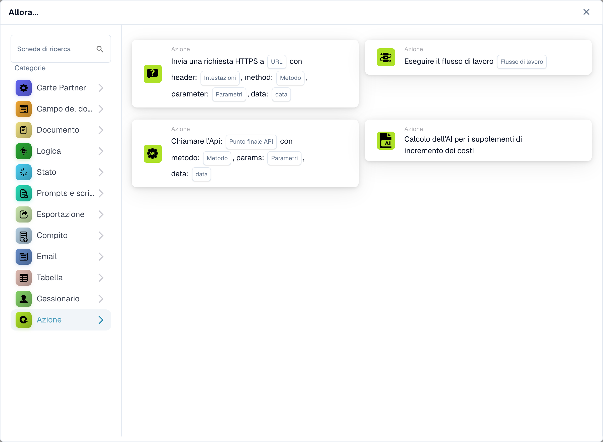

# Allora

Una carta **Allora** indica a un flusso di lavoro cosa fare dopo l'attivazione **Quando** e qualsiasi condizione **E**. Nel **Costruttore di flussi di lavoro**, seleziona **Aggiungi carta** in **Poi...**. Scegli una categoria a sinistra o digita un nome in **Cerca scheda**. Seleziona l'anteprima di una carta per aggiungerla, compila i campi mostrati sulla carta e salva il flusso di lavoro. Scorri all'interno del selettore per vedere più carte. Seleziona **×** per chiuderlo senza aggiungere una carta. Vedi [Flusso di lavoro](..) per la sequenza completa.

Le anteprime seguenti mostrano le azioni disponibili, non le impostazioni completate. Scegli l'azione che corrisponde al risultato desiderato.

## Campo documento

Imposta o inverti una casella di controllo, inserisci del testo in un campo o copia un campo in un altro. Scegli i nomi dei campi e il valore richiesti dalla carta. Vedi [Campo documento](document-field).

<figure><figcaption>
Schede disponibili nella categoria selezionata. Configurare i campi prima dell’uso. Alcune etichette dell’interfaccia di questa versione sono ancora in inglese o tradotte in modo non corretto. Le spiegazioni di questa pagina sono tradotte; l’immagine mostra l’interfaccia reale.
</figcaption></figure>

## Documento

Scegli **Approva il documento** o **Rifiuta il documento** quando il flusso di lavoro dovrebbe prendere quella decisione. Utilizzare prima una condizione **E** se l'approvazione deve dipendere da un controllo. Vedi [Documento](document).

<figure><figcaption>
Schede disponibili nella categoria selezionata. Configurare i campi prima dell’uso. Alcune etichette dell’interfaccia di questa versione sono ancora in inglese o tradotte in modo non corretto. Le spiegazioni di questa pagina sono tradotte; l’immagine mostra l’interfaccia reale.
</figcaption></figure>

## Logica

Utilizza queste schede per convertire valori tra formati numerici, di testo e booleani oppure leggere un valore da JSON. Scegli i campi di input e output sulla scheda selezionata.

<figure><figcaption>
Schede disponibili nella categoria selezionata. Configurare i campi prima dell’uso. Alcune etichette dell’interfaccia di questa versione sono ancora in inglese o tradotte in modo non corretto. Le spiegazioni di questa pagina sono tradotte; l’immagine mostra l’interfaccia reale.
</figcaption></figure>

## Stato

Scegli **Cambia stato** per spostare il documento nello stato selezionato. La carta può anche attivare un altro flusso di lavoro. Vedi [Stato](status).

<figure><figcaption>
Schede disponibili nella categoria selezionata. Configurare i campi prima dell’uso. Alcune etichette dell’interfaccia di questa versione sono ancora in inglese o tradotte in modo non corretto. Le spiegazioni di questa pagina sono tradotte; l’immagine mostra l’interfaccia reale.
</figcaption></figure>

## Prompt e script

Scegli questa categoria per eseguire uno script di prompt DocOperator. Selezionare lo script e le variabili richieste dalla scheda. La scheda offre anche impostazioni di esecuzione come i nuovi tentativi.

<figure><figcaption>
Schede disponibili nella categoria selezionata. Configurare i campi prima dell’uso. Alcune etichette dell’interfaccia di questa versione sono ancora in inglese o tradotte in modo non corretto. Le spiegazioni di questa pagina sono tradotte; l’immagine mostra l’interfaccia reale.
</figcaption></figure>

## Esportazione

Avvia un'esportazione, esporta con una configurazione scelta o accoda un'esportazione finale. Scegli la configurazione di esportazione e l'opzione delle attività in sospeso mostrate sulla tua scheda. Vedi [Esporta](export).

<figure><figcaption>
Schede disponibili nella categoria selezionata. Configurare i campi prima dell’uso. Alcune etichette dell’interfaccia di questa versione sono ancora in inglese o tradotte in modo non corretto. Le spiegazioni di questa pagina sono tradotte; l’immagine mostra l’interfaccia reale.
</figcaption></figure>

## Compito

Crea un'attività o una notifica e assegnala a un utente o gruppo. Inserisci il titolo, la descrizione, la priorità e le impostazioni di notifica richieste dalla carta. Alcune carte vengono assegnate in sequenza. Vedi [Attività](task).

<figure><figcaption>
Schede disponibili nella categoria selezionata. Configurare i campi prima dell’uso. Alcune etichette dell’interfaccia di questa versione sono ancora in inglese o tradotte in modo non corretto. Le spiegazioni di questa pagina sono tradotte; l’immagine mostra l’interfaccia reale.
</figcaption></figure>

## E-mail

Invia un'e-mail utilizzando un modello selezionato, ai destinatari o ai gruppi. Scegli il modello e la destinazione sulla carta.

<figure><figcaption>
Schede disponibili nella categoria selezionata. Configurare i campi prima dell’uso. Alcune etichette dell’interfaccia di questa versione sono ancora in inglese o tradotte in modo non corretto. Le spiegazioni di questa pagina sono tradotte; l’immagine mostra l’interfaccia reale.
</figcaption></figure>

## Tabella

Modificare le voci o calcolare i valori in una tabella di documenti. Seleziona la tabella, le colonne, l'operatore e la colonna dei risultati richiesti dalla scheda. Vedi [Tabella](table).

<figure><figcaption>
Schede disponibili nella categoria selezionata. Configurare i campi prima dell’uso. Alcune etichette dell’interfaccia di questa versione sono ancora in inglese o tradotte in modo non corretto. Le spiegazioni di questa pagina sono tradotte; l’immagine mostra l’interfaccia reale.
</figcaption></figure>

## Assegnatario

Assegna il documento a un utente, gruppo, destinatario o organizzazione secondaria. Alcune carte utilizzano un campo o una tabella decisionale e offrono un fallback. Scegli la destinazione giusta e fallback sulla carta selezionata. Vedi [Assegnatario](assignee).

<figure><figcaption>
Schede disponibili nella categoria selezionata. Configurare i campi prima dell’uso. Alcune etichette dell’interfaccia di questa versione sono ancora in inglese o tradotte in modo non corretto. Le spiegazioni di questa pagina sono tradotte; l’immagine mostra l’interfaccia reale.
</figcaption></figure>

## Azione

Esegui un altro flusso di lavoro, invia una richiesta HTTPS, chiama un'API o utilizza la scheda per il calcolo dell'aumento dei costi. Queste azioni possono influenzare altri sistemi; chiedi al tuo amministratore quale endpoint e impostazioni utilizzare. Vedi [Azione](action).

<figure><figcaption>
Schede disponibili nella categoria selezionata. Configurare i campi prima dell’uso. Alcune etichette dell’interfaccia di questa versione sono ancora in inglese o tradotte in modo non corretto. Le spiegazioni di questa pagina sono tradotte; l’immagine mostra l’interfaccia reale.
</figcaption></figure>

[Campi dettagliati della scheda logica, percorsi JSON, trigger e test](../cards-overview/logic-cards-guide.md).
