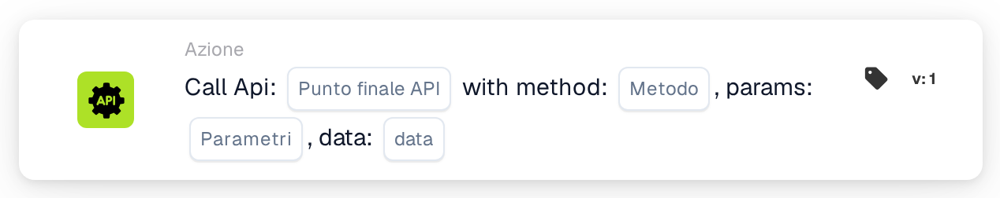
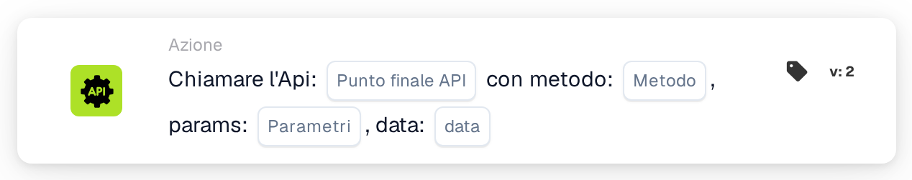

# Chiama l'Api

<figure><figcaption>
Versione 1
</figcaption></figure>

<figure><figcaption>
Versione 2
</figcaption></figure>

<!-- workflow-card-call-api-contract-20261022 -->

## Scopo

Usare `call_api` per chiamare un endpoint della API DocBits configurata. Il percorso relativo viene aggiunto al suo indirizzo di base. Un URL esterno arbitrario non configura un’integrazione con un’altra API.

## Configurazione

Impostare percorso, metodo HTTP, parametri di query e dati accettati dall’endpoint. La richiesta usa il contesto dell’utente DocBits corrente. I valori mancanti di `org_id` e `triggered_by_docflow` vengono aggiunti automaticamente. Gli oggetti dei parametri e dei dati, o la rappresentazione testuale supportata, devono rispettare il formato di questa versione. Non è disponibile una mappatura generale dei campi della risposta JSON.

## Risultato e limiti

Il testo della risposta viene convertito in un booleano: `true`, `1`, `yes` oppure `on` senza altri contenuti producono vero; una risposta non riconosciuta, incluso un oggetto JSON arbitrario, produce falso per impostazione predefinita. Il solo stato HTTP non determina il booleano. Un timeout o un errore della richiesta produce falso. Il test della scheda simula la chiamata e restituisce vero senza inviare la richiesta; non dimostra autenticazione, raggiungibilità o comportamento dell’endpoint.

<!-- workflow-card-practical-example-20261021 -->

## Esempio pratico

Usare questa scheda dopo le condizioni necessarie per ottenere un booleano da un endpoint configurato della API DocBits. Per una prova isolata, scegliere un endpoint esistente, documentato e di sola lettura con il contratto di risposta booleano previsto e il metodo adatto, ad esempio `GET`. Usare soltanto i parametri dimostrativi supportati.

Risultato atteso e controesempio: una risposta HTTP `200` ipotetica il cui testo completo sia `true` produce vero; `false` produce falso. Un oggetto come `{"approved": true}` non viene convertito automaticamente in vero. Verificare separatamente risposta reale e registri. Esempio verificato nel codice di esecuzione; nessuna richiesta o workflow è stato eseguito.
