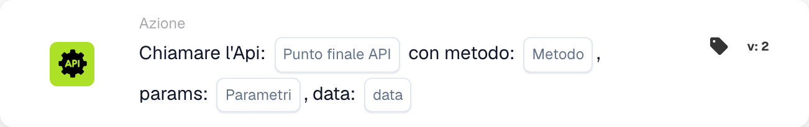

# Chiama l'Api

<figure><figcaption>
Campi della scheda nella versione visualizzata. I campi non sono ancora configurati.
</figcaption></figure>

## Scopo:

La scheda di workflow **"Call API"** consente agli utenti di effettuare richieste HTTP a endpoint API specificati direttamente dal workflow. Questa scheda supporta vari metodi HTTP e consente un'interazione dinamica con sistemi esterni inviando parametri e dati. Semplifica l'integrazione con servizi di terze parti e API personalizzate, garantendo una comunicazione fluida.

## Componenti della scheda:

1. **Endpoint API**
   * **Descrizione:** L'endpoint di destinazione della **DocBits API** con cui questa scheda interagirà.
   * **Dettaglio:** Un campo di testo in cui gli utenti specificano l'endpoint per la richiesta API.
2. **Metodo HTTP**
   * **Descrizione:** Il tipo di richiesta HTTP da effettuare.
   * **Opzioni:**
     1. **GET:** Recupera dati dall'endpoint specificato.
     2. **POST:** Invia dati all'endpoint.
     3. **PUT:** Aggiorna dati esistenti all'endpoint.
     4. **DELETE:** Rimuove dati all'endpoint.
3. **Parametri**
   * **Descrizione:** Parametri di query da includere nella richiesta API.
   * **Dettaglio:** Un campo di testo o un elenco per inserire coppie chiave-valore per l'URL della richiesta.
4. **Dati**
   1. **Descrizione:** Il payload da inviare nel corpo della richiesta API (applicabile ai metodi POST e PUT).
   2. **Dettaglio:** Un campo per inserire i dati in formato JSON.

## Funzionalità:

**Valutazione della condizione:** Il sistema valuta le condizioni definite nelle sezioni "Where" e "And":

* Se entrambe le condizioni sono **vere**, la richiesta API viene eseguita come configurata.
* Se una delle condizioni è **falsa**, la scheda non viene eseguita e non viene effettuata alcuna chiamata API.

**Esecuzione della richiesta API:**

* La scheda invia la richiesta HTTP all'endpoint specificato utilizzando il metodo selezionato.
* Eventuali parametri forniti vengono aggiunti all'URL e i dati vengono inclusi nel corpo della richiesta (se applicabile).

## Configurazione e impostazione:

1. **Definisci l'API dell'endpoint:**\
   Inserisci l'URL dell'API che desideri chiamare.
2. **Seleziona il metodo HTTP:**\
   Scegli uno dei metodi supportati (GET, POST, PUT, DELETE) in base ai requisiti della tua API.
3. **Fornisci i parametri:**\
   Aggiungi eventuali parametri di query richiesti come coppie chiave-valore.
4. **Inclusi i dati (se applicabili):**\
   Per i metodi POST o PUT, specifica i dati da inviare nel corpo della richiesta.
5. **Configurazione delle condizioni:**\
   Configura le sezioni "Where" e "And" per definire quando la chiamata API deve avvenire.

## Conclusione:

La scheda di workflow **"Call API"** migliora l'automazione del workflow consentendo un'interazione diretta con sistemi esterni. Fornendo configurazioni flessibili per endpoint, metodi e dati, garantisce che i workflow possano integrarsi senza problemi con API di terze parti o backend personalizzati. La possibilità di eseguire condizionatamente le chiamate API garantisce precisione ed efficienza nell'automazione delle comunicazioni esterne.

***

<!-- workflow-card-practical-example-20261021 -->

## Esempio pratico

**Quando utilizzarlo:** Richiedere una validazione supplementare ad un servizio esterno configurato.

**Configurazione:** Seleziona l'endpoint API demo configurato e il metodo HTTP. Fornire i parametri e il corpo JSON richiesti da tale endpoint.

**Risultato atteso e controesempio:** Per una risposta simulata `200`, verificare la gestione della risposta prevista dalle seguenti carte. Prova anche `500`; l'avvio della chiamata non dimostra che la verifica aziendale sia andata a buon fine.

Questa è una configurazione illustrativa e il risultato atteso. Utilizza campi, utenti e gruppi configurati nella tua organizzazione di test; non si afferma che questo esempio sia stato eseguito.
