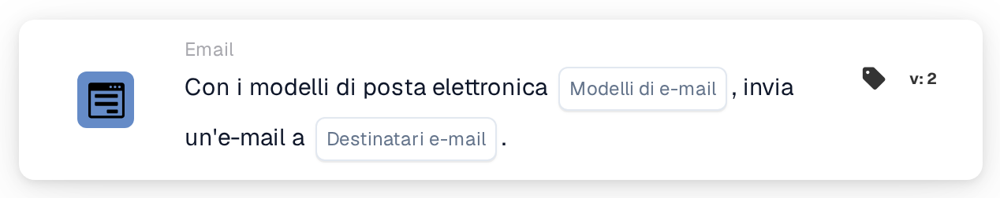

# Invia e-mail

<figure><figcaption>
Versione 2
</figcaption></figure>

## Scopo:

Questa scheda del workflow invia un'e-mail basata su uno o più modelli di e-mail. I destinatari non vengono inseriti come indirizzi fissi: vengono scelti in base al loro ruolo nel workflow, ad esempio l'utente o il gruppo a cui è assegnato il documento, oppure gli utenti e i gruppi restituiti da una tabella delle decisioni. In questo modo il workflow resta valido anche quando cambiano le persone che ricoprono questi ruoli.

Per inviare invece un'e-mail a gruppi di utenti selezionati, è possibile utilizzare la scheda **Send Email to Groups**, vedere [Send Email to Groups](send-email-groups-guide.md).

## Componenti della scheda:

1. **Modelli di e-mail**
   * **Descrizione:** I modelli di e-mail utilizzati per l'e-mail.
   * **Dettaglio:** È possibile selezionare uno o più modelli di e-mail dell'organizzazione. Ogni modello selezionato viene inviato a ogni destinatario. Quando il workflow viene eseguito per un documento, un modello configurato per un tipo di documento specifico viene inviato solo se il documento è di quel tipo.
2. **Destinatari e-mail**
   * **Descrizione:** Chi riceve l'e-mail.
   * **Opzioni:** È possibile selezionare una o più delle seguenti opzioni:
     * **Utente/gruppo assegnato al documento:** L'utente o il gruppo a cui il documento è attualmente assegnato.
     * **Utente/gruppo restituito dalla tabella delle decisioni:** Gli utenti e i gruppi restituiti da una tabella delle decisioni valutata in precedenza nello stesso workflow, ad esempio con la scheda **Decision Table has Returns**.
     * **Utente assegnato al fornitore:** L'utente assegnato del fornitore, nei workflow avviati da una modifica dello stato di un fornitore.
     * **Referente del fornitore:** Il referente del fornitore, nei workflow avviati da una modifica dello stato di un fornitore.

## Funzionalità:

* **Raccolta dei destinatari:** La scheda raccoglie i destinatari di tutte le opzioni selezionate. Un destinatario che risulta da più opzioni riceve l'e-mail una sola volta.
* **Esecuzione dell'azione:** L'e-mail viene inviata con i modelli selezionati. Quando il workflow viene eseguito per un documento, i modelli possono utilizzare i valori dei campi del documento. Il risultato viene registrato nel log del workflow insieme ai nomi dei destinatari.
* **Senza documento:** La scheda può essere eseguita anche in workflow che non vengono avviati per un documento, ad esempio i workflow avviati da una modifica dello stato di un fornitore. In un workflow di questo tipo, l'opzione **Utente/gruppo assegnato al documento** non aggiunge alcun destinatario.
* **Dati mancanti:**
  * Se sulla scheda non è selezionato alcun modello di e-mail o alcuna opzione per i destinatari, la scheda non viene eseguita e segnala i dati mancanti nel log del workflow.
  * Se un'opzione selezionata non porta ad alcuna persona, ad esempio perché il documento non ha un assegnatario o la tabella delle decisioni non ha restituito nessuno, quell'opzione non aggiunge alcun destinatario.
* **Errori:** Se il servizio e-mail rifiuta la richiesta o non risponde in tempo, la scheda termina con un errore.

## Configurazione e impostazione:

* I modelli di e-mail dovrebbero essere configurati nell'organizzazione prima di poter essere selezionati sulla scheda.
* La scheda può essere aggiunta dalla categoria **Email**. Successivamente si selezionano uno o più modelli in **Modelli di e-mail** e una o più opzioni in **Destinatari e-mail**.
* Per l'opzione **Utente/gruppo restituito dalla tabella delle decisioni**, una tabella delle decisioni dovrebbe essere valutata in un punto precedente dello stesso workflow.

## Conclusione:

La scheda del workflow "Send Email" informa automaticamente le persone coinvolte in un processo relativo a un documento o a un fornitore, utilizzando modelli predisposti. Poiché i destinatari vengono scelti in base al ruolo, lo stesso workflow continua a raggiungere le persone giuste anche quando le assegnazioni cambiano.
