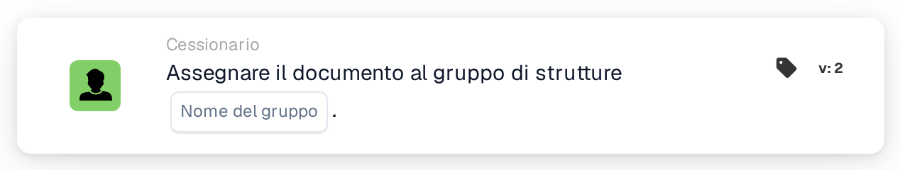

# Assegna documento al gruppo della struttura

<figure><figcaption>
Versione 2
</figcaption></figure>

## Scopo:

Questa scheda del workflow assegna un documento al gruppo responsabile della struttura del relativo ordine di acquisto. La struttura non viene selezionata sulla scheda: viene ricavata dagli ordini di acquisto a cui il documento è abbinato. La scheda cerca quindi un gruppo di utenti il cui nome contenga sia il nome del gruppo inserito sulla scheda sia il codice della struttura, e assegna il documento a quel gruppo.

È utile quando lo stesso tipo di team esiste una volta per ogni struttura, ad esempio un gruppo di approvazione per ogni stabilimento o magazzino, e ogni documento dovrebbe andare al team della struttura per cui è stato ordinato.

Per un'assegnazione che viene aggiunta a una sequenza di approvatori anziché essere effettuata direttamente, è possibile utilizzare la scheda **Assign Sequentially to Facility Group**.

## Componenti della scheda:

1. **Nome del gruppo**
   * **Descrizione:** La parte del nome comune a tutti i gruppi di struttura.
   * **Dettaglio:** Un testo che viene confrontato con i nomi dei gruppi di utenti dell'organizzazione. Un gruppo corrisponde se il suo nome contiene questo testo e il codice della struttura dell'ordine di acquisto. Il confronto non distingue tra maiuscole e minuscole. Ad esempio, con il nome del gruppo **Approver** e un ordine di acquisto per la struttura **1000**, corrisponderebbe un gruppo denominato **Approver 1000**.

## Funzionalità:

* **Individuazione della struttura:** La scheda legge gli ordini di acquisto a cui il documento è abbinato e raccoglie il codice della struttura (la sede dell'ordine di acquisto) di ciascuno di essi.
* **Individuazione del gruppo:** Per ogni codice di struttura, la scheda cerca i gruppi di utenti il cui nome contiene sia il **Nome del gruppo** indicato sulla scheda sia il codice della struttura. I codici di struttura per cui non viene trovato alcun gruppo vengono elencati nel log del workflow.
* **Esecuzione dell'azione:** Il documento viene assegnato al gruppo corrispondente. Se corrispondono più gruppi, ad esempio perché il documento è abbinato a ordini di acquisto di strutture diverse, il documento viene assegnato a uno solo di essi; quale, non è determinato dalla scheda.
* **Dati mancanti:**
  * Se sulla scheda non è inserito alcun nome di gruppo, la scheda non viene eseguita e segnala i dati mancanti nel log del workflow.
  * Se il documento non è abbinato a un ordine di acquisto, la scheda segnala i dati mancanti invece di assegnare il documento.
  * Se nessun gruppo corrisponde ad alcuno dei codici di struttura, il documento non viene assegnato e il log del workflow annota che non è stato trovato alcun gruppo corrispondente.

## Configurazione e impostazione:

* I gruppi di utenti dovrebbero essere denominati in modo che ogni nome contenga la parte comune del nome e il codice della struttura, ad esempio **Approver 1000**, **Approver 2000**.
* La scheda può essere aggiunta dalla categoria **Cessionario**. Successivamente, la parte comune del nome dei gruppi viene inserita nel campo **Nome del gruppo**.
* Poiché la struttura deriva dagli ordini di acquisto abbinati, la scheda è più indicata nei workflow per documenti già abbinati a un ordine di acquisto.

## Conclusione:

La scheda del workflow "Assign Document to Facility Group" instrada i documenti al team della struttura per cui sono stati ordinati. Una sola scheda copre tutte le strutture, a condizione che i gruppi di utenti seguano uno schema di denominazione coerente con il codice della struttura nel nome.
