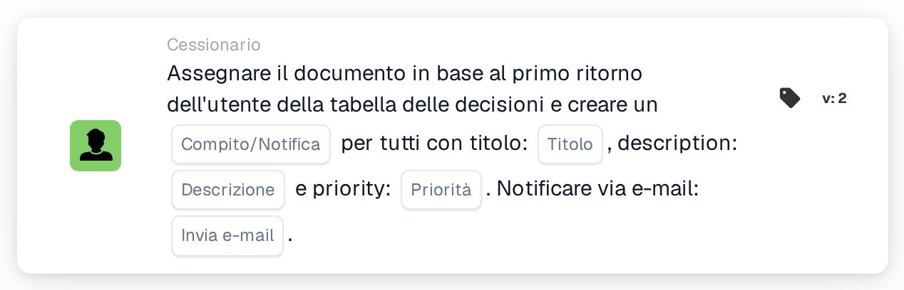

# Assegna documento al primo utente della tabella delle decisioni e crea attività

<figure><figcaption>
Versione 2
</figcaption></figure>

## Scopo:

Questa scheda del workflow utilizza gli utenti restituiti da una tabella delle decisioni in due modi: il documento viene assegnato al primo utente restituito e ogni utente restituito, compreso il primo, riceve un compito o una notifica relativa al documento. In questo modo una persona diventa responsabile del documento, mentre le altre vengono informate o invitate anch'esse ad agire.

Gli utenti provengono da una tabella delle decisioni valutata in precedenza nello stesso workflow, ad esempio con la scheda **Decision Table has Returns**, impostata in modo da utilizzare i dati restituiti nelle schede successive.

## Componenti della scheda:

1. **Compito/Notifica**
   * **Descrizione:** Definisce se per gli utenti restituiti viene creato un compito o una notifica.
   * **Opzioni:**
     * **Compito:** Per ogni utente viene creato un compito.
     * **Notifica:** Per ogni utente viene creata una notifica.
2. **Titolo**
   * **Descrizione:** Il titolo del compito o della notifica.
   * **Dettaglio:** Un breve testo che identifica il compito o la notifica.
3. **Descrizione**
   * **Descrizione:** Ulteriori dettagli sul compito o sulla notifica.
   * **Dettaglio:** Un testo che descrive che cosa dovrebbe essere fatto o perché gli utenti vengono informati.
4. **Priorità**
   * **Descrizione:** L'urgenza del compito o della notifica.
   * **Opzioni:**
     * **peso elevato:** Il compito o la notifica viene creato con priorità alta.
     * **peso medio:** Il compito o la notifica viene creato con priorità media.
     * **peso basso:** Il compito o la notifica viene creato con priorità bassa.
5. **Invia e-mail**
   * **Descrizione:** Definisce se gli utenti vengono informati del compito o della notifica anche via e-mail.
   * **Opzioni:**
     * **Vero:** Viene inviata una notifica via e-mail.
     * **Falso:** Non viene inviata alcuna notifica via e-mail.

## Funzionalità:

* **Lettura della tabella delle decisioni:** La scheda legge gli utenti restituiti dalla tabella delle decisioni in un punto precedente del workflow. Vengono presi in considerazione solo gli utenti restituiti, non i gruppi.
* **Assegnazione del documento:** Il documento viene assegnato al primo utente restituito.
* **Creazione dei compiti:** Per ogni utente restituito viene creato un compito o una notifica con il titolo, la descrizione e la priorità indicati sulla scheda. Ogni utente riceve il proprio compito. I compiti vengono creati anche se l'assegnazione del documento non è riuscita; il log del workflow mostra il risultato dell'assegnazione e di ogni compito.
* **Valori predefiniti:** Se non è impostata alcuna priorità, viene utilizzato **peso medio**. Se **Invia e-mail** non è impostato, non viene inviata alcuna e-mail. Se **Compito/Notifica** non è impostato, viene creato un compito e il log del workflow annota l'impostazione mancante.
* **Dati mancanti:**
  * Se la tabella delle decisioni non ha restituito alcun utente, non viene assegnato nulla e la scheda segnala i dati mancanti nel log del workflow.
  * Se il titolo o la descrizione sono vuoti, il documento non viene assegnato, non viene creato alcun compito e la scheda segnala i dati mancanti.

## Configurazione e impostazione:

* Una tabella delle decisioni che restituisce utenti dovrebbe essere valutata in un punto precedente del workflow, ad esempio con la scheda **Decision Table has Returns**. L'ordine degli utenti restituiti è importante, perché il primo riceve il documento.
* La scheda può essere aggiunta dalla categoria **Cessionario**. Successivamente è possibile configurare il tipo (**Compito** o **Notifica**), il titolo, la descrizione, la priorità e l'impostazione dell'e-mail.

## Conclusione:

La scheda del workflow "Assign Document to First Decision Table User and Create Tasks" unisce una chiara responsabilità per il documento all'informazione di tutte le persone indicate dalla tabella delle decisioni. È utile quando una persona dovrebbe essere titolare del documento mentre altre dovrebbero essere coinvolte o tenute aggiornate.
