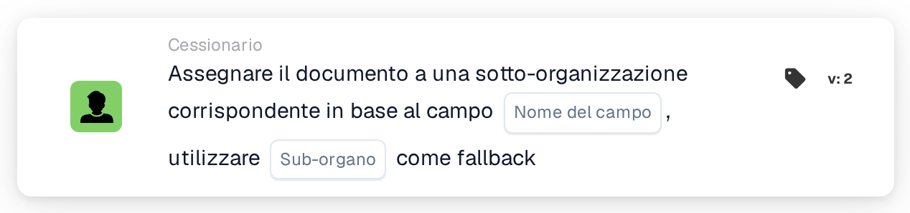

# Assegna il documento alla sottoorganizzazione corrispondente

<figure><figcaption>
Versione 2
</figcaption></figure>

## **Scopo:**

La scheda di workflow **"Assegna documento alla sottoorganizzazione corrispondente in base al campo"** assegna un documento a una sotto-organizzazione in modo dinamico, in base a un campo specificato nel documento. Se non viene trovata alcuna sotto-organizzazione corrispondente, la scheda utilizza una sotto-organizzazione di riserva predefinita.

## **Componenti della scheda:**

1. **Nome campo**
   * **Descrizione:** Specifica il campo del documento da utilizzare per determinare la sotto-organizzazione corrispondente.
   * **Dettaglio:** La scheda cerca un valore nel campo specificato per abbinarlo a una sotto-organizzazione disponibile.
2. **Sotto-organizzazione (fallback)**
   * **Descrizione:** Definisce la sotto-organizzazione di riserva da utilizzare se non viene trovata alcuna corrispondenza nel campo specificato.
   * **Dettaglio:** Se il valore del campo non corrisponde a nessuna sotto-organizzazione, il documento verrà assegnato alla sotto-organizzazione di riserva selezionata.

## **Funzionalità:**

* **Valutazione della condizione:**\
  La scheda esegue la sua azione solo se sia la sezione **"Quando"** che la sezione **"E"** risultano vere.
* **Assegnazione dinamica:**\
  La scheda verifica il valore del campo specificato e assegna il documento alla sotto-organizzazione che corrisponde a tale valore.
* **Meccanismo di riserva:**\
  Se non viene trovata alcuna sotto-organizzazione corrispondente, il documento viene assegnato alla sotto-organizzazione di riserva.

## **Configurazione e impostazione:**

* **Seleziona il Field Name:**\
  Scegli il campo del documento che contiene il valore da abbinare a una sotto-organizzazione.
* **Seleziona la Sub-Organizzazione di riserva:**\
  Scegli la sotto-organizzazione che verrà utilizzata se non viene trovata alcuna corrispondenza nel campo del documento.

## **Conclusione:**

La scheda di workflow **"Assegna documento alla sottoorganizzazione corrispondente in base al campo"** offre flessibilità instradando dinamicamente i documenti alla sotto-organizzazione appropriata, con un'opzione di riserva aggiuntiva per garantire che nessun documento rimanga non assegnato.

<!-- workflow-card-practical-example-20261021 -->

## Esempio pratico

**Quando utilizzarlo:** Scegli un'unità di business da un campo di routing estratto.

**Configurazione:** Imposta il campo di routing `business_unit` sul nome della sottoorganizzazione configurata `Demo North` e scegli `Demo Default` come fallback.

**Risultato previsto e controesempio:** Un valore di campo corrispondente seleziona `Demo North`. Un nome sconosciuto utilizza `Demo Default`; testare il fallback prima di abilitare il flusso di lavoro.

Questa è una configurazione illustrativa e il risultato atteso. Utilizza campi, utenti e gruppi configurati nella tua organizzazione di test; non si afferma che questo esempio sia stato eseguito.
