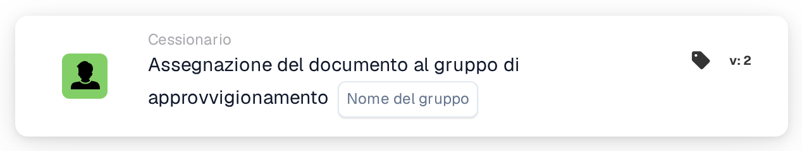

# Assegnare il documento al gruppo di approvvigionamento

<figure><figcaption>
Versione 2
</figcaption></figure>

## **Scopo:**

La scheda di workflow **"Assign to Procurement Group"** viene utilizzata per assegnare un documento a un gruppo di approvvigionamento specificato all'interno del sistema. Ciò aiuta a semplificare la gestione documentale garantendo che il team appropriato gestisca il documento in base al gruppo di approvvigionamento assegnato.

## **Componenti della scheda:**

1. **Gruppo Approvvigionamenti**
   * **Descrizione:** Specifica il gruppo di approvvigionamento a cui verrà assegnato il documento.
   * **Dettaglio:** Il gruppo di approvvigionamento selezionato sarà responsabile dell'elaborazione e della gestione del documento.

## **Funzionalità:**

* **Valutazione della condizione:**\
  La scheda esegue la sua azione solo se sia la sezione **"Quando"** che la sezione **"E"** risultano vere.
* **Esecuzione dell'azione:**\
  Se entrambe le condizioni sono vere, il documento viene assegnato al gruppo di approvvigionamento specificato. Se una delle condizioni è falsa, non viene intrapresa alcuna azione e il documento rimane non assegnato.

## **Configurazione e impostazione:**

* **Seleziona il Gruppo Procurement:** Scegli dal menu a discesa il gruppo di approvvigionamento a cui assegnare il documento.

## **Conclusione:**

La scheda di workflow **"Assign to Procurement Group"** offre un modo semplice ma efficace per garantire che i documenti vengano automaticamente assegnati al team di approvvigionamento corretto per l'ulteriore elaborazione.

<!-- workflow-card-practical-example-20261021 -->

## Esempio pratico

**Quando utilizzarlo:** Invia un'eccezione di acquisto al relativo gruppo di approvvigionamento.

**Configurazione:** Selezionare il gruppo configurato `Demo Procurement`.

**Risultato atteso e controesempio:** Il documento è assegnato a quel gruppo di approvvigionamento. Non si deve presumere che un gruppo ordinario con nome simile sia la stessa destinazione configurata.

Questa è una configurazione illustrativa e il risultato atteso. Utilizza campi, utenti e gruppi configurati nella tua organizzazione di test; non si afferma che questo esempio sia stato eseguito.
