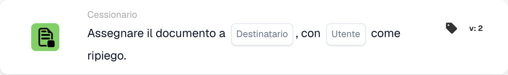

# Assegnare il documento al destinatario

<figure><figcaption>
Campi della scheda nella versione visualizzata. I campi non sono ancora configurati. Alcune etichette dell’interfaccia di questa versione sono ancora in inglese o tradotte in modo non corretto. Le spiegazioni di questa pagina sono tradotte; l’immagine mostra l’interfaccia reale.
</figcaption></figure>

## **Scopo:**

La scheda di workflow **"Assegna documento a Disponente/Acquirente"** assegna un documento a un **Disponent** oppure a un **Acquirente**. Se non viene trovato alcun utente valido, viene selezionato un utente di riserva per garantire che il documento sia sempre assegnato a qualcuno.

## **Componenti della scheda:**

1. **Disponente/Acquirente**
   * **Descrizione:** Specifica se il documento verrà assegnato a un Disponent o a un Purchaser.
   * **Opzioni:**
     * **Disponent:** Assegna il documento al Disponent.
     * **Acquirente:** Assegna il documento al Purchaser.
2. **Utente fallback**
   * **Descrizione:** Specifica un utente di riserva nel caso in cui il documento non possa essere assegnato al Disponent o Purchaser selezionato.
   * **Dettaglio:** Il menu a discesa degli utenti disponibili ti consente di scegliere un utente di riserva per garantire che il documento venga assegnato anche se l'utente principale non può essere determinato.

## **Funzionalità:**

* **Valutazione della condizione:**\
  La scheda esegue la sua azione solo se sia la sezione **"Quando"** che la sezione **"E"** risultano vere.
* **Assegnazione del documento:**\
  La scheda assegna il documento al **Disponent** o al **Acquirente** selezionato. Se la persona selezionata non è disponibile o non è valida, il documento viene assegnato all'utente di riserva.

## **Configurazione e impostazione:**

* **Seleziona Disponente / Acquirente:**\
  Scegli se assegnare il documento al **Disponent** o al **Acquirente**.
* **Seleziona Utente Fallback:**\
  Scegli un utente di riserva dal menu a discesa che riceverà il documento se l'assegnazione principale non è possibile.

## **Conclusione:**

La scheda di workflow **"Assegna documento a Disponente/Acquirente"** garantisce che il documento sia sempre assegnato, al Disponent/Purchaser selezionato o, se necessario, all'utente di riserva. Ciò riduce al minimo le interruzioni del workflow e garantisce che l'elaborazione dei documenti prosegua senza problemi.

<!-- workflow-card-practical-example-20261021 -->

## Esempio pratico

**Quando usarlo:** Assegna un documento al destinatario risolto, con un fallback sicuro.

**Configurazione:** Selezionare la fonte del destinatario e l'utente fallback `Demo Reviewer A`.

**Risultato atteso e controesempio:** Un destinatario risolvibile riceve l'incarico. Se non è possibile risolvere il destinatario, viene utilizzato il fallback configurato. Verificare entrambi i percorsi.

Questa è una configurazione illustrativa e il risultato atteso. Utilizza campi, utenti e gruppi configurati nella tua organizzazione di test; non si afferma che questo esempio sia stato eseguito.
