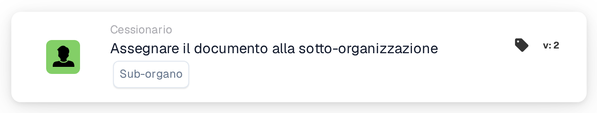

# Assegnare il documento alla sottoorganizzazione

<figure><figcaption>
Versione 2
</figcaption></figure>

## **Scopo:**

La scheda di workflow **"Assegna documento a una sottoorganizzazione"** assegna un documento a una sotto-organizzazione specifica all'interno del sistema, garantendo che venga instradato all'unità organizzativa appropriata per l'elaborazione.

## **Componenti della scheda:**

1. **Sotto-Organizzazione**
   * **Descrizione:** Specifica la sotto-organizzazione a cui verrà assegnato il documento.
   * **Dettaglio:** Viene fornito un menu a discesa delle sotto-organizzazioni disponibili per selezionare quella di destinazione.

## **Funzionalità:**

* **Valutazione della condizione:**\
  La scheda esegue la sua azione solo se sia la sezione **"Quando"** che la sezione **"E"** risultano vere.
* **Assegnazione del documento:**\
  La scheda assegna il documento alla sotto-organizzazione selezionata dal menu a discesa.

## **Configurazione e impostazione:**

* **Seleziona la Sotto-Organizzazione:**\
  Scegli dal menu a discesa la sotto-organizzazione appropriata a cui assegnare il documento.

## **Conclusione:**

La scheda di workflow **"Assegna documento a una sottoorganizzazione"** garantisce che i documenti vengano instradati alla sotto-organizzazione corretta, semplificando il processo di gestione documentale assegnando la responsabilità in base alla struttura organizzativa.

<!-- workflow-card-practical-example-20261021 -->

## Esempio pratico

**Quando utilizzarlo:** Indirizza un documento a un'unità aziendale conosciuta.

**Configurazione:** Seleziona la sottoorganizzazione configurata `Demo North`.

**Risultato atteso e controesempio:** Il documento appartiene alla sottoorganizzazione selezionata dopo l'azione. Conferma la destinazione prima di abilitare il flusso di lavoro perché le regole di accesso della sottoorganizzazione potrebbero differire.

Questa è una configurazione illustrativa e il risultato atteso. Utilizza campi, utenti e gruppi configurati nella tua organizzazione di test; non si afferma che questo esempio sia stato eseguito.
