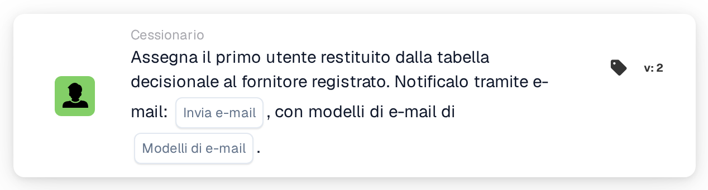

# Assegna il primo utente della tabella delle decisioni al fornitore

<figure><figcaption>
Versione 2
</figcaption></figure>

## Scopo:

Questa scheda del workflow imposta l'utente assegnato di un fornitore registrato in base a una tabella delle decisioni. Il primo utente restituito dalla tabella delle decisioni diventa l'utente assegnato del fornitore, cioè il referente interno responsabile del fornitore. Gli utenti restituiti possono anche essere informati via e-mail.

Come **Assign User to Supplier**, la scheda non opera su un documento: è pensata per i workflow avviati da una modifica dello stato di un fornitore, ad esempio con la scheda When **Supplier status changed**. L'utente viene determinato da una tabella delle decisioni valutata in precedenza nello stesso workflow, ad esempio con la scheda **Decision Table has Returns**, anziché essere selezionato sulla scheda.

## Componenti della scheda:

1. **Invia e-mail**
   * **Descrizione:** L'impostazione dell'e-mail della scheda.
   * **Opzioni:** **Vero** o **Falso**.
   * **Dettaglio:** Con **Vero**, le e-mail vengono inviate con i modelli di e-mail selezionati. Con **Falso**, non viene inviata alcuna e-mail. Anche se **Invia e-mail** non è impostato, non viene inviata alcuna e-mail.
2. **Modelli di e-mail**
   * **Descrizione:** I modelli di e-mail utilizzati per l'e-mail.
   * **Dettaglio:** È possibile selezionare uno o più modelli di e-mail dell'organizzazione. I modelli vengono utilizzati quando **Invia e-mail** è **Vero**.

## Funzionalità:

* **Lettura della tabella delle decisioni:** La scheda legge gli utenti restituiti dalla tabella delle decisioni in un punto precedente del workflow. Vengono presi in considerazione solo gli utenti restituiti, non i gruppi.
* **Notifica via e-mail:** Quando vengono inviate, le e-mail vanno a tutti gli utenti restituiti dalla tabella delle decisioni, non solo al primo. Le e-mail vengono inviate prima che l'utente venga assegnato al fornitore.
* **Esecuzione dell'azione:** Il primo utente restituito viene salvato come utente assegnato del fornitore il cui stato è cambiato. Se il fornitore ha già un utente assegnato, questo viene sostituito. Il risultato viene registrato nel log del workflow.
* **Dati mancanti:**
  * Se la tabella delle decisioni non ha restituito alcun utente, non viene assegnato nulla e la scheda segnala i dati mancanti nel log del workflow.
  * Se **Invia e-mail** è **Vero** ma non è selezionato alcun modello di e-mail, la scheda si arresta senza assegnare l'utente e segnala i dati mancanti.
  * Se **Invia e-mail** non è impostato, il log del workflow annota l'impostazione mancante e l'utente viene assegnato senza e-mail.
* **Errori:** Se il servizio e-mail o il servizio fornitori rifiuta la richiesta o non risponde in tempo, la scheda termina con un errore. Se l'invio delle e-mail non riesce, l'utente non viene assegnato al fornitore.

## Configurazione e impostazione:

* La scheda può essere utilizzata in un workflow avviato da una modifica dello stato di un fornitore. Una tabella delle decisioni che restituisce utenti dovrebbe essere valutata in un punto precedente dello stesso workflow.
* La scheda può essere aggiunta dalla categoria **Cessionario**. Successivamente è possibile impostare **Invia e-mail** e selezionare uno o più modelli di e-mail.

## Conclusione:

La scheda del workflow "Assign First Decision Table User to Supplier" assegna a un fornitore un referente responsabile secondo le regole definite in una tabella delle decisioni. L'e-mail facoltativa informa subito gli utenti restituiti del fornitore.
