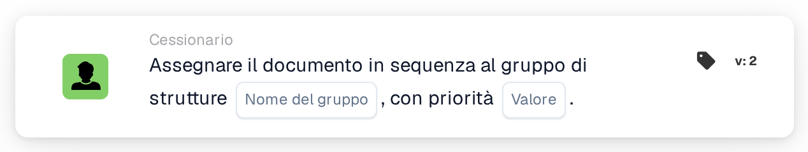

# Assegna in sequenza al gruppo della struttura

<figure><figcaption>
Versione 2
</figcaption></figure>

## Scopo:

Questa scheda del workflow aggiunge all'assegnazione sequenziale del documento il gruppo responsabile della struttura dell'ordine di acquisto del documento. Come **Assign Document to Facility Group**, individua il gruppo tramite il codice della struttura degli ordini di acquisto abbinati. Invece di assegnare subito il documento, aggiunge il gruppo all'ordine degli approvatori con una priorità, così che più schede sequenziali in un workflow possano formare una catena di assegnazioni.

## Componenti della scheda:

1. **Nome del gruppo**
   * **Descrizione:** La parte del nome comune a tutti i gruppi di struttura.
   * **Dettaglio:** Un testo che viene confrontato con i nomi dei gruppi di utenti dell'organizzazione. Un gruppo corrisponde se il suo nome contiene questo testo e il codice della struttura dell'ordine di acquisto. Il confronto non distingue tra maiuscole e minuscole. Ad esempio, con il nome del gruppo **Approver** e un ordine di acquisto per la struttura **1000**, corrisponderebbe un gruppo denominato **Approver 1000**.
2. **Valore**
   * **Descrizione:** La priorità del gruppo all'interno dell'assegnazione sequenziale.
   * **Dettaglio:** Un numero intero. I numeri più bassi vengono prima, con 0 come priorità più alta. Se non viene inserito alcun valore, o viene inserito un valore negativo, viene utilizzata la priorità 1.

## Funzionalità:

* **Individuazione della struttura:** La scheda legge gli ordini di acquisto a cui il documento è abbinato e raccoglie il codice della struttura (la sede dell'ordine di acquisto) di ciascuno di essi.
* **Individuazione del gruppo:** Per ogni codice di struttura, la scheda cerca i gruppi di utenti il cui nome contiene sia il **Nome del gruppo** indicato sulla scheda sia il codice della struttura. I codici di struttura per cui non viene trovato alcun gruppo vengono elencati nel log del workflow.
* **Esecuzione dell'azione:** Ogni gruppo corrispondente viene aggiunto all'assegnazione sequenziale con la priorità indicata nel campo **Valore**. L'assegnazione vera e propria avviene al termine dell'esecuzione del workflow: la voce con il numero di priorità più basso viene assegnata per prima e tutte le voci, compresa la prima, vengono memorizzate sul documento come sue richieste di approvazione. Da queste vengono ricavati i passaggi successivi della sequenza, in ordine crescente di priorità. Se un'altra scheda ha già assegnato direttamente il documento nella stessa esecuzione, questa prima assegnazione sequenziale viene saltata.
* **Dati mancanti:**
  * Se sulla scheda non è inserito alcun nome di gruppo, la scheda non viene eseguita e segnala i dati mancanti nel log del workflow.
  * Se il documento non è abbinato a un ordine di acquisto, la scheda segnala i dati mancanti invece di aggiungere un gruppo.
  * Se nessun gruppo corrisponde ad alcuno dei codici di struttura, non viene aggiunto alcun gruppo e il log del workflow annota che non è stato trovato alcun gruppo corrispondente.

## Configurazione e impostazione:

* I gruppi di utenti dovrebbero essere denominati in modo che ogni nome contenga la parte comune del nome e il codice della struttura, ad esempio **Approver 1000**, **Approver 2000**.
* La scheda può essere aggiunta dalla categoria **Cessionario**. Successivamente, la parte comune del nome dei gruppi viene inserita nel campo **Nome del gruppo** e la priorità nel campo **Valore**.
* Per formare una catena di approvatori, è possibile combinare nel workflow più schede sequenziali, ciascuna con la propria priorità, ad esempio il gruppo di struttura con priorità 1 e un gruppo centrale con priorità 2.

## Conclusione:

La scheda del workflow "Assign Sequentially to Facility Group" colloca il team della struttura responsabile in una posizione definita all'interno di un'approvazione sequenziale. Insieme ad altre schede sequenziali consente catene di approvazione in cui il team della struttura è uno dei vari passaggi.
