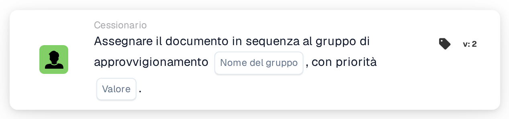

# Assegna in sequenza al gruppo di approvvigionamento

<figure><figcaption>
Versione 2
</figcaption></figure>

## **Scopo**

La scheda di workflow "**Assegnare il documento in sequenza al gruppo di approvvigionamento**" consente l'assegnazione sequenziale dei documenti a un gruppo di approvvigionamento specificato. Il valore di priorità determina l'ordine di assegnazione, dove i numeri più bassi rappresentano una priorità più alta.

## **Componenti della scheda**

1. **Gruppo**
   * **Descrizione**: Un campo di input di testo in cui è possibile inserire il nome del gruppo di approvvigionamento.
   * **Dettaglio**: Specifica il gruppo di approvvigionamento a cui verrà assegnato il documento.
2. **Priorità (Valore)**
   * **Descrizione**: Un campo di input numerico in cui è possibile impostare il livello di priorità per il gruppo.
   * **Dettaglio**: I numeri più bassi indicano una priorità più alta, garantendo che i documenti vengano assegnati ai gruppi in ordine crescente di priorità.

## **Funzionalità**

* **Assegnazione del documento**:\
  La scheda assegna i documenti al gruppo di approvvigionamento specificato in modo sequenziale.\
  I valori di priorità determinano l'ordine di assegnazione, con i numeri più bassi elaborati per primi.

## **Configurazione e impostazione**

1. Aggiungi la scheda **Assegnare il documento in sequenza** al tuo workflow.
2. Configura il campo **Gruppo**:
   * Inserisci il nome del gruppo di approvvigionamento nel campo di testo.
3. Configura il campo **Priorità (valore)**:
   * Inserisci un valore numerico per impostare la priorità di assegnazione.
4. Salva e attiva il workflow per applicare la configurazione.

## **Conclusione**

La scheda di workflow "Assign the Document Sequentially to the Procurement Group" garantisce un'allocazione efficace dei documenti ai gruppi di approvvigionamento in base alla priorità. Ciò migliora l'efficienza organizzativa e la gestione delle attività.

<!-- workflow-card-practical-example-20261021 -->

## Esempio pratico

**Quando utilizzarlo:** Dare priorità a un gruppo di approvvigionamento nell'ambito della revisione dei documenti.

**Configurazione:** Seleziona `Demo Procurement` e priorità `10`.

**Risultato atteso e controesempio:** Il documento riceve l'assegnazione al gruppo di approvvigionamento con priorità `10`. Verifica che le assegnazioni successive utilizzino le priorità numeriche più elevate previste.

Questa è una configurazione illustrativa e il risultato atteso. Utilizza campi, utenti e gruppi configurati nella tua organizzazione di test; non si afferma che questo esempio sia stato eseguito.
