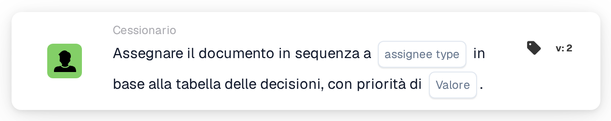
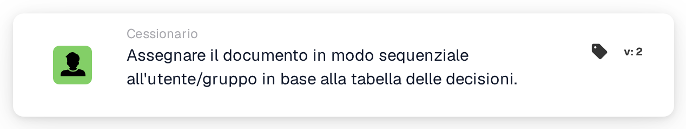

# Assegna in sequenza a utente/gruppo

<figure><figcaption>
Versione 2
</figcaption></figure>

<figure><figcaption>
Assegnare il documento in modo sequenziale all'utente/gruppo in base alla tabella delle decisioni. — Versione 2
</figcaption></figure>

## **Scopo**

La scheda di workflow "**Assegnare il documento in sequenza all'utente/gruppo in base alla tabella decisionale**" assegna dinamicamente i documenti a un utente o a un gruppo, a seconda della valutazione della decision table. Ciò garantisce che i documenti vengano instradati in modo appropriato in base a regole predefinite.

## **Componenti della scheda**

1. **Priorità (Valore)**
   * **Descrizione**: Specifica il livello di priorità per le assegnazioni, dove i numeri più bassi rappresentano una priorità più alta.
   * **Dettaglio**: Un campo di input numerico in cui è possibile impostare il valore di priorità per controllare la sequenza di assegnazione.

## **Funzionalità**

* **Valutazione della decision table**:\
  La decision table valuta condizioni predefinite per decidere se il documento viene assegnato a un utente o a un gruppo.
* **Assegnazione del documento**:
  * Se la decision table restituisce un utente, il documento viene assegnato direttamente a tale utente.
  * Se la decision table restituisce un gruppo, il documento viene assegnato al gruppo in modo sequenziale, rispettando il valore di priorità specificato.

## **Configurazione e impostazione**

1. Aggiungi la scheda **Assegnare il documento in sequenza** al tuo workflow.
2. Configura il campo **Priorità (valore)**:
   * Inserisci un valore numerico per impostare la priorità di assegnazione.
3. Salva e attiva il workflow per applicare la configurazione.

## **Conclusione**

La scheda di workflow "**Assegnare il documento in sequenza all'utente/gruppo in base alla tabella decisionale**" garantisce un instradamento dei documenti efficiente e dinamico. Sfruttando la logica della decision table e i valori di priorità, la scheda facilita un'assegnazione accurata a un utente o a un gruppo, semplificando i workflow documentali.

<!-- workflow-card-practical-example-20261021 -->

## Esempio pratico

**Quando utilizzarlo:** Utilizzare una tabella decisionale per selezionare un assegnatario del documento con priorità.

**Configurazione:** Configura una regola della tabella decisionale demo corrispondente che restituisce l'utente o il gruppo desiderato, quindi seleziona quella tabella sulla scheda.

**Risultato atteso e controesempio:** L'assegnatario restituito viene utilizzato per l'assegnazione sequenziale dei documenti. In assenza di rendimento corrispondente, non presupporre un assegnatario predefinito; controllare il risultato e il comportamento di fallback configurato di questa versione.

Questa è una configurazione illustrativa e il risultato atteso. Utilizza campi, utenti e gruppi configurati nella tua organizzazione di test; non si afferma che questo esempio sia stato eseguito.
