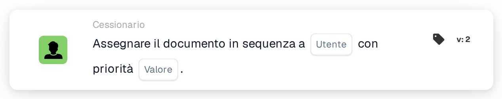

# Assegna in sequenza all'utente

<figure><figcaption>
Versione 2
</figcaption></figure>

## **Scopo**

La scheda di workflow "**Assegna in sequenza all'utente**" automatizza l'assegnazione dei documenti a un utente selezionato in modo sequenziale. Il valore di priorità determina l'ordine di assegnazione, dove i numeri più bassi rappresentano una priorità più alta.

## **Componenti della scheda**

1. **Utente**
   * **Descrizione**: All'utente selezionato verrà assegnato il documento in base alla sequenza del workflow.
   * **Dettaglio**: Un menu a discesa che elenca tutti gli utenti disponibili per l'assegnazione.
2. **Priorità (Valore)**
   * **Descrizione**: Un campo di input numerico in cui è possibile impostare il livello di priorità per l'utente.
   * **Dettaglio**: I numeri più bassi indicano una priorità più alta. I documenti vengono assegnati agli utenti in ordine crescente di priorità.

## **Funzionalità**

* **Assegnazione del documento**:\
  La scheda assegna i documenti all'utente selezionato in modo sequenziale, considerando il livello di priorità.\
  Se più utenti hanno la stessa priorità, i documenti vengono assegnati nell'ordine in cui gli utenti appaiono nel menu a discesa.

## **Configurazione e impostazione**

1. Aggiungi la scheda **Assegnare il documento in sequenza** al tuo workflow.
2. Configura il campo **Utente**:
   * Seleziona un utente dal menu a discesa.
3. Configura il campo **Priorità (valore)**:
   * Inserisci un valore numerico per impostare la priorità di assegnazione.
4. Salva e attiva il workflow per applicare la configurazione.

## **Conclusione**

La scheda di workflow "Assign the Document Sequentially to User" garantisce una distribuzione organizzata dei documenti assegnandoli in una sequenza prioritaria. Ciò migliora la gestione delle attività e riduce i ritardi nell'elaborazione.

<!-- workflow-card-practical-example-20261021 -->

## Esempio pratico

**Quando utilizzarlo:** Aggiungere un utente a una sequenza di approvazione dei documenti con priorità.

**Configurazione:** Seleziona `Demo Reviewer A` e priorità `10`. Aggiungi un compito separato con priorità `20` quando è necessario un revisore successivo.

**Risultato atteso e controesempio:** Le assegnazioni portano le priorità configurate; il valore numerico più basso ha la priorità più alta. Controlla la sequenza di assegnazione, non solo l'ordine delle carte sull'area di disegno.

Questa è una configurazione illustrativa e il risultato atteso. Utilizza campi, utenti e gruppi configurati nella tua organizzazione di test; non si afferma che questo esempio sia stato eseguito.
