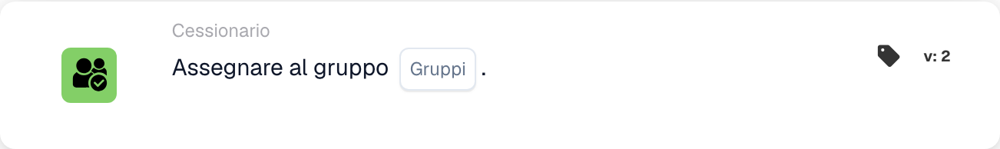

# Assegna al gruppo

<figure><figcaption>
Campi della scheda nella versione visualizzata. I campi non sono ancora configurati. Alcune etichette dell’interfaccia di questa versione sono ancora in inglese o tradotte in modo non corretto. Le spiegazioni di questa pagina sono tradotte; l’immagine mostra l’interfaccia reale.
</figcaption></figure>

## Scopo:

La scheda di workflow **"Assign to Group"** facilita l'assegnazione dei documenti a un **gruppo** specifico all'interno del sistema. Ciò garantisce che il documento venga elaborato dal team appropriato, semplificando il workflow. Potenziata nelle versioni successive, introduce la funzionalità decision tree per l'assegnazione dinamica dei gruppi.

## Componenti della scheda:

1. **Gruppi**
   * **Descrizione:** Specifica il **gruppo** a cui verrà assegnato il documento.
   * **Dettaglio:** Selezionato da un menu a discesa dei **gruppi** disponibili.

## **Componenti aggiuntivi nella Versione 3**

1. **Decision Tree (solo Versione 3)**
   * **Descrizione:** Consente l'utilizzo di una decision tree per determinare dinamicamente il **gruppo** a cui assegnare il documento.
   * **Opzioni:**
     * **True:** Abilita l'elaborazione della decision tree.
     * **False:** Disabilita l'elaborazione della decision tree.

## Funzionalità:

* **Valutazione della condizione:** La scheda esegue la sua azione solo se sia la sezione **"Quando"** che la sezione **"E"** risultano vere.
* **Assegnazione del documento:** Assegna il documento al **gruppo** selezionato. Nella **Versione 3**, la **albero decisionale** determina dinamicamente il gruppo di destinazione se abilitata.

## Configurazione e impostazione:

* **Seleziona il Gruppo:** Scegli il **gruppo** dal menu a discesa a cui assegnare il documento.
* **Utilizza l'albero decisionale (solo versione 3):** Abilita questa opzione se la **albero decisionale** deve essere utilizzata per l'assegnazione dinamica.

## Conclusione:

La scheda di workflow **"Assign to Group"** automatizza l'assegnazione dei documenti a **gruppi** predefiniti, migliorando il coordinamento del team. La **Versione 3** introduce la possibilità di assegnare dinamicamente i gruppi in base alla logica della decision tree.

<!-- workflow-card-practical-example-20261021 -->

## Esempio pratico

**Quando utilizzarlo:** Inserisci un documento in una coda di revisione condivisa.

**Configurazione:** Seleziona il gruppo configurato `Demo Finance`.

**Risultato atteso e controesempio:** Il documento viene assegnato al gruppo selezionato. Si tratta di un'assegnazione di documenti, non di una promessa di creazione di un'attività o di un'e-mail aggiuntiva.

Questa è una configurazione illustrativa e il risultato atteso. Utilizza campi, utenti e gruppi configurati nella tua organizzazione di test; non si afferma che questo esempio sia stato eseguito.
