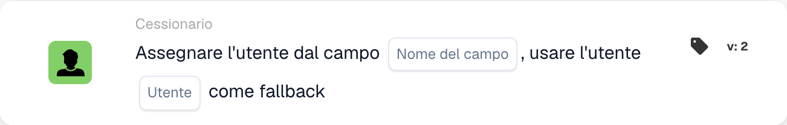

# Assegna utente dal campo

<figure><figcaption>
Campi della scheda nella versione visualizzata. I campi non sono ancora configurati. Alcune etichette dell’interfaccia di questa versione sono ancora in inglese o tradotte in modo non corretto. Le spiegazioni di questa pagina sono tradotte; l’immagine mostra l’interfaccia reale.
</figcaption></figure>

## **Scopo:**

La scheda di workflow **"Assegna utente dal campo con fallback"** assegna dinamicamente un utente in base al valore trovato in un campo specificato del documento. Se il campo non contiene un utente valido, viene selezionato un utente di riserva da un elenco predefinito di utenti disponibili per garantire che l'attività o l'azione venga assegnata correttamente.

## **Componenti della scheda:**

1. **Nome campo**
   * **Descrizione:** Specifica il **campo del documento** che contiene le informazioni sull'utente da assegnare.
   * **Dettaglio:** Questo campo viene valutato per determinare quale utente debba essere assegnato. Se il campo contiene un utente valido, a tale utente verrà assegnata l'attività. Se il campo è vuoto o non valido, verrà assegnato l'utente di riserva.
2. **Utente (Fallback)**
   * **Descrizione:** Specifica l'**utente di riserva** da assegnare se il campo del documento non contiene un utente valido.
   * **Dettaglio:** Viene fornito un menu a discesa con tutti gli utenti disponibili per la selezione. Questo utente verrà assegnato se il campo del documento è vuoto o non contiene un utente valido.

## **Funzionalità:**

* **Valutazione della condizione:**\
  La scheda esegue la sua azione solo se sia la sezione **"Quando"** che la sezione **"E"** risultano vere.
* **Assegnazione dell'utente basata sul campo:**\
  La scheda tenta innanzitutto di assegnare l'attività o l'azione all'utente identificato nel **Nome del campo**.
* **Assegnazione dell'utente di riserva:**\
  Se il campo non contiene un utente valido (o è vuoto), la scheda assegna l'attività all'utente di riserva selezionato dal menu a discesa **Utente (fallback)**.

## **Configurazione e impostazione:**

* **Seleziona il Field Name:**\
  Scegli il **campo del documento** che specifica l'utente per l'assegnazione.
* **Seleziona il Fallback Utente:**\
  Scegli l'**utente di riserva** dal menu a discesa. A questo utente verrà assegnata l'attività se il campo del documento non contiene un utente valido.

## **Conclusione:**

La scheda di workflow **"Assegna utente dal campo con fallback"** garantisce che un'attività o un'azione venga sempre assegnata a un utente valido. Se l'utente nel campo del documento non è disponibile, l'utente di riserva viene assegnato automaticamente, offrendo flessibilità e garantendo il completamento dell'attività.

<!-- workflow-card-practical-example-20261021 -->

## Esempio pratico

**Quando utilizzarlo:** Assegna il revisore nominato dai dati del documento.

**Configurazione:** Selezionare il campo `reviewer_name` e l'utente fallback `Demo Reviewer A`. Fornire un nome utente demo risolvibile nel primo test.

**Risultato previsto e controesempio:** Un valore di campo valido seleziona quell'utente. Un valore vuoto o irrisolvibile utilizza il fallback configurato; verificare entrambi i casi.

Questa è una configurazione illustrativa e il risultato atteso. Utilizza campi, utenti e gruppi configurati nella tua organizzazione di test; non si afferma che questo esempio sia stato eseguito.
