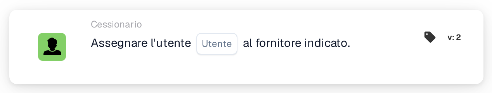

# Assegna utente al fornitore

<figure><figcaption>
Versione 2
</figcaption></figure>

## Scopo:

Questa scheda del workflow imposta l'utente assegnato di un fornitore registrato. L'utente assegnato è il referente interno responsabile del fornitore. La scheda non opera su un documento: è pensata per i workflow avviati da una modifica dello stato di un fornitore, ad esempio con la scheda When **Supplier status changed**. Il fornitore il cui stato è cambiato è il fornitore a cui viene assegnato l'utente.

## Componenti della scheda:

1. **Utente**
   * **Descrizione:** L'utente che diventa l'utente assegnato del fornitore.
   * **Dettaglio:** È possibile selezionare un utente dell'organizzazione. Se il fornitore ha già un utente assegnato, questo viene sostituito.

## Funzionalità:

* **Esecuzione dell'azione:** La scheda ricava il fornitore dall'esecuzione del workflow e salva l'utente selezionato come utente assegnato del fornitore. Il risultato viene registrato nel log del workflow.
* **Utilizzo con le e-mail:** Una volta assegnato un utente, è possibile indirizzargli e-mail con l'opzione **Utente assegnato al fornitore**, ad esempio nella scheda **Send Email**.
* **Dati mancanti:** Se sulla scheda non è selezionato alcun utente, la scheda non viene eseguita e segnala i dati mancanti nel log del workflow.
* **Errori:** Se il servizio fornitori rifiuta la richiesta o non risponde in tempo, la scheda termina con un errore.

## Configurazione e impostazione:

* La scheda può essere utilizzata in un workflow avviato da una modifica dello stato di un fornitore.
* La scheda può essere aggiunta dalla categoria **Cessionario**. Successivamente, nel campo **Utente** si seleziona l'utente che dovrebbe essere responsabile del fornitore.

## Conclusione:

La scheda del workflow "Assign User to Supplier" assegna automaticamente a ogni fornitore un referente responsabile quando il suo stato cambia, ad esempio dopo la registrazione. I passaggi successivi, come le e-mail all'utente assegnato, possono basarsi su questa assegnazione.
