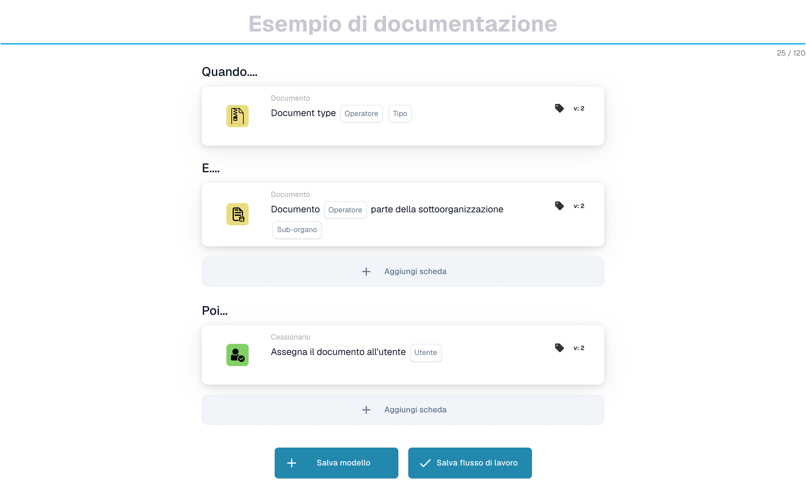
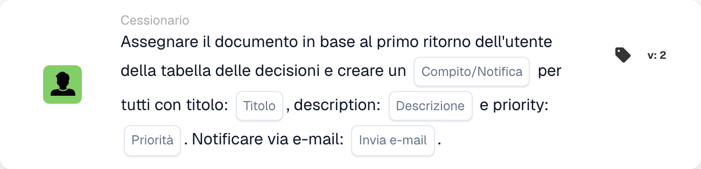
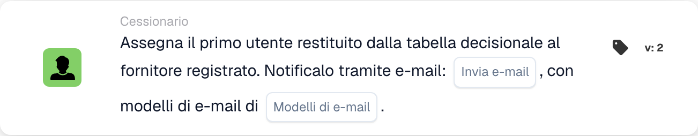

# Assegnazione documenti e tessere utente

## Assegnazione documenti e tessere utente - Guida completa

**Copertine:** 13 assegnazioni e carte relative agli utenti

***

Le schede in questa pagina vanno nel gruppo **Allora** del Workflow Builder: le azioni che vengono eseguite una volta che le condizioni Quando/E corrispondono:

<figure><figcaption><p>Esempio non salvato con schede Quando, E e Allora. Configurare tutti i campi prima dell’esecuzione. Alcune etichette dell’interfaccia di questa versione sono ancora in inglese o tradotte in modo non corretto. Le spiegazioni di questa pagina sono tradotte; l’immagine mostra l’interfaccia reale.</p></figcaption></figure>

***

### 📌 Informazioni sulla versione

**Carte multiversione:** DOC\_USER\_ASSIGN (v2 più recente, v3 deprecata), DOC\_GROUP\_ASSIGN (v2 più recente, v3 deprecata), OC\_ASSIGN\_DOC (v2)

**Importante: le versioni ** v3 hanno aggiunto il supporto dell'albero decisionale ma ora sono deprecate **Raccomandazione:** Utilizzare v2 sia per DOC\_USER\_ASSIGN che per DOC\_GROUP\_ASSIGN

📖 [Cronologia completa delle versioni](../../release.md) | [Versioni e comportamento delle carte](../../cards-overview/card-versions-guide.md)

***

## Assegnazione dei documenti di base

### Scheda: DOC\_USER\_ASSIGN / Assegna documento all'utente

#### Scopo

Assegna il documento a una persona specifica per la sua azione

#### Quando usarlo

* Il documento necessita della revisione di una persona specifica
* Trasferimento al singolo membro del team
* Monitoraggio della responsabilità
* Assegnare il lavoro a una persona nominata

#### Come funziona

```
Document is "assigned to" = John Smith
Only John can see it as assigned to him
John is responsible for this document
```

#### Esempio

```
Invoice arrives
    ↓
Assign Document to: John Smith (Finance Manager)
    ↓
Only John sees "Assigned to Me"
John must take action on it
```

#### Parametri

```
User: [Select which person]
```

#### Nota

Assegnare significa:

* Il documento risulta "assegnato a me" per quella persona
* Quella persona è responsabile
* Gli altri possono comunque vedere il documento (ma non come assegnato loro)
* Un compito alla volta per documento

***

### Scheda: DOC\_GROUP\_ASSIGN / Assegna documento al gruppo

#### Scopo

Assegna il documento a un gruppo (tutti i membri lo vedono come assegnato a loro)

#### Quando usarlo

* Documento per squadra, non individuale
* Possono gestire più persone
* Responsabilità condivisa
* Distribuzione del carico di lavoro del team

#### Come funziona

```
Document is "assigned to" = Finance Team (10 people)
All 10 team members see "Assigned to My Group"
Any team member can take action
```

#### Esempio

```
New vendor invoice
    ↓
Assign Document to: Procurement Team
    ↓
All procurement team members see it
First available person handles it
```

#### Parametri

```
Group: [Select which group]
```

#### Differenza

```
Individual Assignment:
- One person responsible
- That person sees "Assigned to Me"
- Others don't see assignment

Group Assignment:
- Team responsible
- All members see "Assigned to My Group"
- Anyone can claim/process
```

***

### Carta: ACTION\_ASSIGN\_DOC\_BASED\_ON\_DECISION\_TABLE

#### Scopo

Assegna il documento in base alla logica della tabella decisionale

#### Quando usarlo

* Fornitori diversi necessitano di gestori diversi
* Assegnazione in base all'importo
* Logica di routing complessa
* Molteplici condizioni per l'assegnazione

#### Come funziona

```
Decision Table Logic:
  If Supplier = "ABC Corp" → Assign to: Procurement Team
  If Supplier = "XYZ Inc" → Assign to: Direct Manager
  If Amount > €10000 → Assign to: Finance Director

Document arrives
    ↓
Check: Which condition matches?
    ↓
Assign accordingly
```

#### Esempio: assegnazione basata sull'importo

```
Invoice: €2000 from ABC Corp

Decision Table checks:
  Is amount > €10000? NO
  Is amount > €5000? NO
  Is amount > €1000? YES

Result: Assign to: Finance Manager
```

#### Esempio: assegnazione basata sul fornitore

```
Invoice from: Preferred Supplier

Decision Table:
  If preferred supplier → Finance Team
  If new supplier → Procurement Manager
  If blacklisted → Director Review

Result: Assign to: Finance Team
```

#### Parametri

```
Decision Table: [Select decision table]
(Decision table contains assignment logic)
```

***

### Carta: ACTION\_ASSIGN\_DOC\_DECISION\_TABLE\_SEQUENTIAL

#### Scopo

Assegna il documento in sequenza in base alla tabella decisionale con priorità

#### Quando usarlo

* Approvazioni sequenziali multiple
* Persone diverse a livelli diversi
* Catena di approvazione in base all'importo
* Percorso di escalation

#### Come funziona

```
First Decision: Who approves first?
    ↓
Assign to: Person 1
    ↓
Person 1 approves
    ↓
Second Decision: Who approves next?
    ↓
Assign to: Person 2
    ↓
Person 2 approves (final)
    ↓
Document Complete
```

#### Sistema di priorità

```
Priority 1: First assignment
Priority 2: Second assignment
Priority 3: Third assignment
(etc.)

Each must complete before next begins
```

#### Esempio: approvazione multilivello

```
Invoice: €50,000

Decision Table:
  €1k-€5k → Assign to: Finance Manager (Priority 1)
  €5k-€20k → Then: Assign to: Finance Director (Priority 2)
  €20k+ → Then: Assign to: CFO (Priority 3)

Invoice Flow:
1. Finance Manager reviews → approves
2. Finance Director reviews → approves
3. CFO reviews → approves final

Each step depends on previous completion
```

#### Parametri

```
Decision Table: [Select]
Priority Order: [Determined by decision table]
```

***

### Carta: ACTION\_ASSIGN\_DOC\_TO\_USER\_SEQUENTIAL

#### Scopo

Assegna il documento all'utente con priorità sequenziale

#### Quando usarlo

* Il documento richiede una persona specifica
* Chiara elaborazione sequenziale
* Incarico singolo con ordine

#### Come funziona

```
Assign Document to: User A (Priority 1)
    ↓
User A processes
    ↓
Then: Assign to User B (Priority 2)
    ↓
User B processes
```

#### Esempio

```
Invoice processing:
1. Assign to: Accounts Payable Clerk
2. Then: Assign to: Finance Manager
3. Then: Assign to: Director

Each person has their turn
```

***

### Carta: ACTION\_ASSIGN\_DOC\_TO\_GROUP\_SEQUENTIAL

#### Scopo

Assegna il documento in sequenza ai gruppi

#### Quando usarlo

* Approvazioni di più gruppi
* Reparti diversi in ogni fase
* Elaborazione sequenziale basata sul team

#### Come funziona

```
Step 1: Assign to Group A (Quality Team)
        Quality verifies
    ↓
Step 2: Assign to Group B (Finance Team)
        Finance reviews
    ↓
Step 3: Assign to Group C (Procurement)
        Procurement approves
```

#### Esempio

```
New Supplier Onboarding:

Step 1: Quality Team
  - Evaluate supplier capability
  - Check certifications

Step 2: Finance Team
  - Check payment terms
  - Verify pricing

Step 3: Procurement Team
  - Approve supplier
  - Set up in system

Document passes through all three
```

***

### Carta: ACTION\_ASSIGN\_DOC\_TO\_FACILITY\_GROUP

<!-- workflow-facility-example-direct-20261022 -->

Questa azione del workflow assegna un documento a un gruppo in base alle sedi dei suoi ordini di acquisto abbinati. Nella versione 2, `group_name` è un frammento di testo cercato nei nomi dei gruppi.

Esempio: un documento sintetico è abbinato all’ordine `DEMO-PO-100`, con `location_id=BERLIN`. I gruppi configurati sono `Receiving BERLIN` e `Receiving MUNICH`. Inserire `Receiving` in `group_name`. Il nome del gruppo deve contenere sia questo frammento sia la sede dell’ordine; il confronto non distingue maiuscole e minuscole.

Risultato previsto: il documento viene assegnato direttamente a `Receiving BERLIN`, se il suo stato consente l’assegnazione. Senza un ordine abbinato o un gruppo corrispondente, l’assegnazione non è riuscita; controllare i log del workflow. Evitare nomi ambigui: se corrispondono più gruppi, questa scheda non garantisce un ordine di selezione fisso.

Questa è una configurazione illustrativa; non è stato eseguito alcun workflow.

***

### Carta: ACTION\_ASSIGN\_DOC\_TO\_FACILITY\_GROUP\_SEQUENTIAL

<!-- workflow-facility-example-sequential-20261022 -->

Questa azione del workflow aggiunge i gruppi di sede corrispondenti alla coda di assegnazione sequenziale con una priorità configurata. Non rappresenta il trasferimento di merci tra fabbriche o magazzini.

Esempio: usare lo stesso ordine sintetico, la stessa sede e gli stessi gruppi dell’esempio precedente. Impostare `group_name=Receiving` e la priorità `value=10`. La versione 2 legge la sede dall’ordine abbinato e trova `Receiving BERLIN`.

Risultato previsto: una richiesta di assegnazione a quel gruppo viene aggiunta alla coda con priorità `10`. Se corrispondono più gruppi, ricevono tutti la stessa priorità; i loro nomi non stabiliscono un ordine di elaborazione. Verificare separatamente la coda e la successiva approvazione. Senza corrispondenze non viene creata un’assegnazione riuscita.

Questa è una configurazione illustrativa; non è stato eseguito alcun workflow.

***

### Carta: ACTION\_ASSIGN\_DOC\_TO\_PROCUREMENT\_GROUP

#### Scopo

Assegna il documento al dipartimento acquisti

#### Quando usarlo

* Gestione del team di procurement
* Lavoro relativo ai fornitori
* Relativo all'ordine di acquisto

#### Esempio

```
Vendor evaluation document
    ↓
Assign to: Procurement Group
    ↓
Procurement team evaluates vendor
```

***

### Carta: ACTION\_ASSIGN\_DOC\_TO\_PROCUREMENT\_GROUP\_SEQUENTIAL

#### Scopo

Assegnazione sequenziale all'interno degli appalti

#### Quando usarlo

* Processo di approvvigionamento in più fasi
* Catena di approvazione negli appalti

#### Esempio

```
Purchase Requisition:

Step 1: Buyer (Creates PO)
Step 2: Approver (Reviews)
Step 3: Director (Final sign-off)

Each step in sequence
```

***

### Scheda: ACTION\_CHANGE\_DOC\_SUBORG / Modifica sotto-organizzazione del documento

#### Scopo

Assegna il documento a diverse organizzazioni secondarie

#### Quando usarlo

* È stata selezionata l'organizzazione sbagliata
* È necessario spostarsi nel reparto corretto
* Ristrutturazione organizzativa

#### Come funziona

```
Current Sub-Org: Finance Department
    ↓
Change to: Accounting Department
    ↓
Document now belongs to Accounting
```

#### Esempio

```
Document for: Berlin Office
    ↓
Realize should be: Munich Office
    ↓
Change Sub-Organization to: Munich Office
```

***

### Carta: ACTION\_CHANGE\_DOC\_SUBORG\_BY\_FIELD\_TEXT

#### Scopo

Modifica l'organizzazione secondaria in base al valore del campo del documento

#### Quando usarlo

* Sottoorganizzazione memorizzata nel campo
* Abbina la posizione del documento al campo
* Assegnazione automatica dell'organizzazione

#### Come funziona

```
Document Field: "Delivery_Location" = "Berlin"
    ↓
Decision Table:
  If location = "Berlin" → Assign to: Berlin Sub-Org
  If location = "Munich" → Assign to: Munich Sub-Org

    ↓
Document assigned to: Berlin Sub-Org
```

#### Esempio

```
Invoice field: "Cost Center: CC-Berlin-001"
    ↓
System recognizes: Berlin location
    ↓
Change document to: Berlin Sub-Organization
```

***

### Carta: ACTION\_ASSIGN\_USER\_FROM\_FIELD\_WITH\_FALLBACK

#### Scopo

Assegna il documento all'utente dal campo, con fallback se l'utente non viene trovato

#### Quando usarlo

* Nome utente memorizzato nel campo documento
* Potrebbe non esistere nel sistema
* È necessario il backup se l'utente non è disponibile

#### Come funziona

```
Document Field: "Approver: John Smith"
    ↓
Try to assign to: John Smith
    ↓
If John doesn't exist:
    ↓
Use Fallback: Sarah Johnson (Manager)
    ↓
Document assigned to: Sarah Johnson
```

#### Parametri

```
Source Field: [Field containing user name]
Fallback User: [If source user not found]
```

#### Esempio

```
Invoice has field: "Contact Person: Mike Johnson"

Try to assign to: Mike Johnson
    ↓
If Mike not in system:
    ↓
Fallback to: Finance Manager (Robert)
```

***

### Carta: ACTION\_ASSIGN\_USER\_TO\_SUPPLIER

#### Scopo

Assegna il documento all'utente che gestisce quel fornitore

#### Quando usarlo

* Utente collegato al fornitore
* Responsabile contabilità fornitori
* Titolare del rapporto con il fornitore

#### Come funziona

```
Document Supplier: ABC Corp
    ↓
System checks: Who manages ABC Corp?
    ↓
Assign to: John Smith (ABC Corp Account Manager)
```

***

## Alberi decisionali di assegnazione

### Tabella decisionale Esempio 1: basata sull'importo

```
Amount ≤ €1000
  → Assign to: Finance Team

Amount €1000-€5000
  → Assign to: Finance Manager

Amount €5000-€20000
  → Assign to: Finance Director

Amount > €20000
  → Assign to: CFO
```

### Tabella decisionale Esempio 2: Basato sul fornitore

```
Supplier Type = "Preferred"
  → Assign to: Account Manager

Supplier Type = "New"
  → Assign to: Procurement Manager

Supplier Type = "Problem"
  → Assign to: Procurement Director
```

### Tabella decisionale Esempio 3: basata sul tipo di documento

```
Document Type = "Invoice"
  → Assign to: Accounts Payable Team

Document Type = "Credit Memo"
  → Assign to: Finance Manager

Document Type = "PO"
  → Assign to: Procurement Team
```

***

## Esempi di flusso di lavoro di assegnazione

### Esempio 1: Instradamento semplice

```
Document Arrives
    ↓
Check: Supplier = "ABC Corp"? YES
    ↓
Assign to: John Smith
(John handles ABC Corp)
    ↓
John reviews and approves
```

### Esempio 2: Approvazione sequenziale

```
Document Arrives
    ↓
Assign to: Finance Manager (Step 1)
    ↓
Manager reviews
    ↓
Passes to: Finance Director (Step 2)
    ↓
Director reviews
    ↓
Passes to: CFO (Step 3)
    ↓
CFO approves final
```

### Esempio 3: routing basato sull'importo

```
Invoice: €50,000
    ↓
Decision Table: Amount > €20k?
    ↓
YES → Assign to: CFO
    ↓
CFO approves directly
```

### Esempio 4: basato sulla struttura

```
Shipment for: Berlin Office
    ↓
Assign to: Berlin Warehouse Team
    ↓
Then assign to: Berlin Distribution Team
    ↓
Both teams process in sequence
```

***

## Migliori pratiche per l'assegnazione

✅ **Fai:**

* Mantieni semplici le tabelle decisionali
* Testare la logica di routing con esempi
* Assicurati che tutti i percorsi portino da qualche parte
* Avere un fallback per gli utenti mancanti
* Decisioni di instradamento dei documenti

❌ **Non farlo:**

* Creare assegnazioni circolari (A→B→A)
* Assegna a utenti inesistenti (senza fallback)
* Rendi il routing troppo complesso
* Dimentica di testare il routing
* Assegna a persone non disponibili

***

## Risoluzione dei problemi di assegnazione

### "Documento non assegnato"

**Causa:** Condizione non soddisfatta oppure l'utente non esiste

**Soluzione:**

* La condizione di controllo è vera
* Verificare che l'utente esista nel sistema
* Controlla le impostazioni di fallback
* Esaminare la logica della tabella decisionale

### "Persona sbagliata assegnata"

**Causa:** Tabella decisionale o logica di instradamento errata

**Soluzione:**

* Tabella decisionale del test
* Controlla le condizioni
* Verifica la mappatura degli utenti
* Esaminare i valori dei campi

### "L'incarico sembra saltare qualcuno"

**Causa:** Ordine sequenziale errato

**Soluzione:**

* Controlla i numeri prioritari
* Verificare che la sequenza sia corretta
* Prova con campione
* Esaminare l'ordinamento della tabella decisionale

***

## Confronto delle carte di incarico

| Carta                                                    | Assegna a               | Tipo di percorso  | Caso d'uso                   |
| ------------------------------------------------------- | ------------------------ | ----------- | -------------------------- |
| DOC\_USER\_ASSIGN                                       | Individuale               | Diretto      | Assegnazione semplice          |
| DOC\_GROUP\_ASSIGN                                      | Gruppo                    | Diretto      | Assegnazione della squadra            |
| ACTION\_ASSIGN\_DOC\_BASED\_ON\_DECISION\_TABLE         | Risultato della decisione          | Condizionale | Instradamento complesso            |
| ACTION\_ASSIGN\_DOC\_DECISION\_TABLE\_SEQUENTIAL        | Multiplo (sequenziale)    | Condizionale | Catena di approvazione             |
| ACTION\_ASSIGN\_DOC\_TO\_USER\_SEQUENTIAL               | Utente (sequenziale)        | Ordinato     | Passaggi utente sequenziali      |
| ACTION\_ASSIGN\_DOC\_TO\_GROUP\_SEQUENTIAL              | Gruppi (sequenziali)      | Ordinato     | Passi di gruppo sequenziali     |
| ACTION\_ASSIGN\_DOC\_TO\_FACILITY\_GROUP                | Gruppo di strutture           | Diretto      | Specifico per la struttura          |
| ACTION\_ASSIGN\_DOC\_TO\_FACILITY\_GROUP\_SEQUENTIAL    | Strutture (sequenziali)  | Ordinato     | Multistruttura             |
| ACTION\_ASSIGN\_DOC\_TO\_PROCUREMENT\_GROUP             | Appalti              | Diretto      | Flusso di lavoro dell'approvvigionamento       |
| ACTION\_ASSIGN\_DOC\_TO\_PROCUREMENT\_GROUP\_SEQUENTIAL | Approvvigionamento (sequenziale) | Ordinato     | Catena di approvazione degli appalti |
| ACTION\_CHANGE\_DOC\_SUBORG                             | Sottoorganizzazione         | Diretto      | Cambio di dipartimento          |
| ACTION\_CHANGE\_DOC\_SUBORG\_BY\_FIELD\_TEXT            | Organizzazione secondaria per campo         | Condizionale | Assegnazione sul campo     |
| ACTION\_ASSIGN\_USER\_FROM\_FIELD\_WITH\_FALLBACK       | Campo/Ripiego           | Condizionale | Assegnazione utente dinamica    |

***

## Carte correlate

* **ACTION\_CREATE\_TASK\_FOR\_USER** - Assegna l'attività alla stessa persona
* **ACTION\_SEND\_EMAIL** - Avvisa la persona assegnata
* **CONDITION\_USER\_IS\_ISNOT** - Controlla se è stata assegnata la persona corretta
* **CONDITION\_GROUP\_IS\_ISNOT** - Controlla se è stato assegnato il gruppo corretto

<!-- workflow-card-example-action_assign_doc_to_first_user_and_tasks-20261021 -->

### Assegnare il documento al primo utente restituito e creare attività

<figure><figcaption><p>Campi della scheda nella versione visualizzata. I campi non sono ancora configurati. Alcune etichette dell’interfaccia di questa versione sono ancora in inglese o tradotte in modo non corretto. Le spiegazioni di questa pagina sono tradotte; l’immagine mostra l’interfaccia reale.</p></figcaption></figure>

`ACTION_ASSIGN_DOC_TO_FIRST_USER_AND_TASKS` · versione 2

Utilizza una regola della tabella decisionale demo che restituisce gli utenti configurati `Demo Reviewer A` e `Demo Reviewer B` in quest'ordine. Seleziona l'opzione attività/notifica, titolo `Review invoice`, descrizione, priorità e preferenza email. Il primo utente restituito è la destinazione dell'assegnazione del documento e le attività/notifiche configurate sono destinate agli utenti restituiti. Controllare entrambe le uscite; una dichiarazione vuota non deve essere trattata come una cessione.

<!-- workflow-card-example-action_assign_supplier_user_first_return_of_dt-20261021 -->

### Assegnare il primo utente restituito al fornitore

<figure><figcaption><p>Campi della scheda nella versione visualizzata. I campi non sono ancora configurati. Alcune etichette dell’interfaccia di questa versione sono ancora in inglese o tradotte in modo non corretto. Le spiegazioni di questa pagina sono tradotte; l’immagine mostra l’interfaccia reale.</p></figcaption></figure>

`ACTION_ASSIGN_SUPPLIER_USER_FIRST_RETURN_OF_DT` · versione 2

Utilizzare un fornitore demo registrato e una regola della tabella decisionale il cui primo risultato utente è `Demo Supplier Owner`. Seleziona la tabella decisionale e, se necessario, i modelli di email. L'associazione fornitore-utente utilizza il primo utente restituito; non è la stessa operazione dell'assegnazione del documento. Verificare il risultato del fornitore separatamente e testare una restituzione della regola vuota.
