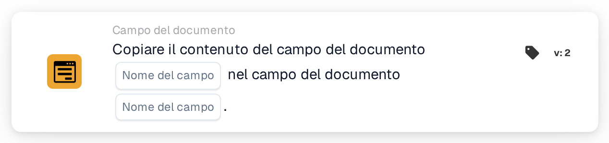

# Copia campo documento nel campo documento

<figure><figcaption>
Versione 2
</figcaption></figure>

## Scopo:

Questa scheda del workflow copia il contenuto di un campo del documento in un altro campo dello stesso documento. Può essere utilizzata, ad esempio, per compilare un campo necessario per un'esportazione o per una scheda successiva con un valore già estratto in un campo diverso.

## Componenti della scheda:

1. **Nome del campo** (primo)
   * **Descrizione:** Il campo del documento il cui contenuto viene copiato.
   * **Dettaglio:** Il nome di un campo del documento. Il nome viene confrontato in modo esatto, distinguendo tra maiuscole e minuscole. Il campo stesso non viene modificato.
2. **Nome del campo** (secondo)
   * **Descrizione:** Il campo del documento in cui viene copiato il contenuto.
   * **Dettaglio:** Il nome di un campo del documento. Il suo contenuto attuale viene sostituito dal contenuto copiato.

## Funzionalità:

* **Lettura del valore:** La scheda cerca il primo campo tra i campi del documento e ne legge il valore. Il valore trovato viene annotato nel log del workflow.
* **Esecuzione dell'azione:** Il valore viene scritto nel secondo campo e il documento viene salvato. Il valore copiato viene ripreso così com'è, senza conversione. Se il secondo campo non esiste ancora nel documento, viene aggiunto. Dopo una copia riuscita, le schede successive del workflow lavorano con il nuovo valore.
* **Dati mancanti:**
  * Se sulla scheda non è impostato uno dei due nomi di campo, la scheda non viene eseguita e segnala i dati mancanti nel log del workflow.
  * Se il documento non ha alcun campo con il primo nome, non viene copiato nulla e la scheda segnala che il campo non è stato trovato nel documento.
* **Errori:** Se il documento non può essere salvato, ad esempio perché il suo stato attuale non consente modifiche, la scheda termina con un errore e il secondo campo mantiene il contenuto precedente.

## Configurazione e impostazione:

* La scheda può essere aggiunta dalla categoria **Campo del documento**. Successivamente, il campo da cui copiare viene impostato nel primo campo **Nome del campo** e il campo in cui copiare nel secondo.
* Poiché il valore viene copiato senza conversione, i due campi dovrebbero contenere lo stesso tipo di dati, ad esempio testo in testo o una data in una data.

## Conclusione:

La scheda del workflow "Copy Document Field into Document Field" trasferisce valori tra campi senza lavoro manuale. Mantiene coerenti i campi correlati e consente ai passaggi successivi di un workflow di utilizzare un valore con il nome di campo che si aspettano.
