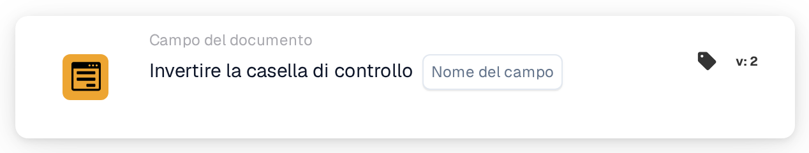

# Casella di controllo Inverti

<figure><figcaption>
Versione 2
</figcaption></figure>

## **Scopo:**

Questa scheda di workflow è progettata per invertire lo stato corrente di un campo casella di controllo. Se la casella di controllo è selezionata (true), verrà deselezionata (false), e viceversa. L'inversione avviene in base alle condizioni impostate nelle sezioni **"Quando"** e **"E"**. Questa scheda aiuta ad automatizzare i workflow in cui una condizione richiede di invertire una casella di controllo in base a criteri specifici.

## **Componenti della scheda:**

1. **Nome campo**
   * **Descrizione**: Specifica il campo casella di controllo da invertire.
   * **Dettaglio**: Il campo casella di controllo selezionato avrà il proprio stato invertito da true a false o da false a true in base al suo stato corrente.

## **Funzionalità:**

* **Valutazione della condizione**: Il sistema valuta le condizioni definite nelle sezioni **"Quando"** e **"E"**:
  * Se **entrambe le condizioni sono vere**, l'azione della sezione **"Then"** verrà eseguita, il che in questo caso significa che il campo casella di controllo verrà invertito.
  * Se **una delle condizioni è falsa**, la scheda non verrà eseguita e non verrà apportata alcuna modifica al campo casella di controllo.
* **Esecuzione dell'azione**: Se le condizioni nelle sezioni **"Quando"** e **"E"** risultano vere, lo stato del campo casella di controllo verrà invertito:
  * Se la casella di controllo è selezionata (true), verrà deselezionata (false).
  * Se la casella di controllo è deselezionata (false), verrà selezionata (true).

## **Configurazione e impostazione:**

Per configurare questa scheda, gli utenti devono:

1. **Selezionare il campo casella di controllo** (Field Name) che verrà invertito. I campi casella di controllo disponibili nel documento sono elencati per la selezione.
2. Il campo casella di controllo verrà invertito solo se le condizioni in entrambe le sezioni **"Quando"** e **"E"** sono vere.

## **Conclusione:**

La scheda di workflow **"Invert checkbox \[Field Name]"** offre uno strumento di automazione semplice ma potente per invertire i valori delle caselle di controllo in base a condizioni specifiche. Riducendo la necessità di aggiustamenti manuali delle caselle di controllo, questa scheda migliora l'efficienza nell'elaborazione dei documenti e garantisce coerenza tra i workflow.

<!-- workflow-card-practical-example-20261021 -->

## Esempio pratico

**Quando utilizzarlo:** Attiva o disattiva un valore booleano quando questa è l'operazione aziendale prevista.

**Configurazione:** Selezionare la casella di controllo `demo_flag` con il valore iniziale `false`.

**Risultato atteso e controesempio:** Un'esecuzione rende `true`; una seconda esecuzione lo fa nuovamente `false`. Utilizzare invece la casella di controllo Imposta quando i nuovi tentativi devono lasciare sempre lo stesso valore.

Questa è una configurazione illustrativa e il risultato atteso. Utilizza campi, utenti e gruppi configurati nella tua organizzazione di test; non si afferma che questo esempio sia stato eseguito.
