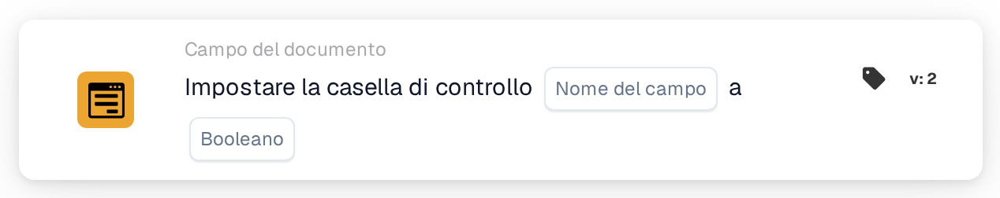

# Imposta la casella di controllo su

<figure><figcaption>
Versione 2
</figcaption></figure>

## **Scopo:**

Questa scheda di workflow è progettata per impostare un campo casella di controllo su un valore specificato (true o false) in base alle condizioni definite nelle sezioni **"Quando"** e **"E"**. Offre un modo semplice ma efficace per automatizzare gli aggiornamenti delle caselle di controllo quando determinati criteri sono soddisfatti, garantendo un'elaborazione dei documenti semplificata.

## **Componenti della scheda:**

1. **Nome campo:**
   * **Descrizione**: Specifica il campo in cui verrà impostata la casella di controllo.
   * **Dettaglio**: Il campo casella di controllo da aggiornare è identificato dal nome del campo.
2. **Booleano**
   * **Descrizione**: Definisce il valore su cui verrà impostato il campo casella di controllo quando entrambe le condizioni nelle sezioni **Dove** e **E** sono vere.
   * **Opzioni**:
     * **True**: La casella di controllo verrà impostata su **true** se le condizioni sono soddisfatte.
     * **False**: La casella di controllo verrà impostata su **false** se le condizioni sono soddisfatte.

## **Funzionalità:**

* **Valutazione della condizione**: Il sistema valuta le condizioni sia nella sezione **"Quando"** che nella sezione **"E"**.
* **Esecuzione dell'azione**: Se sia la sezione **"Quando"** che la sezione **"E"** risultano vere, il campo casella di controllo verrà aggiornato al valore specificato (true o false). Se una delle condizioni è falsa, non viene intrapresa alcuna azione e la casella di controllo rimane com'era.

## **Configurazione e impostazione:**

Per configurare questa scheda, gli utenti devono:

1. **Specificare il campo casella di controllo di destinazione** che verrà impostato su true o false quando le condizioni sono soddisfatte.
2. **Scegliere il valore (true o false)** su cui verrà impostata la casella di controllo al momento della valutazione della condizione.
3. La scheda esegue la sua azione solo se entrambe le condizioni nelle sezioni **"Quando"** e **"E"** risultano vere.

## **Conclusione:**

La scheda di workflow **"Set Checkbox"** è uno strumento di automazione semplice ed efficace per aggiornare i campi casella di controllo in base a condizioni specifiche. Garantendo che sia la sezione **"Quando"** che la sezione **"E"** siano soddisfatte, consente agli utenti di automatizzare i processi e ridurre l'intervento manuale, assicurando un'elaborazione dei documenti più fluida ed efficiente.

<!-- workflow-card-practical-example-20261021 -->

## Esempio pratico

**Quando usarlo:** Contrassegna una validazione riuscita con un flag esplicito.

**Configurazione:** Seleziona il campo della casella di controllo `review_complete` e impostalo su `true`.

**Risultato atteso e controesempio:** Il campo viene selezionato. Esegui l'azione con `false` in un test separato quando devi eliminare la bandiera.

Questa è una configurazione illustrativa e il risultato atteso. Utilizza campi, utenti e gruppi configurati nella tua organizzazione di test; non si afferma che questo esempio sia stato eseguito.
