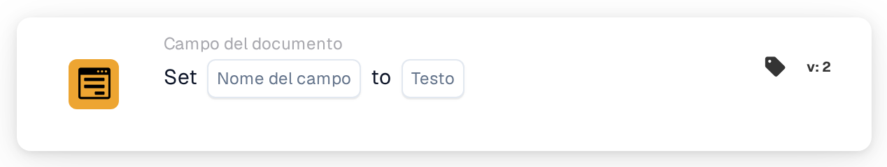

# Imposta su

<figure><figcaption>
Versione 2
</figcaption></figure>

## **Scopo:**

Questa scheda di workflow è progettata per impostare automaticamente un campo specificato del documento su un valore testuale predefinito in base alle condizioni definite nelle sezioni **"Quando"** e **"E"**. Consente agli utenti di semplificare l'inserimento dei dati garantendo che i campi vengano popolati con valori coerenti quando determinati criteri sono soddisfatti.

## **Componenti della scheda:**

1. **Nome campo**
   * **Descrizione**: Specifica il campo che verrà aggiornato con il valore testuale.
   * **Dettaglio**: Il campo selezionato verrà aggiornato con il valore testuale specificato se le condizioni nelle sezioni **"Quando"** e **"E"** sono soddisfatte.
2. **Testo**
   * **Descrizione**: Definisce il valore testuale che verrà impostato nel campo di destinazione quando le condizioni risultano vere.
   * **Dettaglio**: Può essere un messaggio personalizzato, uno stato o un valore predefinito che l'utente desidera scrivere nel campo. Il testo dovrebbe essere allineato al formato di input previsto del campo (es. alfanumerico, data o altri tipi di informazioni testuali).

## **Funzionalità:**

* **Valutazione della condizione**: Il sistema valuta le condizioni nelle sezioni **"Quando"** e **"E"**:
  * Se **entrambe le condizioni sono vere**, verranno eseguite le azioni definite nella sezione **"Then"**. Nello specifico, il campo di destinazione (Field Name) verrà popolato con il testo specificato.
  * Se **la sezione "Where" o la sezione "And" è falsa**, non viene intrapresa alcuna azione e il campo rimane invariato. Le azioni della sezione **Allora** vengono completamente saltate se una delle condizioni è falsa.
* **Esecuzione dell'azione**: Se entrambe le condizioni nelle sezioni **"Quando"** e **"E"** sono soddisfatte, il sistema popola automaticamente il campo specificato con il valore testuale scelto. Se le condizioni non sono soddisfatte, non viene apportata alcuna modifica al campo.

## **Configurazione e impostazione:**

Per configurare questa scheda:

1. **Seleziona il campo** (Field Name) che verrà aggiornato con il valore testuale. I campi disponibili nel documento sono elencati per la selezione.
2. **Specifica il valore testuale** che verrà scritto nel campo di destinazione quando le condizioni sono vere.
3. L'azione verrà eseguita solo se entrambe le condizioni nelle sezioni **"Quando"** e **"E"** risultano vere.

## **Conclusione:**

La scheda di workflow **"Imposta campo su testo"** offre un modo diretto per automatizzare il popolamento di valori testuali in campi specifici del documento in base a condizioni predefinite. Ciò riduce l'inserimento manuale dei dati e garantisce coerenza nell'elaborazione dei documenti, rendendola uno strumento utile per automatizzare i workflow e migliorare l'efficienza.

<!-- workflow-card-practical-example-20261021 -->

## Esempio pratico

**Quando utilizzarlo:** Scrivere un risultato di routing in un campo documento.

**Configurazione:** Seleziona il campo di testo `routing_result` e imposta il testo su `manual review`.

**Risultato atteso e controesempio:** Il campo contiene esattamente `manual review`. Una successiva condizione di uguaglianza può utilizzare quel valore; è un campo del documento piuttosto che una variabile dell'organizzazione.

Questa è una configurazione illustrativa e il risultato atteso. Utilizza campi, utenti e gruppi configurati nella tua organizzazione di test; non si afferma che questo esempio sia stato eseguito.
