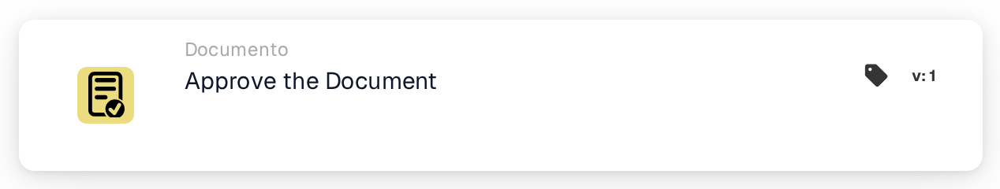
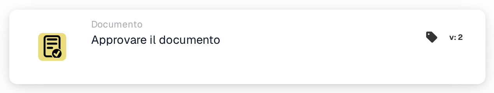

# Approvare il documento

<figure><figcaption>
Versione 1
</figcaption></figure>

<figure><figcaption>
Versione 2
</figcaption></figure>

## **Scopo:**

La scheda di workflow **"Approvare il documento"** viene utilizzata per contrassegnare un documento come approvato. Consente al documento di avanzare alla fase successiva del workflow, permettendo l'esecuzione di workflow di elaborazione o approvazione automatizzati. Questa scheda aiuta a semplificare i processi di gestione documentale, garantendo che solo i documenti approvati proseguano verso ulteriori azioni.

## **Componenti della scheda:**

1. **Stato di approvazione**
   * **Descrizione**: Questo componente contrassegna il documento come approvato.
   * **Dettaglio**: Quando questa scheda viene attivata, lo stato di approvazione del documento viene aggiornato per indicare l'approvazione. Questa azione può essere impostata in base alle condizioni definite nelle sezioni **"Quando"** e **"E"**.

## **Funzionalità:**

* **Valutazione della condizione**: Il sistema valuta le condizioni impostate nelle sezioni **"Quando"** e **"E"**.
  * Se **entrambe le condizioni sono vere**, il documento verrà contrassegnato come approvato.
  * Se **una delle condizioni è falsa**, la scheda non verrà eseguita e lo stato di approvazione del documento rimarrà invariato.
* **Esecuzione dell'azione**: Quando le condizioni sono soddisfatte, il documento viene approvato. Questa modifica si riflette nello stato del documento, consentendogli di proseguire ulteriormente nel workflow.

## **Conclusione:**

La scheda di workflow **"Approvare il documento"** è un componente chiave per automatizzare l'approvazione dei documenti nei workflow aziendali. Garantendo che vengano approvati solo i documenti che soddisfano criteri specifici, aiuta a mantenere la coerenza, riduce la supervisione manuale e consente un'elaborazione dei documenti più fluida.

<!-- workflow-card-practical-example-20261021 -->

## Esempio pratico

**Quando utilizzarlo:** Approvare un documento dopo che tutte le condizioni di revisione richieste sono state soddisfatte.

**Configurazione:** Posiziona questa azione dopo le condizioni di revisione nel ramo riuscito. Utilizza un documento dimostrativo in attesa di approvazione.

**Risultato atteso e controesempio:** L'azione approva quel documento. Un documento che non soddisfa una condizione precedente non raggiunge mai questa azione; la sola approvazione non costituisce la prova del completamento dell'esportazione ERP.

Questa è una configurazione illustrativa e il risultato atteso. Utilizza campi, utenti e gruppi configurati nella tua organizzazione di test; non si afferma che questo esempio sia stato eseguito.
