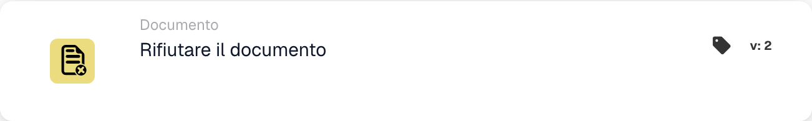

# Rifiutare il documento

<figure><figcaption>
Campi della scheda nella versione visualizzata. I campi non sono ancora configurati.
</figcaption></figure>

## **Scopo:**

La scheda di workflow **"Rifiutare il documento"** viene utilizzata per contrassegnare un documento come rifiutato all'interno di un workflow. Questa azione arresta l'avanzamento del documento e ne impedisce il passaggio alla fase successiva del workflow. Garantisce che i documenti che non soddisfano le condizioni o i criteri necessari vengano segnalati e bloccati da ulteriori elaborazioni.

## **Componenti della scheda:**

1. **Stato di rifiuto**
   * **Descrizione**: Questo componente contrassegna il documento come rifiutato, segnalando che non ha soddisfatto le condizioni richieste per l'approvazione.
   * **Dettaglio**: Quando viene attivata, questa scheda aggiorna lo stato del documento a "rifiutato". Questa decisione viene presa in base alle condizioni impostate nelle sezioni **"Quando"** e **"E"**.

## **Funzionalità:**

* **Valutazione della condizione**: Il sistema valuta le condizioni impostate nelle sezioni **"Quando"** e **"E"**.
  * Se **entrambe le condizioni sono vere**, il documento verrà rifiutato.
  * Se **una delle condizioni è falsa**, la scheda non verrà eseguita e lo stato del documento rimarrà invariato.
* **Esecuzione dell'azione**: Quando le condizioni sono soddisfatte, il documento viene contrassegnato come rifiutato. Questa azione garantisce che solo i documenti che soddisfano criteri specifici proseguano, mentre gli altri vengono segnalati e bloccati per la revisione o la correzione.

## **Conclusione:**

La scheda di workflow **"Rifiutare il documento"** è uno strumento essenziale per controllare il flusso dei documenti nei processi automatizzati. Consentendo il rifiuto dei documenti non conformi, garantisce che solo i documenti validi e accurati proseguano attraverso il workflow, migliorando l'efficienza e l'accuratezza nella gestione documentale.

<!-- workflow-card-practical-example-20261021 -->

## Esempio pratico

**Quando utilizzarlo:** Rifiutare un documento che soddisfa una regola di rifiuto definita.

**Configurazione:** Indirizza un documento demo deliberatamente non valido in questa azione, ad esempio dopo una decisione esplicita di rifiuto.

**Risultato atteso e controesempio:** Il documento viene rifiutato. Un documento valido deve seguire un ramo diverso e non deve eseguire questa azione.

Questa è una configurazione illustrativa e il risultato atteso. Utilizza campi, utenti e gruppi configurati nella tua organizzazione di test; non si afferma che questo esempio sia stato eseguito.
