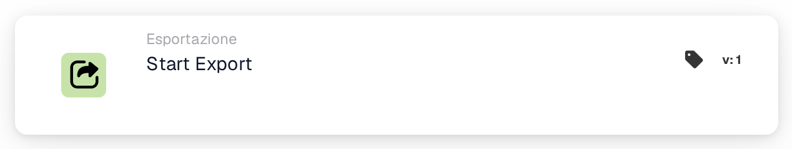
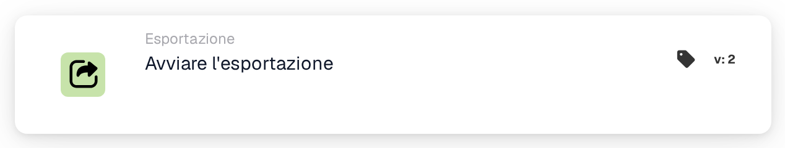
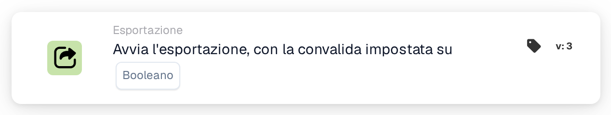
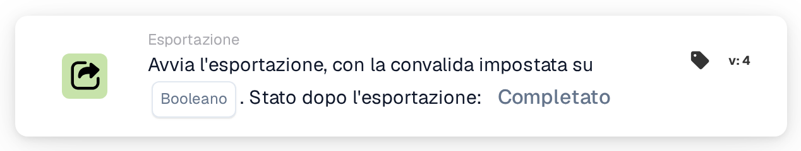

# Avvia l'esportazione

<figure><figcaption>
Versione 1
</figcaption></figure>

<figure><figcaption>
Versione 2
</figcaption></figure>

<figure><figcaption>
Versione 3
</figcaption></figure>

<figure><figcaption>
Versione 4
</figcaption></figure>

## **Scopo:**

La scheda del flusso di lavoro **"Avvia esportazione"** è progettata per avviare il processo di esportazione di un documento. Questa scheda funziona come un trigger all'interno del flusso di lavoro per avviare senza problemi l'operazione di esportazione una volta soddisfatte le condizioni nelle sezioni precedenti.

## **Componenti della Carta:**

1. **Azione**
   1. **Descrizione**: avvia il processo di esportazione del documento.
   2. **Dettaglio**: la carta utilizza le impostazioni di esportazione configurate nel sistema per elaborare ed esportare il documento.

## **Funzionalità:**

* **Valutazione Condizioni**: Il sistema valuta le condizioni impostate in **"Quando"** e **"E Sezioni"** del flusso di lavoro. Se tutte le condizioni sono vere, inizia il processo di esportazione.
* **Esportazione documento**: il documento viene elaborato ed esportato utilizzando la configurazione di esportazione predefinita o definita in precedenza.

## **Impostazione e configurazione:**

Le versioni precedenti utilizzano le impostazioni di esportazione già definite nel sistema. Nella versione 4, configura la convalida e seleziona Stato dopo l'esportazione. Controlla anche che:

1. Le condizioni **"Quando"** e **"E Sezioni"** sono configurate correttamente, poiché la scheda viene eseguita solo se queste condizioni risultano vere.
2. Una configurazione di esportazione valida è associata al documento nel sistema.

## **Conclusione:**

La scheda del flusso di lavoro **"Avvia esportazione"** fornisce un modo semplificato e automatizzato per avviare il processo di esportazione. Facendo affidamento su impostazioni preconfigurate e valutazioni condizionali, garantisce un'elaborazione dei documenti efficiente e accurata.

## Versioni delle carte e stato dei risultati

La dichiarazione precedente relativa all'assenza di configurazione specifica della scheda si applica alla precedente scheda Start Export. Avvia esportazione con convalida v4 include la convalida e **Stato dopo l'esportazione**. Scegli `finished` per chiudere un documento esportato con successo, o `exported` per mantenerlo aperto per ulteriori elaborazioni. Le versioni precedenti mantengono `finished`. Vedi [Esporta carte e stato dei risultati](../../cards-overview/export-cards-guide.md) per impostazioni predefinite, errori e test.

<!-- workflow-card-practical-example-20261021 -->

## Esempio pratico

**Quando utilizzarlo:** Esportare un documento dopo aver superato i controlli richiesti.

**Configurazione:** Selezionare lo stato post-esportazione supportato, ad esempio `exported` quando il documento deve rimanere disponibile per ulteriori elaborazioni. Assicurarsi che l'esportatore configurato e i dati richiesti siano pronti.

**Risultato previsto e controesempio:** Dopo l'esportazione riuscita, viene applicato lo stato del risultato selezionato. Un errore dell'esportatore non indica un'esportazione completata; ispezionarne il registro e testare il ramo fallito.

Questa è una configurazione illustrativa e il risultato atteso. Utilizza campi, utenti e gruppi configurati nella tua organizzazione di test; non si afferma che questo esempio sia stato eseguito.
