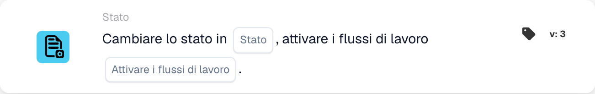

# Cambia stato in

<figure><figcaption>
Campi della scheda nella versione visualizzata. I campi non sono ancora configurati.
</figcaption></figure>

## **Scopo:**

La scheda di workflow **"Change Status"** viene utilizzata per cambiare lo stato di un documento in uno degli stati predefiniti — **Errore, Rifiutato, Pronto per la convalida, In attesa di approvazione, In attesa di seconda approvazione** — e, facoltativamente, attivare i workflow associati in base al cambiamento di stato. Questa scheda automatizza il processo di aggiornamento degli stati e di attivazione dei workflow, garantendo una gestione documentale efficiente e una corretta gestione degli errori.

## **Componenti della scheda:**

1. **Stato**
   * **Descrizione**: Specifica il nuovo stato da applicare al documento.
   * **Opzioni**:
     * **Error**: Contrassegna il documento come affetto da un errore.
     * **Rifiutato**: Indica che il documento è stato rifiutato e non proseguirà ulteriormente.
     * **Pronto per la convalida**: Imposta il documento per essere revisionato e validato dall'utente o dal processo di sistema successivo.
     * **In attesa di approvazione**: Mette il documento in uno stato di attesa per l'approvazione.
     * **In attesa della seconda approvazione**: Mette il documento in attesa di un secondo livello di approvazione, se applicabile.
2. **Attiva flussi di lavoro**
   * **Descrizione**: Determina se eventuali workflow successivi debbano essere attivati dopo il cambiamento di stato.
   * **Opzioni**:
     * **True**: Avvia eventuali workflow pertinenti in base al cambiamento di stato.
     * **False**: Impedisce l'esecuzione dei workflow dopo il cambiamento di stato.

## **Funzionalità:**

* **Valutazione della condizione**: Il sistema valuta le condizioni impostate nelle sezioni **"Quando"** e **"E"**. Se queste condizioni sono vere, la scheda procede a cambiare lo stato del documento al valore selezionato.
* **Aggiornamento dello stato**: Una volta soddisfatte le condizioni, lo stato del documento viene aggiornato a una delle opzioni predefinite (Error, Rejected, Ready for Validation, Pending Approval, Pending Second Approval), a seconda della selezione dell'utente.
* **Attivazione dell'azione di workflow**: Se **Attiva flussi di lavoro** è impostato su **True**, il sistema avvia automaticamente eventuali workflow associati dopo l'aggiornamento dello stato. Se impostato su **False**, non vengono attivati workflow aggiuntivi e il processo termina con il cambiamento di stato.

## **Configurazione e impostazione:**

Per configurare questa scheda, gli utenti devono:

1. Specificare lo **Stato** desiderato su cui verrà impostato il documento al momento della valutazione della condizione (Error, Rejected, Ready for Validation, Pending Approval o Pending Second Approval).
2. Scegliere se **Attiva flussi di lavoro** dopo il cambiamento di stato selezionando **True** o **False**.
3. La scheda esegue la sua azione solo se entrambe le condizioni nelle sezioni **"Quando"** e **"E"** risultano vere.

## **Conclusione:**

La scheda di workflow **"Change Status"** offre un approccio semplificato per gestire gli stati dei documenti e attivare i workflow correlati. Garantisce che i documenti vengano automaticamente instradati allo stato corretto e che vengano intraprese le azioni necessarie, a seconda del cambiamento di stato. Impostando condizioni chiare per l'esecuzione, riduce lo sforzo manuale e migliora l'efficienza del workflow.

<!-- workflow-card-practical-example-20261021 -->

## Esempio pratico

**Quando utilizzarlo:** Sposta un documento rivisto in uno stato di elaborazione definito.

**Configurazione:** Seleziona lo stato `Demo Review` configurato e disabilita l'attivazione di flussi di lavoro aggiuntivi per questo esempio.

**Risultato atteso e controesempio:** Il documento riceve lo stato selezionato. Questa azione da sola non esegue l'esportazione configurata separatamente.

Questa è una configurazione illustrativa e il risultato atteso. Utilizza campi, utenti e gruppi configurati nella tua organizzazione di test; non si afferma che questo esempio sia stato eseguito.
