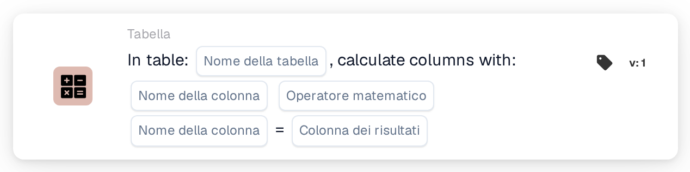

# Calcola colonne con

<figure><figcaption>
Versione 1
</figcaption></figure>

<figure><figcaption>
Versione 2
</figcaption></figure>

## Scopo:

Questa scheda del workflow calcola, riga per riga, un valore a partire da due colonne di una tabella del documento e salva il risultato in una colonna risultato. Può essere utilizzata, ad esempio, per calcolare i totali di riga a partire da quantità e prezzo unitario.

## Video di amministrazione:



[Guarda il video con sottotitoli italiani](https://docbits-videos.fra1.cdn.digitaloceanspaces.com/settings-assistant/workflow-card-calc-columns-admin/v1/it.html) · [Leggi la trascrizione](https://docbits-videos.fra1.cdn.digitaloceanspaces.com/settings-assistant/workflow-card-calc-columns-admin/v1/it.txt)

## Componenti della scheda:

1. **Tabella**
   * **Descrizione:** La tabella del documento in cui viene eseguito il calcolo.
2. **Prima colonna**
   * **Descrizione:** La colonna con il primo valore di ogni riga.
3. **Operazione**
   * **Opzioni:**
     * **+** somma il secondo valore al primo.
     * **-** sottrae il secondo valore dal primo.
     * **\*** moltiplica i due valori.
     * **/** divide il primo valore per il secondo.
4. **Seconda colonna**
   * **Descrizione:** La colonna con il secondo valore di ogni riga.
5. **Colonna risultato**
   * **Descrizione:** La colonna in cui viene salvato il risultato di ogni riga.
   * **Dettaglio:** Il nome viene salvato in lettere maiuscole, con gli spazi sostituiti da trattini bassi (`total amount` diventa `TOTAL_AMOUNT`). Se la colonna non esiste ancora, la scheda la aggiunge; se esiste, i suoi valori vengono sostituiti.

Le versioni 1 e 2 della scheda hanno le stesse impostazioni e funzionano allo stesso modo.

## Funzionalità:

* **Calcolo:** Per ogni riga della tabella, la scheda legge le due colonne (maiuscole e minuscole nei nomi delle colonne non hanno importanza), applica l'operazione e scrive il risultato nella colonna risultato. I risultati vengono arrotondati a quattro cifre decimali. Successivamente il documento viene salvato con i nuovi valori.
  * Un valore vuoto o mancante conta come `0`. Se entrambi i valori di una riga sono vuoti, il risultato di quella riga resta vuoto.
  * Una divisione per zero lascia vuoto il risultato di quella riga.
  * Con **+**, due valori che non sono numeri vengono uniti con uno spazio anziché sommati. Con le altre operazioni, un valore che non è un numero provoca un errore e non viene salvato alcun risultato.
* **Esecuzione dell'azione:** Se il calcolo e il salvataggio riescono, il workflow prosegue con le schede successive. Se la tabella non esiste sul documento, se un valore non può essere calcolato o se il documento non può essere salvato, la scheda segnala un errore nel log del workflow.
* **Scheda di prova:** Quando la scheda viene eseguita con **Scheda di prova**, il calcolo viene solo simulato e il documento non viene modificato.

## Configurazione e impostazione:

* La scheda può essere aggiunta come azione Then dalla categoria **Tabella**. Successivamente si selezionano la tabella, le due colonne, l'operazione e la colonna risultato.
* **Esempio:** Tabella `INVOICE_TABLE`, `QUANTITY` **\*** `UNIT_PRICE`, colonna risultato `TOTAL_AMOUNT`. Una riga con quantità 2 e prezzo unitario 10 ottiene 20, una riga con 3 e 4 ottiene 12.
* Poiché un valore vuoto conta come `0`, un prezzo mancante dà come risultato `0`. Verificare che le colonne di input siano compilate, ad esempio con una condizione prima di questa scheda, può aiutare a evitare totali errati.
* Per sottrazione e divisione, l'ordine delle due colonne è importante.

## Conclusione:

La scheda del workflow "Calculate Columns with" aggiunge automaticamente valori calcolati alle righe della tabella. I totali di riga e valori simili sono disponibili per le schede successive e per l'esportazione senza calcolo manuale.
