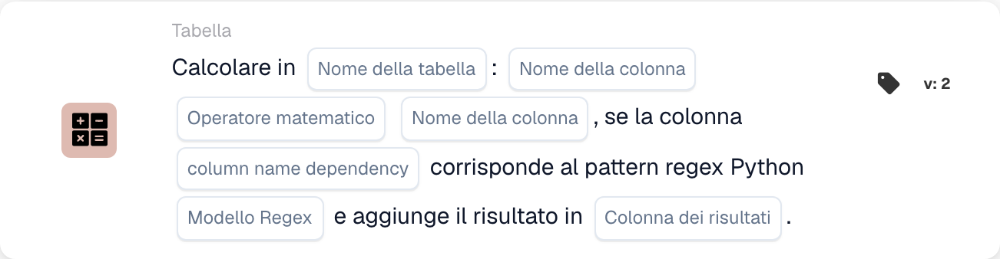

# Calcola

<figure><figcaption>
Campi della scheda nella versione visualizzata. I campi non sono ancora configurati. Alcune etichette dell’interfaccia di questa versione sono ancora in inglese o tradotte in modo non corretto. Le spiegazioni di questa pagina sono tradotte; l’immagine mostra l’interfaccia reale.
</figcaption></figure>

## **Scopo:**

La scheda di workflow **"Calcola con dipendenza Regex"** consente agli utenti di eseguire calcoli tra colonne in una tabella selezionata, con una condizione aggiuntiva basata su un pattern di espressione regolare (regex) applicato a una colonna di dipendenza. Se il pattern corrisponde, il calcolo viene eseguito e il risultato viene memorizzato nella colonna dei risultati specificata.

## **Componenti della scheda:**

1. **Nome tabella**
   * **Descrizione:** Specifica la **tabella** in cui verranno calcolate le colonne.
   * **Dettaglio:** Viene fornito un menu a discesa di tutte le **tabelle** disponibili per la selezione.
2. **Nome colonna (1a colonna)**
   * **Descrizione:** Specifica la **prima colonna** coinvolta nel calcolo.
   * **Dettaglio:** Viene fornito un elenco di tutte le **colonne** disponibili per la selezione.
3. **Operazione**
   * **Descrizione:** Definisce l'operazione matematica da applicare tra le colonne selezionate.
   * **Opzioni:**
     * **Add (+):** Somma il valore della seconda colonna al valore della prima colonna.
     * **Sottrarre (-):** Sottrae il valore della seconda colonna dalla prima colonna.
     * **Multiply (\*):** Moltiplica il valore della prima colonna per il valore della seconda colonna.
     * **Dividi (/):** Divide il valore della prima colonna per la seconda colonna.
4. **Nome colonna (2a colonna)**
   * **Descrizione:** Specifica la **seconda colonna** coinvolta nel calcolo.
   * **Dettaglio:** Viene fornito un elenco di tutte le **colonne** disponibili per la selezione.
5. **Nome colonna (dipendenza)**
   * **Descrizione:** Specifica la **colonna di dipendenza** a cui verrà applicato il pattern regex.
   * **Dettaglio:** Viene fornito un elenco di tutte le **colonne** disponibili per la corrispondenza del pattern.
6. **Modello Regex**
   * **Descrizione:** Definisce il **pattern regex** che verrà utilizzato per la corrispondenza con la colonna di dipendenza.
   * **Dettaglio:** Se il valore nella colonna di dipendenza corrisponde al pattern regex, il calcolo verrà eseguito.
7. **Colonna dei risultati**
   * **Descrizione:** Specifica la **colonna dei risultati** in cui verrà memorizzato il risultato del calcolo.
   * **Dettaglio:** Può essere una colonna nuova o esistente in cui verrà memorizzato il valore calcolato.

## **Funzionalità:**

* **Valutazione della condizione:**
  * La scheda esegue la sua azione solo se sia la sezione **"Quando"** che la sezione **"E"** risultano vere.
  * La scheda esegue la sua azione solo se il valore nella colonna di dipendenza corrisponde al **pattern regex** fornito.
* **Calcolo delle colonne:**\
  Se il pattern regex corrisponde, la scheda esegue l'operazione matematica selezionata tra le due colonne scelte.
* **Memorizzazione del risultato:**\
  Il risultato del calcolo viene memorizzato nella **colonna dei risultati** selezionata.

## **Configurazione e impostazione:**

* **Seleziona la tabella:**\
  Scegli la **tabella** in cui verranno calcolate le colonne.
* **Scegli le colonne:**\
  Seleziona la **prima colonna** e la **seconda colonna** che verranno utilizzate nel calcolo.
* **Seleziona l'operazione:**\
  Scegli l'operazione matematica (**Add (+)**, **Sottrai (-)**, **Multiply (\*)**, **Divide (/)**) da applicare tra le colonne.
* **Seleziona la colonna di dipendenza:**\
  Scegli la **colonna di dipendenza** a cui verrà applicato il pattern regex.
* **Definisci il pattern regex:**\
  Inserisci il **pattern regex** a cui la colonna di dipendenza dovrebbe corrispondere.
* **Seleziona la colonna dei risultati:**\
  Scegli la **colonna dei risultati** in cui verrà memorizzato il valore calcolato.

## **Conclusione:**

La scheda di workflow **"Calcola con dipendenza Regex"** offre un modo potente per eseguire calcoli con logica condizionale basata su un pattern regex. Ciò garantisce che solo le righe in cui la colonna di dipendenza corrisponde al pattern specificato vengano sottoposte al calcolo specificato, e il risultato viene memorizzato nella colonna dei risultati scelta.

<!-- workflow-card-practical-example-20261021 -->

## Esempio pratico

**Quando utilizzarlo:** Calcola solo le righe della tabella selezionate.

**Configurazione:** Utilizza la tabella demo `lines` con colonne numeriche `quantity` e `unit_price`. Seleziona le righe corrispondenti tramite la colonna di dipendenza e l'espressione regolare, moltiplica le colonne numeriche e scrivi in ​​`line_total`.

**Risultato atteso e controesempio:** Una riga selezionata con `2` e `10` riceve `20`. Una riga non corrispondente deve essere controllata separatamente per confermare che non è stata selezionata per il calcolo.

Questa è una configurazione illustrativa e il risultato atteso. Utilizza campi, utenti e gruppi configurati nella tua organizzazione di test; non si afferma che questo esempio sia stato eseguito.
