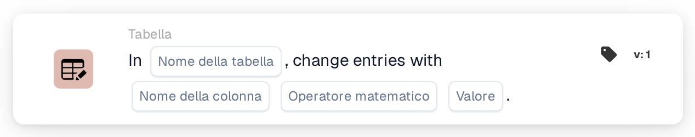
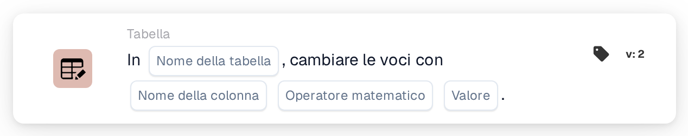

# Cambia voci con

<figure><figcaption>
Versione 1
</figcaption></figure>

<figure><figcaption>
Versione 2
</figcaption></figure>

## **Scopo:**

La scheda di workflow **"Change Entries in Table"** viene utilizzata per aggiornare le voci in una tabella di database specificata. Consente di selezionare una **tabella** e una **colonna**, quindi eseguire operazioni matematiche (addizione, sottrazione, moltiplicazione o divisione) sui valori in quella colonna, utilizzando un valore specificato.

## **Componenti della scheda:**

1. **Nome tabella**
   * **Descrizione:** Specifica la **tabella** in cui verranno aggiornate le voci.
   * **Dettaglio:** Viene fornito un menu a discesa delle **tabelle** disponibili, che consente di selezionare la tabella di destinazione per l'aggiornamento delle voci.
2. **Nome colonna**
   * **Descrizione:** Specifica la **colonna** all'interno della tabella selezionata da aggiornare.
   * **Dettaglio:** Verrà fornito un elenco di tutte le **colonne** disponibili per la selezione.
3. **Operazione**
   * **Descrizione:** Definisce l'operazione matematica da eseguire sui valori della **colonna**.
   * **Opzioni:**
     * **Add (+):** Somma un **valore** specificato al valore corrente nella colonna selezionata.
     * **Sottrarre (-):** Sottrae un **valore** specificato dal valore corrente nella colonna selezionata.
     * **Multiply (\*):** Moltiplica il valore corrente nella colonna selezionata per un **valore** specificato.
     * **Dividi (/):** Divide il valore corrente nella colonna selezionata per un **valore** specificato.
4. **Valore**
   * **Descrizione:** Specifica il **valore** da utilizzare nell'operazione selezionata.
   * **Dettaglio:** È il numero che verrà sommato, sottratto, moltiplicato o diviso con le voci nella colonna selezionata.

## **Funzionalità:**

* **Valutazione della condizione:**\
  La scheda esegue la sua azione solo se sia la sezione **"Quando"** che la sezione **"E"** risultano vere.
* **Aggiornamento delle voci della tabella:**\
  La scheda esegue l'operazione selezionata (**+**, **-**, **\*** o **/**) sui valori nella **colonna** scelta della **tabella** selezionata, utilizzando il **valore** specificato.

## **Configurazione e impostazione:**

* **Seleziona la tabella:**\
  Scegli la **tabella** in cui verranno applicate le modifiche.
* **Scegli la colonna:**\
  Seleziona la **colonna** all'interno della tabella che desideri aggiornare.
* **Seleziona l'operazione:**\
  Scegli l'operazione matematica (**+**, **-**, **\***, **/**) da applicare ai valori della colonna selezionata.
* **Inserisci il valore:**\
  Fornisci il **valore** da utilizzare nell'operazione selezionata.

## **Conclusione:**

La scheda di workflow **"Change Entries in Table"** consente aggiornamenti automatizzati delle voci del database selezionando una **tabella**, una **colonna** e l'**operazione matematica** desiderata. Questa scheda è essenziale per eseguire modifiche dei dati in blocco o calcoli all'interno del database.

<!-- workflow-card-practical-example-20261021 -->

## Esempio pratico

**Quando utilizzarlo:** Applica una regolazione numerica a una colonna della tabella esistente.

**Configurazione:** Seleziona tabella demo `lines`, colonna numerica `quantity`, addizione e valore `1`.

**Risultato atteso e controesempio:** Una quantità esistente di `2` diventa `3`. Ripetendo questa azione si produce `4`, quindi usalo solo quando è prevista l'aggiunta ripetuta.

Questa è una configurazione illustrativa e il risultato atteso. Utilizza campi, utenti e gruppi configurati nella tua organizzazione di test; non si afferma che questo esempio sia stato eseguito.
