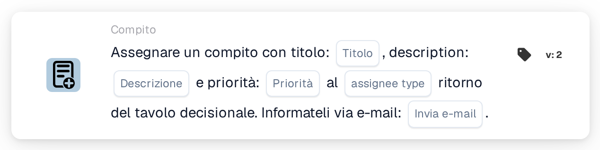
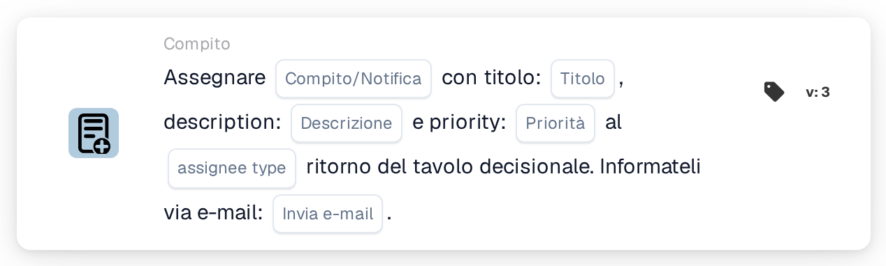

# Assegna un'attività con un titolo

<figure><figcaption>
Versione 2
</figcaption></figure>

<figure><figcaption>
Versione 3
</figcaption></figure>

## **Scopo:**

La scheda di workflow "Assign Task / Notification from Decision Table" è progettata per assegnare dinamicamente attività o notifiche in base ai risultati di una decision table. Questa scheda garantisce che le attività o le notifiche vengano assegnate all'utente o al gruppo corretto secondo la logica definita nella decision table, con una notifica email opzionale inviata al destinatario.

## **Componenti della scheda:**

1. **Titolo**
   * **Descrizione**: Specifica il titolo dell'attività o della notifica creata.
   * **Dettaglio**: Il titolo dovrebbe fornire contesto e descrivere lo scopo dell'attività o della notifica.
2. **Descrizione**
   * **Descrizione**: Definisce il contenuto o lo scopo dell'attività o della notifica.
   * **Dettaglio**: Fornisce informazioni aggiuntive sull'attività o sulla notifica, spiegando il contesto o l'azione richiesta.
3. **Priorità**
   * **Descrizione**: Definisce il livello di urgenza dell'attività o della notifica.
   * **Opzioni**:
     * **High**: Attività o notifiche che richiedono attenzione immediata.
     * **Medio**: Attività importanti che dovrebbero essere gestite tempestivamente.
     * **Low**: Attività che possono essere gestite in un secondo momento.
4. **Tipo assegnatario**
   * **Descrizione**: Specifica l'utente o il gruppo assegnato all'attività o alla notifica in base all'output della decision table.
   * **Dettaglio**: La decision table valuta dinamicamente le condizioni e restituisce l'utente o il gruppo appropriato per l'assegnazione.
5. **Notifica e-mail**
   * **Descrizione**: Configura se verrà inviata una notifica email all'utente o al gruppo assegnato.
   * **Opzioni**:
     * **True**: Invia una notifica email al destinatario.
     * **False**: Non viene inviata alcuna notifica email.

#### **Componenti aggiuntivi nella Versione 3**

1. **Tipo di notifica**
   * **Descrizione**: Specifica se la scheda crea un'attività o una notifica.
   * **Opzioni**:
     * **Compito**: Crea un'attività assegnata all'utente o al gruppo della decision table.
     * **Notification**: Invia una notifica all'utente o al gruppo della decision table.

## **Funzionalità:**

* **Valutazione della condizione:**\
  La scheda esegue la sua azione solo se sia la sezione **"Quando"** che la sezione **"E"** risultano vere.
* **Assegnazione di attività / notifica**\
  La scheda assegna l'attività o la notifica all'utente o al gruppo identificato dalla decision table. La decision table valuta dinamicamente condizioni predefinite e restituisce il destinatario corrispondente.
* **Notifica email**\
  Se configurato, viene inviata una notifica email all'utente o al gruppo assegnato.
* **Funzionalità della Versione 3**\
  Nella Versione 3, la scheda consente la creazione di un'attività o di una notifica, offrendo maggiore flessibilità per la gestione delle attività e la comunicazione.

## **Configurazione e impostazione:**

1. **Definisci i dettagli di attività o notifica**:\
   Inserisci il titolo, la descrizione e la priorità dell'attività o della notifica.
2. **Configura la decision table**:\
   Configura la decision table per determinare dinamicamente quale utente o gruppo debba essere assegnato all'attività o alla notifica.
3. **Abilita la notifica email**:\
   Specifica se debba essere inviata una notifica email all'utente o al gruppo assegnato.
4. **Specifica il tipo di notifica (Versione 3)**:\
   Scegli se la scheda creerà un'attività o invierà una notifica.

## **Conclusione:**

La scheda di workflow **"Assegna attività/notifica dalla tabella decisionale"** automatizza l'assegnazione di attività o notifiche in base a condizioni dinamiche definite in una decision table. La Versione 3 ne potenzia la funzionalità consentendo agli utenti di scegliere tra la creazione di un'attività o di una notifica, e garantisce che venga sempre assegnato il destinatario corretto. La funzionalità di notifica email tiene informati gli utenti, semplificando la comunicazione e la gestione delle attività.

<!-- workflow-card-practical-example-20261021 -->

## Esempio pratico

**Quando utilizzarlo:** Crea un'attività per l'assegnatario restituito da una tabella decisionale.

**Configurazione:** Utilizza una regola demo corrispondente che restituisce `Demo Reviewer A`, titolo `Review invoice` e la priorità desiderata.

**Risultato atteso e controesempio:** L'attività risultante viene assegnata in base all'assegnatario restituito. Testare separatamente una regola senza corrispondenza e ispezionare il registro della carta.

Questa è una configurazione illustrativa e il risultato atteso. Utilizza campi, utenti e gruppi configurati nella tua organizzazione di test; non si afferma che questo esempio sia stato eseguito.
