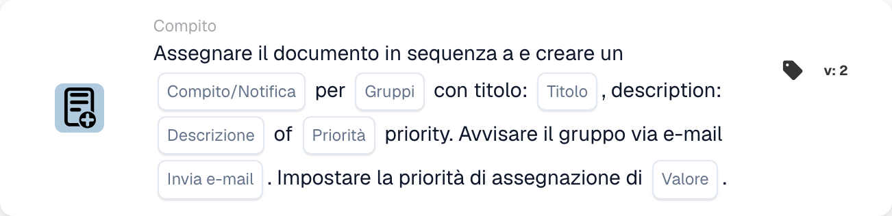

# Assegna documento e crea attività/notifica per il gruppo

<figure><figcaption>
Campi della scheda nella versione visualizzata. I campi non sono ancora configurati.
</figcaption></figure>

## **Scopo**

La scheda di workflow "**Assegna documento e crea attività/notifica per il gruppo**" assegna un documento a un gruppo specificato, crea un'attività o una notifica con dettagli personalizzabili e, facoltativamente, invia una notifica email al gruppo. Questa scheda supporta inoltre l'assegnazione di un valore di priorità numerica per determinare l'ordine di esecuzione.

## **Componenti della scheda**

1. **Nome gruppo**
   * **Descrizione:** Specifica il gruppo che riceverà l'attività o la notifica.
   * **Dettaglio:** Un menu a discesa per scegliere il nome del gruppo a cui verranno assegnati il documento e l'attività/notifica.
2. **Attività/Notifica**
   * **Descrizione:** Specifica il tipo di azione da creare per il gruppo.
   * **Dettaglio:** Un menu a discesa per selezionare "Task" o "Notification" in base all'azione desiderata.
3. **Titolo**
   * **Descrizione:** Fornisce il titolo dell'attività o della notifica.
   * **Dettaglio:** Un campo per aggiungere un titolo conciso e descrittivo per l'attività o la notifica.
4. **Descrizione**
   * **Descrizione:** Descrive ulteriormente l'attività o la notifica.
   * **Dettaglio:** Un campo per fornire dettagli aggiuntivi sullo scopo dell'attività o sul contenuto della notifica.
5. **Priorità**
   * **Descrizione:** Definisce il livello di urgenza dell'attività o della notifica.
   * **Opzioni:**
     * **High:** Richiede attenzione immediata.
     * **Medio:** Importante ma non urgente.
     * **Low:** Può essere gestita in seguito.
6. **Invia posta**
   * **Descrizione:** Configura se viene inviata una notifica email al gruppo.
   * **Opzioni:**
     * **True:** Invia una notifica email.
     * **False:** Non invia un'email.
7. **Valore**
   * **Descrizione:** Imposta la priorità numerica per l'assegnazione del documento.
   * **Dettaglio:** Un campo per inserire un valore numerico, dove un numero più basso indica una priorità più alta.

## **Funzionalità**

* **Valutazione della condizione:**\
  La scheda esegue le sue azioni solo se le condizioni configurate del workflow sono soddisfatte.
* **Assegnazione del documento e creazione di attività/notifica:**\
  Il documento viene assegnato al gruppo specificato nel campo "Group Name". Viene creata un'attività o una notifica con il titolo, la descrizione e il livello di priorità configurati.
* **Notifica email:**\
  Se "Send Mail" è impostato su True, viene inviata una notifica email al gruppo per informarlo dell'attività o della notifica.

## **Configurazione e impostazione**

1. **Definisci il nome del gruppo:**
   * Inserisci il nome del gruppo nel campo Group Name.
2. **Seleziona Task/Notifica:**
   * Scegli "Task" o "Notification" dal menu a discesa Task/Notification.
3. **Imposta i dettagli di Task/Notification:**
   * Inserisci il Title e la Description per l'attività o la notifica.
   * Seleziona la priorità dal menu a discesa (Alta, Media o Bassa).
4. **Abilita la notifica email:**
   * Configura l'opzione Send Mail su True o False, a seconda che debba essere inviata una notifica email.
5. **Assegna la priorità numerica:**
   * Inserisci un valore numerico nel campo Value per determinare la priorità dell'assegnazione, dove i valori più bassi hanno la precedenza.
6. Salva la configurazione della scheda e attiva il workflow.

## **Conclusione**

La scheda di workflow "Assign Document and Create Task/Notification for Group" garantisce che i documenti vengano assegnati al gruppo appropriato creando al contempo attività o notifiche con opzioni di priorità e notifica email personalizzabili. Ciò semplifica la gestione documentale e migliora l'efficienza del workflow.

<!-- workflow-card-practical-example-20261021 -->

## Esempio pratico

**Quando utilizzarlo:** Crea un'attività di squadra insieme all'assegnazione di documenti con priorità.

**Configurazione:** Seleziona `Demo Finance`, titolo `Review invoice` e le priorità del compito e dell'assegnazione.

**Risultato atteso e controesempio:** Controllare separatamente l'assegnazione del documento di gruppo e l'attività/notifica. Un'attività da sola non costituisce la prova dell'approvazione di un documento completato.

Questa è una configurazione illustrativa e il risultato atteso. Utilizza campi, utenti e gruppi configurati nella tua organizzazione di test; non si afferma che questo esempio sia stato eseguito.
