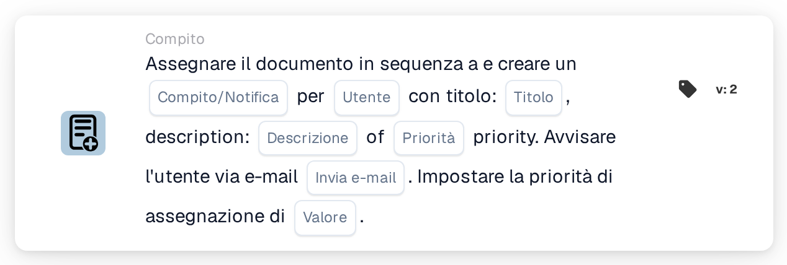

# Assegna documento e crea attività/notifica per l'utente

<figure><figcaption>
Versione 2
</figcaption></figure>

## **Scopo**

La scheda di workflow "**Assegna documento e crea attività/notifica per l'utente**" assegna un documento a un utente specificato, crea un'attività o una notifica con dettagli configurabili e, facoltativamente, invia una notifica email all'utente. Questa scheda consente inoltre di impostare un valore di priorità numerica per determinare l'ordine di esecuzione.

## **Componenti della scheda**

1. **Utente**
   * **Descrizione:** Specifica l'utente che riceverà l'attività o la notifica.
   * **Dettaglio:** Un menu a discesa per selezionare l'utente a cui verranno assegnati il documento e l'attività/notifica.
2. **Attività/Notifica**
   * **Descrizione:** Specifica il tipo di azione da creare per l'utente.
   * **Dettaglio:** Un menu a discesa per scegliere "Task" o "Notification" in base all'azione prevista.
3. **Titolo**
   * **Descrizione:** Il titolo dell'attività o della notifica.
   * **Dettaglio:** Un campo per fornire un titolo conciso e descrittivo per l'attività o la notifica.
4. **Descrizione**
   * **Descrizione:** Dettagli aggiuntivi sull'attività o sulla notifica.
   * **Dettaglio:** Un campo per descrivere lo scopo dell'attività o fornire contesto per la notifica.
5. **Priorità**
   * **Descrizione:** Definisce il livello di urgenza dell'attività o della notifica.
   * **Opzioni:**
     * **High:** Richiede attenzione immediata.
     * **Medio:** Importante ma non urgente.
     * **Low:** Può essere gestita in seguito.
6. **Invia posta**
   * **Descrizione:** Configura se viene inviata una notifica email all'utente.
   * **Opzioni:**
     * **True:** Invia una notifica email all'utente.
     * **False:** Non viene inviata alcuna notifica email.
7. **Valore**
   * **Descrizione:** Imposta la priorità numerica per l'assegnazione del documento.
   * **Dettaglio:** Un campo per inserire un valore numerico, dove i numeri più bassi indicano una priorità più alta.

## **Funzionalità**

* **Valutazione della condizione:**\
  La scheda esegue le sue azioni solo se le condizioni configurate del workflow sono soddisfatte.
* **Assegnazione del documento e creazione di attività/notifica:**\
  Il documento viene assegnato all'utente specificato nel campo "User". Viene creata un'attività o una notifica con il titolo, la descrizione e il livello di priorità forniti.
* **Notifica email:**\
  Se "Send Mail" è impostato su True, viene inviata un'email all'utente per notificarlo dell'attività o della notifica.

## **Configurazione e impostazione**

1. **Seleziona l'utente:**
   * Scegli l'utente dal menu a discesa User.
2. **Configura i dettagli di Task/Notification:**
   * Seleziona "Task" o "Notification" dal menu a discesa Task/Notification.
   * Inserisci il Title e la Description per l'attività o la notifica.
   * Imposta la Priority selezionando High, Medium o Low dal menu a discesa.
3. **Abilita la notifica email:**
   * Configura l'opzione Send Mail su True o False, a seconda che debba essere inviata una notifica email.
4. **Imposta la priorità numerica:**
   * Inserisci un valore numerico nel campo Value per determinare la priorità dell'assegnazione, dove i valori più bassi vengono elaborati per primi.
5. Salva la configurazione della scheda e attiva il workflow.

## **Conclusione**

La scheda di workflow "Assign Document and Create Task/Notification for User" garantisce che i documenti vengano assegnati all'utente appropriato creando al contempo attività o notifiche con priorità definite e notifiche email opzionali. Questa scheda aiuta a semplificare la delega delle attività e migliora l'efficienza del workflow.

<!-- workflow-card-practical-example-20261021 -->

## Esempio pratico

**Quando utilizzarlo:** Crea un'attività di revisione dell'utente insieme all'assegnazione di documenti con priorità.

**Configurazione:** Selezionare `Demo Reviewer A`, titolo dell'attività `Review invoice`, priorità dell'attività e priorità di assegnazione.

**Risultato atteso e controesempio:** Verificare che esistano sia l'assegnazione del documento che l'attività/notifica per l'utente selezionato, con le priorità previste.

Questa è una configurazione illustrativa e il risultato atteso. Utilizza campi, utenti e gruppi configurati nella tua organizzazione di test; non si afferma che questo esempio sia stato eseguito.
