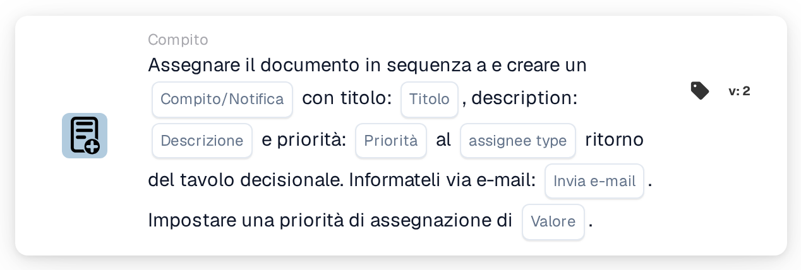

# Assegna documento e crea attività/notifica

<figure><figcaption>
Versione 2
</figcaption></figure>

## **Scopo**

La scheda di workflow "**Assegna documento e crea attività/notifica in base alla tabella decisionale**" assegna un documento e crea un'attività o una notifica con dettagli configurabili. L'assegnatario è determinato dal risultato di una decision table e la scheda consente di impostare le priorità e di inviare notifiche email.

## **Componenti della scheda**

1. **Tipo assegnatario**
   * **Descrizione:** Specifica se il risultato della decision table assegna il documento e l'attività/notifica a un utente o a un gruppo.
   * **Dettaglio:** Un campo per configurare il tipo di assegnatario come "User" o "Group" in base all'output della decision table.
2. **Attività/Notifica**
   * **Descrizione:** Specifica il tipo di azione da creare per l'assegnatario.
   * **Dettaglio:** Un menu a discesa per selezionare "Task" o "Notification" in base alle esigenze del workflow.
3. **Titolo**
   * **Descrizione:** Il titolo dell'attività o della notifica.
   * **Dettaglio:** Un campo per fornire un titolo conciso che identifichi l'attività o la notifica.
4. **Descrizione**
   * **Descrizione:** Dettagli aggiuntivi sull'attività o sulla notifica.
   * **Dettaglio:** Un campo per descrivere lo scopo e il contesto dell'attività o della notifica.
5. **Priorità**
   * **Descrizione:** Definisce il livello di urgenza dell'attività o della notifica.
   * **Opzioni:**
     * **High:** Richiede attenzione immediata.
     * **Medio:** Importante ma non urgente.
     * **Low:** Può essere gestita in seguito.
6. **Tipo assegnatario**
   * **Descrizione:** Questo campo determina il tipo di assegnatario (User o Group) a cui vengono assegnati il documento e l'attività/notifica.
   * **Dettaglio:** Un menu a discesa per selezionare se l'attività/notifica viene assegnata a un utente o a un gruppo in base all'output della decision table.
7. **Invia posta**
   * **Descrizione:** Configura se inviare una notifica email all'assegnatario.
   * **Opzioni:**
     * **True:** Invia una notifica email.
     * **False:** Non viene inviata alcuna notifica email.
8. **Valore**
   * **Descrizione:** Imposta la priorità numerica per l'assegnazione del documento.
   * **Dettaglio:** Un campo per inserire un valore numerico, dove i numeri più bassi indicano una priorità più alta.

## **Funzionalità**

* **Valutazione della condizione:**\
  La scheda esegue le sue azioni solo se le condizioni del workflow sono soddisfatte.
* **Valutazione della decision table:**\
  La decision table determina se il documento e l'attività/notifica vengono assegnati a un utente o a un gruppo.
* **Assegnazione del documento e creazione di attività/notifica:**\
  Il documento viene assegnato al risultato della decision table. Viene creata un'attività o una notifica con il titolo, la descrizione e il livello di priorità specificati.
* **Notifica email:**\
  Se "Send Mail" è impostato su True, viene inviata una notifica email all'assegnatario.

## **Configurazione e impostazione**

1. **Definisci il Tipo Assegnatario:**
   * Configura il campo Assegnatario Digita su "Utente" o "Gruppo" in base all'output della tabella decisionale.
2. **Seleziona Task/Notifica:**
   * Scegli "Task" o "Notification" dal menu a discesa Task/Notification.
3. **Imposta i dettagli di Task/Notification:**
   * Inserisci il Title e la Description per l'attività o la notifica.
   * Seleziona la priorità (Alta, Media o Bassa) dal menu a discesa.
4. **Abilita la notifica email:**
   * Imposta l'opzione Send Mail su True o False, a seconda che debba essere inviata una notifica email.
5. **Imposta la priorità numerica:**
   * Inserisci un valore numerico nel campo Value per determinare la priorità di assegnazione, dove i numeri più bassi vengono elaborati per primi.
6. Salva la configurazione della scheda e attiva il workflow.

## **Conclusione**

La scheda di workflow "Assign Document and Create Task/Notification Based on Decision Table" garantisce che le attività o le notifiche vengano assegnate dinamicamente all'utente o al gruppo appropriato in base ai risultati della decision table. Questa scheda facilita una delega efficiente delle attività, priorità personalizzabili e notifiche email opzionali per migliorare la reattività del workflow.

<!-- workflow-card-practical-example-20261021 -->

## Esempio pratico

**Quando utilizzarlo:** Utilizzare il risultato di una tabella decisionale per assegnare un documento e creare un'attività di revisione in sequenza.

**Configurazione:** Selezionare la tabella decisionale demo, il titolo dell'attività `Review invoice`, la descrizione e la priorità. Configura il formato di restituzione dell'assegnatario e l'opzione email richiesta dalla versione selezionata.

**Risultato atteso e controesempio:** L'assegnatario restituito corrispondente riceve l'assegnazione del documento documentato e l'attività/notifica. Verificare entrambi i risultati; una tabella vuota restituita non è un'assegnazione riuscita.

Questa è una configurazione illustrativa e il risultato atteso. Utilizza campi, utenti e gruppi configurati nella tua organizzazione di test; non si afferma che questo esempio sia stato eseguito.
