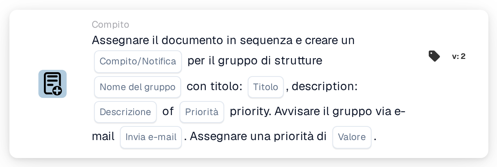

# Assegnare al gruppo della struttura e creare un'attività/notifica

<figure><figcaption>
Versione 2
</figcaption></figure>

## Scopo:

Questa scheda del workflow aggiunge all'assegnazione sequenziale del documento il gruppo responsabile della struttura dell'ordine di acquisto del documento e associa a questo passaggio un compito o una notifica. La struttura viene ricavata dagli ordini di acquisto a cui il documento è abbinato e il gruppo viene individuato in base al nome, che contiene sia il nome del gruppo inserito sulla scheda sia il codice della struttura. Il compito o la notifica appartiene al passaggio del gruppo nella sequenza.

## Componenti della scheda:

1. **Compito/Notifica**
   * **Descrizione:** Definisce se per il gruppo viene creato un compito o una notifica.
   * **Opzioni:**
     * **Compito:** Viene creato un compito.
     * **Notifica:** Viene creata una notifica.
2. **Nome del gruppo**
   * **Descrizione:** La parte del nome comune a tutti i gruppi di struttura.
   * **Dettaglio:** Un testo che viene confrontato con i nomi dei gruppi di utenti dell'organizzazione. Un gruppo corrisponde se il suo nome contiene questo testo e il codice della struttura dell'ordine di acquisto. Il confronto non distingue tra maiuscole e minuscole. Ad esempio, con il nome del gruppo **Approver** e un ordine di acquisto per la struttura **1000**, corrisponderebbe un gruppo denominato **Approver 1000**.
3. **Titolo**
   * **Descrizione:** Il titolo del compito o della notifica.
   * **Dettaglio:** Un breve testo che identifica il compito o la notifica.
4. **Descrizione**
   * **Descrizione:** Ulteriori dettagli sul compito o sulla notifica.
   * **Dettaglio:** Un testo che descrive che cosa dovrebbe essere fatto o perché il gruppo viene informato.
5. **Priorità**
   * **Descrizione:** L'urgenza del compito o della notifica.
   * **Opzioni:**
     * **peso elevato:** Il compito o la notifica viene creato con priorità alta.
     * **peso medio:** Il compito o la notifica viene creato con priorità media.
     * **peso basso:** Il compito o la notifica viene creato con priorità bassa.
6. **Invia e-mail**
   * **Descrizione:** Definisce se il gruppo viene informato del compito anche via e-mail.
   * **Opzioni:**
     * **Vero:** Al gruppo viene inviata una notifica via e-mail.
     * **Falso:** Non viene inviata alcuna notifica via e-mail.
7. **Valore**
   * **Descrizione:** La priorità del gruppo all'interno dell'assegnazione sequenziale.
   * **Dettaglio:** Un numero intero. I numeri più bassi vengono prima, con 0 come priorità più alta. Se non viene inserito alcun valore, o viene inserito un valore negativo, viene utilizzata la priorità 1.

## Funzionalità:

* **Individuazione della struttura:** La scheda legge gli ordini di acquisto a cui il documento è abbinato e raccoglie il codice della struttura (la sede dell'ordine di acquisto) di ciascuno di essi.
* **Individuazione del gruppo:** Per ogni codice di struttura, la scheda cerca i gruppi di utenti il cui nome contiene sia il **Nome del gruppo** indicato sulla scheda sia il codice della struttura. I codici di struttura per cui non viene trovato alcun gruppo vengono elencati nel log del workflow.
* **Esecuzione dell'azione:** Ogni gruppo corrispondente viene aggiunto all'assegnazione sequenziale con la priorità indicata nel campo **Valore**, insieme al compito o alla notifica. L'assegnazione vera e propria avviene al termine dell'esecuzione del workflow: la voce con il numero di priorità più basso viene assegnata per prima e ne viene creato il compito o la notifica. Tutte le voci, compresa la prima, vengono memorizzate sul documento come sue richieste di approvazione, e da queste vengono ricavati i passaggi successivi della sequenza in ordine crescente di priorità. Se un'altra scheda ha già assegnato direttamente il documento nella stessa esecuzione, questa prima assegnazione sequenziale viene saltata e il relativo compito o notifica non viene creato in questa esecuzione.
* **Valori predefiniti:** Se non è impostata alcuna priorità del compito, viene utilizzato **peso medio**. Se **Invia e-mail** non è impostato, non viene inviata alcuna e-mail. Se **Compito/Notifica** non è impostato, viene creato un compito e il log del workflow annota l'impostazione mancante.
* **Dati mancanti:**
  * Se il nome del gruppo, il titolo o la descrizione sono vuoti, la scheda non viene eseguita e segnala i dati mancanti nel log del workflow.
  * Se il documento non è abbinato a un ordine di acquisto, la scheda segnala i dati mancanti invece di aggiungere un gruppo.
  * Se nessun gruppo corrisponde ad alcuno dei codici di struttura, non viene aggiunto alcun gruppo e il log del workflow annota che non è stato trovato alcun gruppo corrispondente.

## Configurazione e impostazione:

* I gruppi di utenti dovrebbero essere denominati in modo che ogni nome contenga la parte comune del nome e il codice della struttura, ad esempio **Approver 1000**, **Approver 2000**.
* La scheda può essere aggiunta dalla categoria **Compito**. Successivamente è possibile configurare il tipo (**Compito** o **Notifica**), la parte comune del nome dei gruppi, il titolo, la descrizione, la priorità del compito, l'impostazione dell'e-mail e la posizione nella sequenza (**Valore**).
* Per formare una catena di approvatori, è possibile combinare nel workflow più schede sequenziali, ciascuna con il proprio **Valore**.

## Conclusione:

La scheda del workflow "Assign to Facility Group and Create a Task/Notification" colloca il team della struttura responsabile in una posizione definita all'interno di un'approvazione sequenziale e gli affida un compito chiaro per il suo passaggio. Una sola scheda copre tutte le strutture, a condizione che i gruppi di utenti seguano uno schema di denominazione coerente con il codice della struttura nel nome.
