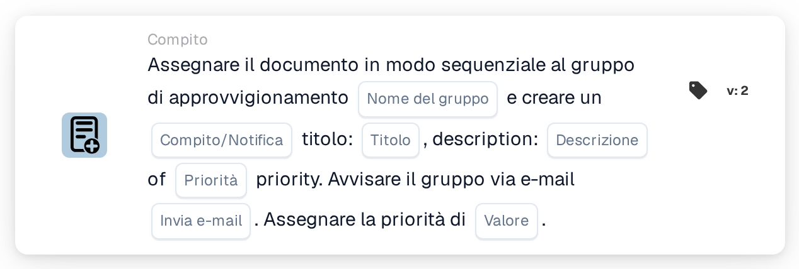

# Assegnare al gruppo di approvvigionamento e creare un'attività/notifica

<figure><figcaption>
Versione 2
</figcaption></figure>

## **Scopo**

La scheda di workflow "**Assegnare il documento al gruppo di approvvigionamento e creare attività/notifica**" assegna un documento a un gruppo di approvvigionamento specificato, crea un'attività o una notifica con dettagli definiti e, facoltativamente, notifica il gruppo via email. Prioritizza l'esecuzione delle attività in base a un valore di priorità numerica configurabile.

## **Componenti della scheda**

1. **Nome gruppo**
   * **Descrizione:** Specifica il gruppo di approvvigionamento responsabile della gestione del documento.
   * **Dettaglio:** Un campo in cui l'utente può inserire manualmente il nome del gruppo di approvvigionamento.
2. **Attività/Notifica**
   * **Descrizione:** Definisce se viene creata un'attività o una notifica per il gruppo.
   * **Dettaglio:** Un campo in cui l'utente può scegliere tra la creazione di un'attività o di una notifica.
3. **Titolo**
   * **Descrizione:** Il titolo dell'attività o della notifica creata per il gruppo.
   * **Dettaglio:** Un campo per fornire un titolo conciso e identificabile per l'attività o la notifica.
4. **Descrizione**
   * **Descrizione:** Ulteriori dettagli sull'attività o sulla notifica.
   * **Dettaglio:** Un campo per descrivere lo scopo dell'attività e fornire contesto o istruzioni.
5. **Priorità**
   * **Descrizione:** Definisce il livello di urgenza dell'attività o della notifica.
   * **Opzioni:**
     * **High:** L'attività richiede attenzione immediata.
     * **Medio:** L'attività è importante ma non urgente.
     * **Low:** L'attività può essere gestita in un secondo momento.
6. **Invia posta**
   * **Descrizione:** Configura se debba essere inviata una notifica email al gruppo.
   * **Opzioni:**
     * **True:** Invia una notifica email al gruppo di approvvigionamento.
     * **False:** Non viene inviata alcuna notifica email.
7. **Valore**
   * **Descrizione:** Imposta la priorità numerica per l'esecuzione dell'attività.
   * **Dettaglio:** Un campo per inserire un valore numerico, dove un numero più basso rappresenta una priorità più alta.

## **Funzionalità**

* **Valutazione della condizione:**\
  La scheda esegue le sue azioni solo se le condizioni definite del workflow sono soddisfatte.
* **Assegnazione del gruppo e creazione di attività/notifica:**\
  Il documento viene assegnato al gruppo di approvvigionamento specificato. Viene creata un'attività o una notifica con il titolo, la descrizione e la priorità forniti.
* **Notifica email:**\
  Se "Send Mail" è impostato su True, il gruppo riceve un'email relativa all'attività o alla notifica.

## **Configurazione e impostazione**

1. **Definisci il nome del gruppo:**
   * Inserisci il nome del gruppo di approvvigionamento nel campo Group Name.
2. **Configura i dettagli di Task/Notification:**
   * Specifica il Title e la Description per l'attività o la notifica.
   * Seleziona la priorità dal menu a discesa (Alta, Media o Bassa).
3. **Abilita la notifica email:**
   * Imposta "Send Mail" su True o False a seconda che il gruppo debba ricevere un'email.
4. **Imposta la priorità numerica:**
   * Inserisci un valore numerico nel campo Value per determinare la priorità dell'attività, dove i valori più bassi vengono elaborati per primi.
5. Salva la configurazione della scheda e attiva il workflow.

## **Conclusione**

La scheda di workflow "Assign Document to Procurement Group and Create Task/Notification" garantisce che i documenti vengano indirizzati al gruppo appropriato con istruzioni chiare sulle attività e livelli di priorità. Abilitando le notifiche email opzionali, questa scheda migliora la visibilità delle attività e garantisce un'esecuzione fluida del workflow.

<!-- workflow-card-practical-example-20261021 -->

## Esempio pratico

**Quando utilizzarlo:** Combina l'assegnazione di appalti prioritari con un'attività di revisione.

**Configurazione:** Seleziona `Demo Procurement`, titolo `Review order variance`, priorità attività e priorità assegnazione.

**Risultato atteso e controesempio:** L'obiettivo di approvvigionamento configurato riceve l'assegnazione documentata e l'attività/notifica. Verificare entrambi e le loro priorità nel risultato.

Questa è una configurazione illustrativa e il risultato atteso. Utilizza campi, utenti e gruppi configurati nella tua organizzazione di test; non si afferma che questo esempio sia stato eseguito.
