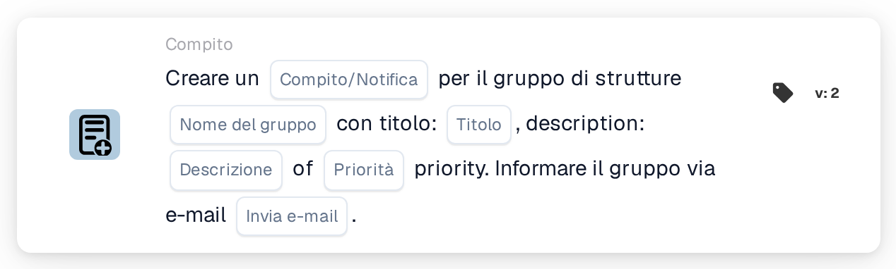

# Crea una nuova attività e assegnala al gruppo della struttura

<figure><figcaption>
Versione 2
</figcaption></figure>

## Scopo:

Questa scheda del workflow crea un compito o una notifica per il gruppo responsabile della struttura dell'ordine di acquisto del documento. La struttura non viene selezionata sulla scheda: viene ricavata dagli ordini di acquisto a cui il documento è abbinato. La scheda cerca quindi un gruppo di utenti il cui nome contenga sia il nome del gruppo inserito sulla scheda sia il codice della struttura, e crea il compito per quel gruppo. Il documento stesso non viene riassegnato.

Per una scheda che assegna anche il documento al gruppo di struttura nell'ambito di un'assegnazione sequenziale, è possibile utilizzare **Assign to Facility Group and Create a Task/Notification**.

## Componenti della scheda:

1. **Compito/Notifica**
   * **Descrizione:** Definisce se per il gruppo viene creato un compito o una notifica.
   * **Opzioni:**
     * **Compito:** Viene creato un compito.
     * **Notifica:** Viene creata una notifica.
2. **Nome del gruppo**
   * **Descrizione:** La parte del nome comune a tutti i gruppi di struttura.
   * **Dettaglio:** Un testo che viene confrontato con i nomi dei gruppi di utenti dell'organizzazione. Un gruppo corrisponde se il suo nome contiene questo testo e il codice della struttura dell'ordine di acquisto. Il confronto non distingue tra maiuscole e minuscole. Ad esempio, con il nome del gruppo **Warehouse** e un ordine di acquisto per la struttura **1000**, corrisponderebbe un gruppo denominato **Warehouse 1000**.
3. **Titolo**
   * **Descrizione:** Il titolo del compito o della notifica.
   * **Dettaglio:** Un breve testo che identifica il compito o la notifica.
4. **Descrizione**
   * **Descrizione:** Ulteriori dettagli sul compito o sulla notifica.
   * **Dettaglio:** Un testo che descrive che cosa dovrebbe essere fatto o perché il gruppo viene informato.
5. **Priorità**
   * **Descrizione:** L'urgenza del compito o della notifica.
   * **Opzioni:**
     * **peso elevato:** Il compito o la notifica viene creato con priorità alta.
     * **peso medio:** Il compito o la notifica viene creato con priorità media.
     * **peso basso:** Il compito o la notifica viene creato con priorità bassa.
6. **Invia e-mail**
   * **Descrizione:** Definisce se il gruppo viene informato del compito anche via e-mail.
   * **Opzioni:**
     * **Vero:** Al gruppo viene inviata una notifica via e-mail.
     * **Falso:** Non viene inviata alcuna notifica via e-mail.

## Funzionalità:

* **Individuazione della struttura:** La scheda legge gli ordini di acquisto a cui il documento è abbinato e raccoglie il codice della struttura (la sede dell'ordine di acquisto) di ciascuno di essi.
* **Individuazione del gruppo:** Per ogni codice di struttura, la scheda cerca i gruppi di utenti il cui nome contiene sia il **Nome del gruppo** indicato sulla scheda sia il codice della struttura. I codici di struttura per cui non viene trovato alcun gruppo vengono elencati nel log del workflow.
* **Creazione del compito:** Per il gruppo corrispondente viene creato un compito o una notifica con il titolo, la descrizione e la priorità indicati sulla scheda, collegato al documento. Se corrispondono più gruppi, il compito viene creato per uno solo di essi; quale, non è determinato dalla scheda.
* **Valori predefiniti:** Se non è impostata alcuna priorità, viene utilizzato **peso medio**. Se **Invia e-mail** non è impostato, non viene inviata alcuna e-mail. Se **Compito/Notifica** non è impostato, viene creato un compito e il log del workflow annota l'impostazione mancante.
* **Dati mancanti:**
  * Se il nome del gruppo, il titolo o la descrizione sono vuoti, la scheda non viene eseguita e segnala i dati mancanti nel log del workflow.
  * Se il documento non è abbinato a un ordine di acquisto, la scheda segnala i dati mancanti invece di creare un compito.
  * Se nessun gruppo corrisponde ad alcuno dei codici di struttura, non viene creato alcun compito e il log del workflow annota che non è stato trovato alcun gruppo corrispondente.

## Configurazione e impostazione:

* I gruppi di utenti dovrebbero essere denominati in modo che ogni nome contenga la parte comune del nome e il codice della struttura, ad esempio **Warehouse 1000**, **Warehouse 2000**.
* La scheda può essere aggiunta dalla categoria **Compito**. Successivamente è possibile configurare il tipo (**Compito** o **Notifica**), la parte comune del nome dei gruppi, il titolo, la descrizione, la priorità e l'impostazione dell'e-mail.

## Conclusione:

La scheda del workflow "Create a New Task and assign it to Facility Group" coinvolge nel processo il team della struttura giusta senza modificare l'assegnatario del documento. Una sola scheda copre tutte le strutture, a condizione che i gruppi di utenti seguano uno schema di denominazione coerente con il codice della struttura nel nome.
