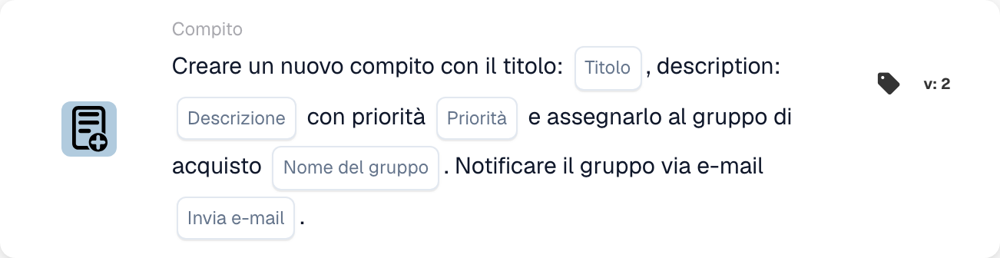

# Crea una nuova attività e assegnala al gruppo di approvvigionamento

<figure><figcaption>
Campi della scheda nella versione visualizzata. I campi non sono ancora configurati.
</figcaption></figure>

## **Scopo:**

La scheda di workflow **"Crea attività per gruppo di approvvigionamento"** crea una nuova attività assegnata dinamicamente al gruppo di approvvigionamento specificato nella configurazione. Questa attività può essere assegnata con diversi livelli di priorità ed è possibile inviare una notifica email opzionale per informare il gruppo dell'attività. Questa scheda garantisce che il team giusto venga avvisato in base alle condizioni del workflow.

## **Componenti della scheda:**

1. **Titolo**
   * **Descrizione:** Specifica il titolo dell'attività.
   * **Dettaglio:** Questo campo identifica l'attività creata, fornendo un titolo conciso per una facile identificazione.
2. **Descrizione**
   * **Descrizione:** Fornisce ulteriori dettagli sull'attività.
   * **Dettaglio:** Questo campo viene utilizzato per descrivere l'obiettivo dell'attività e qualsiasi contesto o istruzione necessari.
3. **Priorità**
   * **Descrizione:** Definisce l'urgenza dell'attività.
   * **Opzioni:**
     * **High:** L'attività richiede attenzione immediata.
     * **Medio:** L'attività è importante ma non urgente.
     * **Low:** L'attività può essere gestita in un secondo momento.
4. **Nome gruppo**
   * **Descrizione:** Specifica il gruppo di approvvigionamento a cui verrà assegnata l'attività.
   * **Dettaglio:** Questo campo designa il gruppo di approvvigionamento responsabile dell'attività. Garantisce che l'attività venga indirizzata al team giusto.
5. **Notifica e-mail**
   * **Descrizione:** Configura se debba essere inviata una notifica email al gruppo di approvvigionamento assegnato.
   * **Opzioni:**
     * **True:** Invia una notifica email al gruppo di approvvigionamento.
     * **False:** Non viene inviata alcuna notifica email.

## **Funzionalità:**

* **Valutazione della condizione:**\
  La scheda esegue la sua azione solo se sia la sezione **"Quando"** che la sezione **"E"** risultano vere.
* **Creazione dell'attività:**\
  La scheda crea una nuova attività, assegnandola al gruppo di approvvigionamento definito nel campo "Group Name". Questa attività includerà il titolo, la descrizione e il livello di priorità specificati.
* **Notifica email:**\
  Se l'opzione di notifica email è impostata su true, viene inviata un'email al gruppo di approvvigionamento per informarlo dell'attività.

## **Configurazione e impostazione:**

* **Definisci i dettagli dell'attività:**\
  Inserisci il titolo, la descrizione e il livello di priorità dell'attività.
* **Seleziona il gruppo di approvvigionamento:**\
  Scegli il gruppo di approvvigionamento che sarà responsabile dell'attività.
* **Abilita la notifica email:**\
  Specifica se debba essere inviata una notifica email al gruppo al momento della creazione dell'attività.

## **Conclusione:**

La scheda di workflow "Create Task for Procurement Group" garantisce che le attività vengano automaticamente assegnate al gruppo di approvvigionamento appropriato con priorità definite. Questa scheda può anche notificare il gruppo via email per garantire che le attività vengano gestite tempestivamente, migliorando l'efficienza del workflow e la gestione delle attività.

<!-- workflow-card-practical-example-20261021 -->

## Esempio pratico

**Quando utilizzarlo:** Chiedi al team acquisti di esaminare un'eccezione fattura.

**Configurazione:** Selezionare `Demo Procurement`, titolo `Review order variance`, descrizione e priorità.

**Risultato atteso e controesempio:** Viene creata un'attività per il gruppo di approvvigionamento selezionato. Controllare l'assegnatario e la descrizione dell'attività; la sola creazione non conferma che la varianza sia stata risolta.

Questa è una configurazione illustrativa e il risultato atteso. Utilizza campi, utenti e gruppi configurati nella tua organizzazione di test; non si afferma che questo esempio sia stato eseguito.
