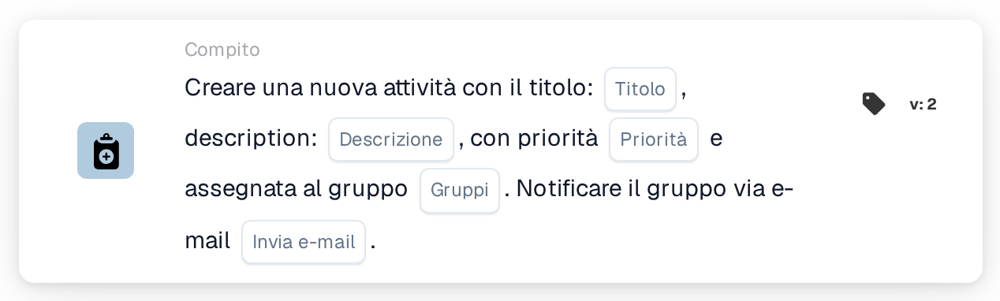
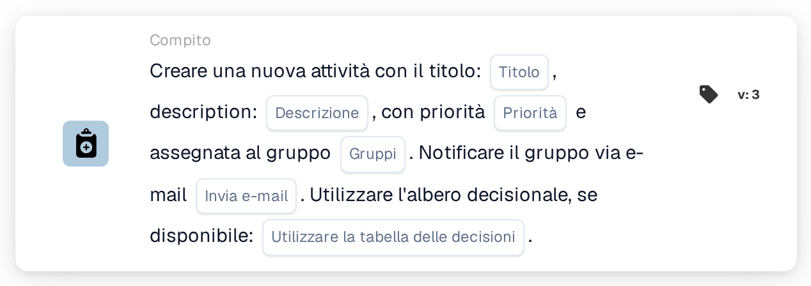
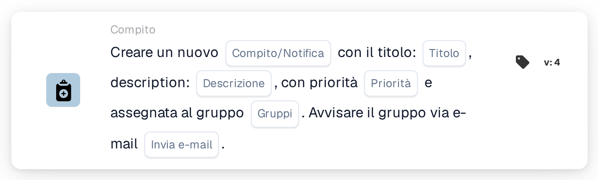

# Crea una nuova attività e assegnala al gruppo

<figure><figcaption>
Versione 2
</figcaption></figure>

<figure><figcaption>
Versione 3
</figcaption></figure>

<figure><figcaption>
Versione 4
</figcaption></figure>

## **Scopo:**

La scheda di workflow **"Crea attività o notifica di gruppo"** facilita la creazione di attività o notifiche per gruppi specificati, garantendo una comunicazione e una gestione delle attività efficienti. Potenziata con la funzionalità decision tree nelle versioni successive, determina dinamicamente il gruppo assegnato o il metodo, semplificando le operazioni.

## **Componenti della scheda:**

1. **Titolo**
   * **Descrizione**: Specifica il titolo dell'attività o della notifica.
   * **Dettaglio**: Funge da identificatore per l'attività o la notifica creata.
2. **Descrizione**
   * **Descrizione**: Descrive il contesto o i dettagli dell'attività o della notifica.
   * **Dettaglio**: Fornisce chiarezza sul suo scopo.
3. **Priorità**
   * **Descrizione**: Imposta il livello di importanza dell'attività.
   * **Opzioni**:
     * **High**: Richiede un'azione immediata.
     * **Medio**: Importante ma meno urgente.
     * **Low**: Può essere gestita in seguito.
4. **Gruppo assegnato**
   * **Descrizione**: Specifica il gruppo responsabile dell'attività o della notifica.
   * **Dettaglio**: Selezionato da un menu a discesa dei gruppi disponibili.
5. **Notifica e-mail**
   * **Descrizione**: Consente l'invio di un'email per notificare il gruppo assegnato.
   * **Opzioni**:
     * **True**: Invia una notifica email.
     * **False**: Non viene inviata alcuna notifica email.

## **Componenti aggiuntivi nella Versione 3 e nella Versione 4**

1. **Decision Tree (solo Versione 3)**
   * **Descrizione**: Consente l'utilizzo di una decision tree per la creazione dinamica delle attività.
   * **Opzioni**:
     * **True**: Attiva l'elaborazione della decision tree.
     * **False**: Disabilita l'elaborazione della decision tree.
2. **Opzione attività/notifica (solo Versione 4)**
   * **Descrizione**: Consente di creare un'attività o una notifica.
   * **Opzioni**:
     * **Compito**: Crea un'attività per il gruppo selezionato.
     * **Notification**: Invia una notifica anziché creare un'attività.

## **Funzionalità:**

* **Valutazione della condizione**:\
  Esegue l'azione della scheda solo quando le sezioni **"Quando"** e **"E"** sono vere.
* **Creazione di attività o notifica**:
  * Viene creata un'attività per il gruppo selezionato con il titolo, la descrizione e la priorità specificati.
  * Nella Versione 4, la scheda può creare una notifica anziché un'attività.
* **Assegnazione dinamica (solo Versione 3)**:\
  Se abilitata, la decision tree determina dinamicamente il gruppo di destinazione.
* **Notifica email**:\
  Invia una notifica email al gruppo se l'opzione email è impostata su true.

## **Configurazione e impostazione:**

1. **Definisci i dettagli di attività o notifica**: Inserisci il titolo, la descrizione e la priorità.
2. **Assegna a un gruppo**: Seleziona un gruppo dal menu a discesa per l'assegnazione dell'attività o della notifica.
3. **Abilita la notifica email**: Indica se il gruppo debba essere notificato via email.
4. **Utilizza l'albero decisionale (solo versione 3)**: Abilita la decision tree per assegnare dinamicamente il gruppo.
5. **Seleziona il tipo di output (solo Versione 4)**: Scegli se la scheda crea un'attività o una notifica.

## **Conclusione:**

La scheda di workflow **"Crea attività o notifica di gruppo"** semplifica la gestione di attività e notifiche indirizzandole direttamente ai gruppi. La sua funzionalità di assegnazione dinamica, abilitata dalla decision tree, migliora la flessibilità, mentre le notifiche email garantiscono una comunicazione tempestiva. Le Versioni 3 e 4 aggiungono funzionalità avanzate, rendendola uno strumento versatile per un'esecuzione efficiente del workflow.

<!-- workflow-card-practical-example-20261021 -->

## Esempio pratico

**Quando usarlo:** Assegna a un team condiviso un compito di revisione concreto.

**Configurazione:** Seleziona il gruppo `Demo Finance`, titolo `Review invoice`, una descrizione utile e priorità. Disabilita la posta elettronica per il primo test.

**Risultato atteso e controesempio:** Il gruppo riceve il compito. Confermare il titolo e l'assegnatario nell'elenco delle attività; la consegna della posta elettronica è un controllo separato quando abilitata.

Questa è una configurazione illustrativa e il risultato atteso. Utilizza campi, utenti e gruppi configurati nella tua organizzazione di test; non si afferma che questo esempio sia stato eseguito.
