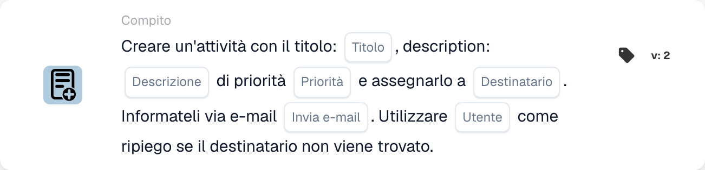

# Crea una nuova attività e assegnala al destinatario

<figure><figcaption>
Campi della scheda nella versione visualizzata. I campi non sono ancora configurati.
</figcaption></figure>

## **Scopo:**

La scheda di workflow **"Crea attività con fallback"** garantisce una delega efficiente delle attività assegnandole a ruoli specifici — dispatcher o purchaser — incorporando al contempo un meccanismo di riserva per prevenire i fallimenti nell'assegnazione delle attività. Questa scheda migliora l'affidabilità e l'adattabilità del workflow in scenari dinamici.

## **Componenti della scheda:**

1. **Titolo**
   * **Descrizione**: Specifica il titolo dell'attività creata.
   * **Dettaglio**: Fornisce un identificatore conciso per l'attività.
2. **Descrizione**
   * **Descrizione**: Descrive lo scopo o il contesto dell'attività.
   * **Dettaglio**: Chiarisce i dettagli dell'attività.
3. **Priorità**
   * **Descrizione**: Imposta il livello di urgenza dell'attività.
   * **Opzioni**:
     * **High**: Richiede attenzione immediata.
     * **Medio**: Importante ma non urgente.
     * **Low**: Può essere gestita in seguito.
4. **Ruolo assegnato**
   * **Descrizione**: Specifica il ruolo principale a cui viene assegnata l'attività.
   * **Opzioni**:
     * **Disponent**: Assegna l'attività al disponent.
     * **Acquirente**: Assegna l'attività al purchaser.
5. **Notifica e-mail**
   * **Descrizione**: Consente di notificare l'utente assegnato via email.
   * **Opzioni**:
     * **True**: Invia una notifica email all'utente.
     * **False**: Non viene inviata alcuna notifica email.
6. **Utente fallback**
   * **Descrizione**: Fornisce un'opzione di riserva per l'assegnazione dell'attività se il ruolo destinatario non viene trovato.
   * **Dettaglio**: Consente di selezionare un utente da un menu a discesa per garantire la delega dell'attività.

## **Funzionalità:**

* **Valutazione della condizione**:\
  La scheda viene eseguita solo se le condizioni nelle sezioni **"Quando"** e **"E"** sono soddisfatte.
* **Assegnazione dell'attività**:
  * L'attività viene assegnata al ruolo selezionato (dispatcher o purchaser).
  * Se il ruolo specificato non viene trovato, l'attività viene assegnata a un utente dal menu a discesa di riserva.
* **Notifica email**:\
  Invia un'email all'utente assegnato se la notifica email è abilitata.

## **Configurazione e impostazione:**

1. **Specifica i dettagli dell'attività**: Inserisci il titolo, la descrizione e la priorità dell'attività.
2. **Seleziona il ruolo principale**: Scegli il ruolo a cui verrà assegnata l'attività (dispatcher o purchaser).
3. **Configura l'utente di riserva**: Seleziona un utente di riserva dal menu a discesa per garantire l'assegnazione dell'attività se il ruolo principale non viene trovato.
4. **Abilita la notifica email**: Indica se l'utente assegnato debba ricevere una notifica email.

## **Conclusione:**

La scheda di workflow **"Crea attività con fallback"** garantisce una delega delle attività fluida integrando un meccanismo di riserva. Assegnando le attività in base ai ruoli e offrendo un'opzione di utente alternativo, migliora l'affidabilità e la flessibilità nei processi di gestione delle attività.

<!-- workflow-card-complete-example-20261021 oc_task -->

### Esempio di attività del destinatario

**Configurazione:** Inserire titolo `Review delivery date`, una descrizione che identifichi il documento sintetico, una priorità, ruolo Acquirente e utente fallback configurato `DEMO_REVIEWER`. Disabilita la notifica e-mail per questa configurazione illustrativa.

**Risultato atteso e controesempio:** Quando un acquirente può essere risolto, la nuova attività viene assegnata a quell'utente. Se non è possibile risolvere il ruolo, viene utilizzato il fallback configurato. Verificare l'effettiva proprietà dell'attività; un destinatario principale mancante non è una prova dell'esistenza dell'utente fallback o della creazione di un'attività.

Questa è una configurazione di test illustrativa e il risultato atteso; non è stato eseguito. Utilizza dati e destinatari configurati nella tua organizzazione di test.
