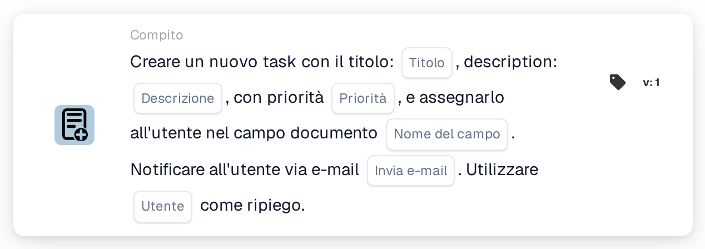
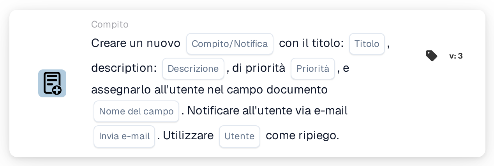

# Crea una nuova attività e assegnala all'utente nel campo documento

<figure><figcaption>
Versione 1
</figcaption></figure>

<figure><figcaption>
Versione 3
</figcaption></figure>

## **Scopo:**

La scheda di workflow **"Crea attività o notifica basata sul campo"** viene utilizzata per creare attività o notifiche assegnate dinamicamente agli utenti identificati all'interno di specifici campi del documento. Questa scheda fornisce un meccanismo di riserva opzionale per garantire un'esecuzione fluida del workflow anche quando il campo del documento non specifica un utente valido.

## **Componenti della scheda:**

1. **Titolo**
   * **Descrizione**: Specifica il titolo dell'attività o della notifica.
   * **Dettaglio**: Utilizzato per nominare e identificare l'attività o la notifica creata.
2. **Descrizione**
   * **Descrizione**: Fornisce dettagli aggiuntivi sull'attività o sulla notifica.
   * **Dettaglio**: Garantisce che il destinatario comprenda lo scopo e il contesto dell'attività o della notifica.
3. **Priorità**
   * **Descrizione**: Definisce l'urgenza dell'attività o della notifica.
   * **Opzioni**:
     * **High**: Richiede attenzione immediata.
     * **Medio**: Importante ma meno urgente.
     * **Low**: Può essere gestita in un secondo momento.
4. **Nome campo**
   * **Descrizione**: Specifica il campo del documento che verrà utilizzato per assegnare l'attività o la notifica.
   * **Dettaglio**: Il campo selezionato determinerà dinamicamente l'utente a cui verrà assegnata l'attività o la notifica. Se il campo è vuoto o non valido, l'attività o la notifica verrà assegnata all'utente di riserva selezionato dal menu a discesa.
5. **Notifica e-mail**
   * **Descrizione**: Configura se l'utente assegnato viene notificato via email.
   * **Opzioni**:
     * **True**: Invia una notifica email all'utente assegnato.
     * **False**: Non viene inviata alcuna notifica email.
6. **Utente fallback**
   * **Descrizione**: Consente la selezione di un utente da un menu a discesa per assegnare l'attività o la notifica quando non viene trovato alcun utente valido nel campo del documento.
   * **Dettaglio**: Garantisce che l'attività o la notifica venga assegnata anche se il campo del documento è vuoto o non valido.

## **Componenti aggiuntivi nella Versione 3:**

1. **Tipo di notifica**
   * **Descrizione**: Specifica se la scheda crea un'attività o una notifica.
   * **Opzioni**:
     * **Compito**: Crea un'attività assegnata all'utente specificato.
     * **Notification**: Invia una notifica anziché creare un'attività.

## **Funzionalità:**

* **Valutazione della condizione**:\
  La scheda esegue la sua azione solo se sia la sezione **"Quando"** che la sezione **"E"** risultano vere.
* **Creazione di attività o notifica**:
  * Assegna l'attività o la notifica all'utente identificato nel campo del documento.
  * Nella Versione 3, consente di creare un'attività o una notifica.
* **Meccanismo di riserva**:\
  Se il campo del documento non identifica un utente valido, la scheda assegna l'attività o la notifica all'utente di riserva selezionato dal menu a discesa.
* **Notifica email**:\
  Invia una notifica email all'utente assegnato se configurato.

## **Configurazione e impostazione:**

1. **Definisci i dettagli di attività o notifica**: Inserisci il titolo, la descrizione e la priorità.
2. **Seleziona il campo del documento**: Scegli il campo che specifica l'utente per l'assegnazione dell'attività o della notifica.
3. **Abilita la notifica email**: Specifica se debba essere inviata una notifica email all'utente assegnato.
4. **Seleziona l'utente di fallback**: Scegli un utente di riserva dal menu a discesa per l'assegnazione se il campo del documento non identifica un utente valido.
5. **Specifica il tipo di notifica (Versione 3)**: Indica se la scheda crea un'attività o una notifica.

## **Conclusione:**

La scheda di workflow **"Crea attività o notifica basata sul campo"** semplifica la gestione di attività e notifiche assegnando dinamicamente le responsabilità in base ai campi del documento. Il suo meccanismo di utente di riserva e le opzioni potenziate nella Versione 3 offrono flessibilità, garantendo che le attività o le notifiche vengano sempre assegnate, anche quando i dati del documento sono incompleti.

<!-- workflow-card-practical-example-20261021 -->

## Esempio pratico

**Quando utilizzarlo:** Crea un'attività di revisione per l'utente indicato nei dati del documento.

**Configurazione:** Seleziona `reviewer_name`, utente fallback `Demo Reviewer A`, titolo `Review invoice` e priorità.

**Risultato atteso e controesempio:** Un utente risolvibile nel campo riceve l'attività. Un campo vuoto o irrisolvibile utilizza il fallback configurato; testare entrambi i percorsi.

Questa è una configurazione illustrativa e il risultato atteso. Utilizza campi, utenti e gruppi configurati nella tua organizzazione di test; non si afferma che questo esempio sia stato eseguito.
