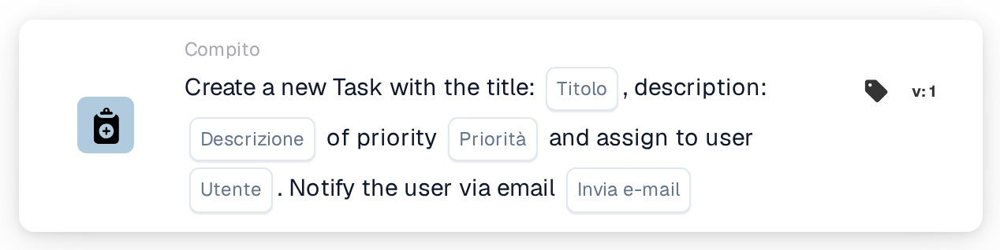
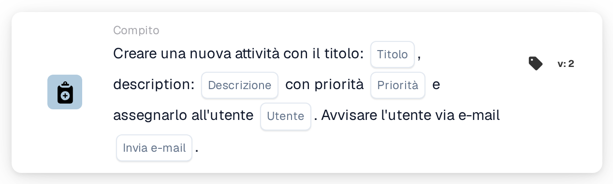
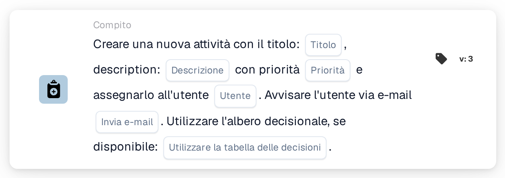
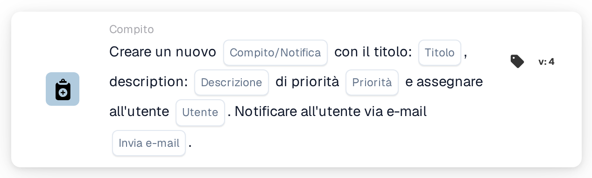

# Crea una nuova attività e assegnala all'utente

<figure><figcaption>
Versione 1
</figcaption></figure>

<figure><figcaption>
Versione 2
</figcaption></figure>

<figure><figcaption>
Versione 3
</figcaption></figure>

<figure><figcaption>
Versione 4
</figcaption></figure>

## **Scopo**

La scheda di workflow **"Crea attività o notifica"** semplifica la gestione delle attività e delle notifiche all'interno dei workflow. A seconda della versione, la scheda può creare attività, inviare notifiche e sfruttare funzionalità aggiuntive come le decision tree per l'elaborazione dinamica.

## **Componenti della scheda**

1. **Titolo**
   * **Descrizione**: Definisce il titolo dell'attività o della notifica creata.
   * **Dettaglio**: Il titolo fornisce un identificatore chiaro e conciso per l'attività o la notifica.
2. **Descrizione**
   * **Descrizione**: Fornisce dettagli sull'attività o sulla notifica.
   * **Dettaglio**: Aiuta a chiarire lo scopo o il contesto dell'attività o della notifica per l'utente assegnato.
3. **Priorità**
   * **Descrizione**: Imposta il livello di urgenza dell'attività.
   * **Opzioni**:
     * **High**: Richiede attenzione immediata.
     * **Medio**: Importante ma non urgente.
     * **Low**: Può essere gestita in seguito.
4. **Utente assegnato**
   1. **Descrizione**: Specifica l'utente a cui viene assegnata l'attività.
   2. **Dettaglio**: Gli utenti vengono selezionati da un menu a discesa del personale disponibile.
5. **Notifica e-mail**
   * **Descrizione**: Determina se l'utente assegnato riceve una notifica email.
   * **Opzioni**:
     * **True**: Invia una notifica email all'utente.
     * **False**: Non viene inviata alcuna notifica email.

## Componenti aggiuntivi **nella Versione 3 e nella Versione 4**

1. **Decision Tree (solo Versione 3)**
   * **Descrizione**: Consente l'utilizzo di una decision tree per la creazione dinamica delle attività.
   * **Opzioni**:
     * **True**: Attiva l'elaborazione della decision tree.
     * **False**: Disabilita l'elaborazione della decision tree.
2. **Attività o notifica (solo Versione 4)**
   * **Descrizione**: Consente la scelta tra la creazione di un'attività o di una notifica.
   * **Opzioni**:
     * **Compito**: Crea un'attività.
     * **Notification**: Crea una notifica anziché un'attività.

## **Funzionalità:**

* **Valutazione della condizione**:\
  Questa scheda viene attivata solo se le condizioni nelle sezioni **"Quando"** e **"E"** sono soddisfatte.
* **Creazione di attività o notifica**:
  * Versioni 2 e 3: Viene creata un'attività con il titolo, la descrizione, la priorità e l'utente assegnato specificati.
  * Versione 4: Consente di creare un'attività o una notifica.
* **Assegnazione dinamica**:
  * Nella Versione 3, la decision tree determina dinamicamente l'utente a cui assegnare l'attività in base ai parametri del workflow.
* **Notifica email**:\
  Invia un'email all'utente assegnato se l'opzione di notifica è abilitata.

## **Configurazione e impostazione:**

1. **Seleziona la versione**: Scegli la versione della scheda in base alla funzionalità richiesta:
   * Versione 2: Creazione di attività di base con assegnazione manuale dell'utente e notifiche email.
   * Versione 3: Include la funzionalità decision tree per l'assegnazione dinamica dell'utente.
   * Versione 4: Aggiunge la possibilità di creare una notifica anziché un'attività.
2. **Inserisci i dettagli dell'attività**: Specifica il titolo, la descrizione e la priorità dell'attività o della notifica.
3. **Assegna l'utente**:
   * Per le Versioni 2 e 4, seleziona manualmente un utente dal menu a discesa.
   * Per la Versione 3, abilita la decision tree per determinare dinamicamente l'utente assegnato.
4. **Abilita la notifica email**: Specifica se l'utente assegnato debba ricevere una notifica email.
5. (Per la Versione 4) **Scegli Task o Notification**: Indica se creare un'attività o una notifica.

## **Conclusione:**

La scheda di workflow **"Crea attività o notifica"** è uno strumento versatile per gestire attività e notifiche. Supportando l'assegnazione dinamica dell'utente tramite le decision tree e offrendo opzioni per la creazione di attività o notifiche, migliora l'adattabilità del workflow e l'efficienza della collaborazione.

<!-- workflow-card-practical-example-20261021 -->

## Esempio pratico

**Quando utilizzarlo:** Assegna a un revisore un'azione esplicita.

**Configurazione:** Selezionare `Demo Reviewer A`, titolo `Review invoice`, descrizione e priorità.

**Risultato atteso e controesempio:** L'utente selezionato riceve la nuova attività. Confermare il titolo dell'attività e l'assegnatario; il compito deve ancora essere completato dal revisore.

Questa è una configurazione illustrativa e il risultato atteso. Utilizza campi, utenti e gruppi configurati nella tua organizzazione di test; non si afferma che questo esempio sia stato eseguito.
