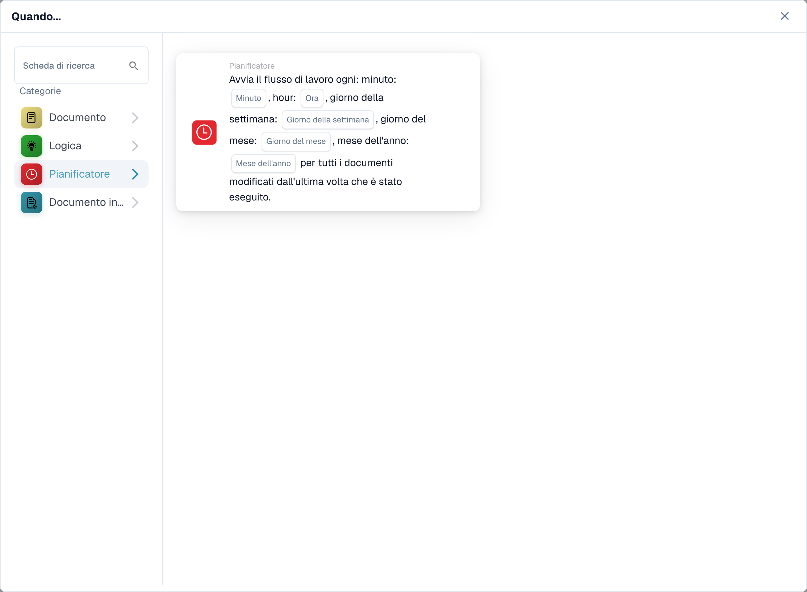
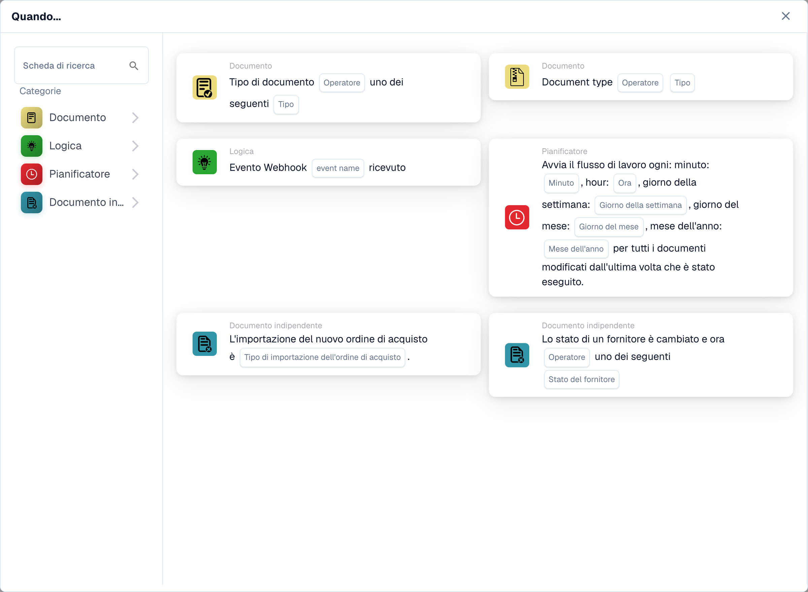
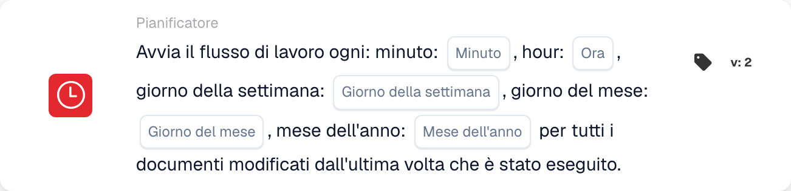

# Quando

Le carte in questa categoria, mostrate nella libreria **Aggiungi carta** del Workflow Builder:

<figure><figcaption>
Schede disponibili nella categoria selezionata. Configurare i campi prima dell’uso.
</figcaption></figure>

<figure><figcaption>
Schede disponibili nella categoria selezionata. Configurare i campi prima dell’uso.
</figcaption></figure>

#### Comprendere il "Quando" nelle configurazioni del flusso di lavoro

**Scopo di "Quando"**

* La sezione "Quando" in una configurazione del flusso di lavoro definisce le condizioni di attivazione che avviano una particolare azione del flusso di lavoro. Queste condizioni si basano su criteri specifici relativi agli attributi del documento o alle attività dell'utente all'interno del sistema ERP.

**Come funziona**

* Nella tua interfaccia, "Quando" sembra essere un punto di partenza in cui gli utenti possono selezionare diverse carte attivatrici. Ciascuna carta specifica le condizioni in base alle quali verranno eseguite le azioni successive (definite nella sezione "E").

**Schede Condizioni Tipo Documento**

* Le schede con l'icona del documento visualizzate nello screenshot sono variazioni delle condizioni "Tipo documento", che vengono utilizzate per attivare flussi di lavoro in base al tipo di documento in elaborazione. Ecco una ripartizione di ciascun tipo di scheda condizione mostrata:
  * **Tipo di documento (Operatore) uno di (Tipo)**: Questa scheda attiva un'azione quando il tipo di documento corrisponde a uno dei tipi specificati in un elenco. L'operatore potrebbe includere opzioni come "è" o "non è", consentendo condizioni inclusive o esclusive.
  * **Tipo di documento (Operatore) (Tipo)**: questa variante più semplice si attiva in base a una singola condizione di tipo di documento. In genere controlla se il tipo di documento "è" o "non è" un tipo specifico, senza la possibilità di selezionare tra più tipi.
  *

**Battuta di sedano**

* La scheda con l'icona dell'orologio nello screenshot è una condizione "Celery Beat", utilizzata per attivare flussi di lavoro in base a data e ora.

#### Impostazione di una carta trigger "Quando".

1. **Selezione del tipo di condizione**: gli utenti iniziano selezionando un tipo di condizione pertinente al flusso di lavoro che desiderano automatizzare. In questo caso, il focus è sui tipi di documenti.
2. **Definizione dell'operatore**: gli utenti devono decidere l'operatore logico, ad esempio "è" o "non è", che stabilisce le basi per confrontare i tipi di documenti effettivi con le condizioni definite.
3. **Specifica dei tipi di documenti**: A seconda della carta, gli utenti possono selezionare uno o più tipi di documenti che attiveranno il flusso di lavoro quando i documenti di tali tipi vengono elaborati.
4. **Finalizzazione del trigger**: una volta impostata la condizione, diventa la base per attivare azioni specifiche definite nel flusso di lavoro. Se un documento soddisfa la condizione impostata, le azioni definite verranno avviate automaticamente.

#### Applicazione pratica

In pratica, queste carte trigger sono fondamentali per automatizzare processi come approvazioni, notifiche o qualsiasi procedura che dipenda dal tipo di documento gestito. Ad esempio, se un tipo di documento "è" una "Fattura" e soddisfa le condizioni impostate nella scheda "Quando", il flusso di lavoro potrebbe instradare automaticamente il documento per l'elaborazione del pagamento.

Questa configurazione garantisce che i flussi di lavoro non solo siano efficienti ma anche adattati alle specifiche esigenze operative dell'organizzazione, riducendo la supervisione manuale e accelerando i processi di gestione dei documenti.

In sintesi, la parte "Quando" della configurazione del flusso di lavoro riguarda l'impostazione della fase per azioni automatizzate in base a condizioni specifiche e predefinite. È uno strumento potente per garantire che il tuo sistema ERP reagisca dinamicamente alle esigenze dell'azienda, migliorando sia la produttività che l'accuratezza nella gestione dei documenti.

[Riferimento trigger di modifica variabile ed evento webhook](../cards-overview/logic-cards-guide.md).

<!-- workflow-card-example-celery_beat-20261021 -->

### Elaborazione pianificata

<figure><figcaption>
Campi della scheda nella versione visualizzata. I campi non sono ancora configurati.
</figcaption></figure>

`CELERY_BEAT` · versione 2

Utilizza un trigger pianificato per i documenti modificati rispetto all'esecuzione precedente. Per un programma demo giornaliero, seleziona il minuto `0`, l'ora `9` e i valori giornalieri/mesi offerti. Verificare il fuso orario dello scheduler configurato e la prossima esecuzione pianificata. Questo trigger non è una prova che i documenti non modificati vengano rielaborati.
